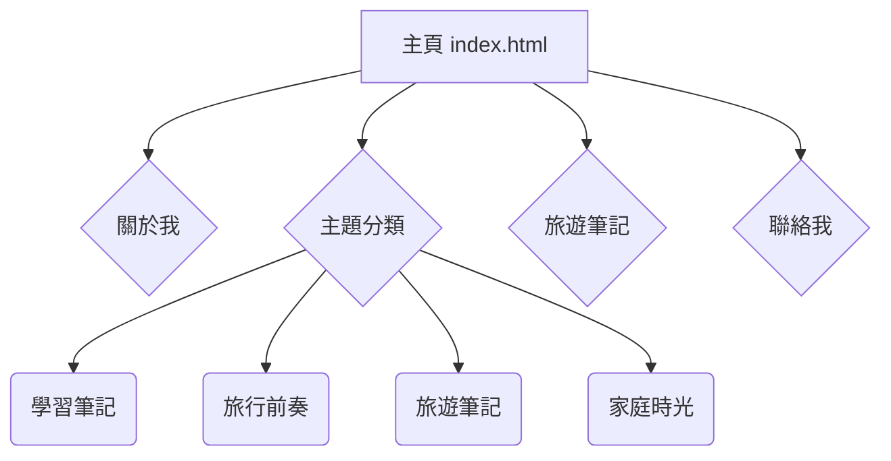

## 測試網頁建立
### 設立初期是希望可以記錄個人在學習,家庭與旅遊的半公開紀錄.
### 後來在學習筆記裡慢慢增加工作上與提供學習上增加很多影像的專業名詞解釋與說明
網站的說明 : 
主頁 : 

## 學習筆記
### 1. 學習筆記
- AE（自動曝光）概念及基本原理
- AWB 計算與說明
- CCM (色彩校正矩陣) 計算與說明
- Imatest 在測試影像 Gamma 值時的角色
- (灰階卡) Q-13 在測試影像時的業界標準
- BLC（黑電平校正）概念與原理
- 燈具色溫與光譜（多光源燈箱）概念與原理
- 影像調整與驗證圖表說明介紹
- LDC 計算與說明
- ISP 影像介紹及影像處理(一)
- ISP 影像介紹及影像處理(二)
- ISP-壞點校正(DPC)
- 3D降噪與2D降噪
- LSC成因與說明
- MTF與SFR的差異與說明數據
- WDR vs HDR：ISP 影像訊號處理與計算機制
- Imatest 操作與說明
- Demosaic（去馬賽克）轉換與深度解析
- Image 影像轉換與說明
- Teams IQ Test Tool 調整流程與步驟 (IQ Test Tool)
- Gamma 曲線（Gamma Curve）的用途與計算方式
---
### 2. ISP Tool 調整流程
- STM-32 IQ Tune
- SigmaStar IQ Tune 參數與調整步驟
- ESP32-P4 IQ Tune 參數與調整步驟
- RockChip IQ Tool 調整流程與步驟 (Tuning IQ Tool)
- Infinite-ISP 調適工具 (Tuning Tool)操作流程
- STM-32 IQ 影像參數說明
---
### 3. 軟體演示
- Lens shadding 演示
- Gamma 演示
- AWB 演示
- CCM 演示
- LDC 演示
- 曝光三元素 演示
- HUV 演示
- Focus & Zoom 演示
- SFR & MTF 演示
- Demosaic 演示
- Lens Shading校正互動 演示
---
## 旅行前奏
- 杭州八天七夜自由行規劃
- 又又家度假小樓(杭州浙大紫金港西溪天街店)
- 杭州旅遊攻略
## 旅遊足跡
- 杭州七天六夜自由行旅遊紀錄
### 家庭時光