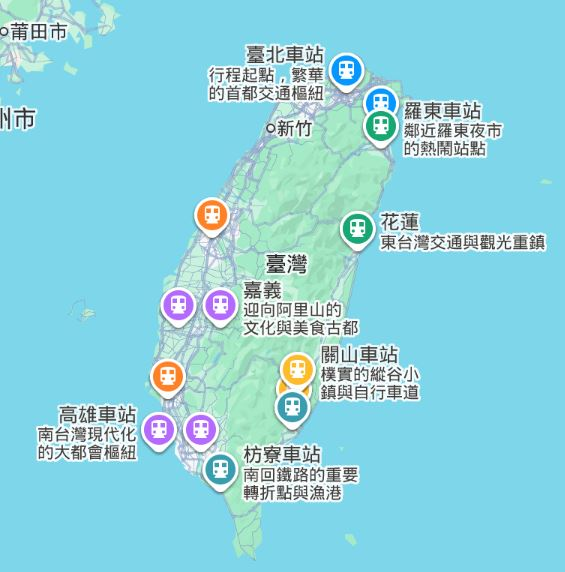

🚂 七天六夜火車環島路線總覽

• Day 1：台北 ➔ 宜蘭（礁溪/羅東）｜溫泉放鬆與蘭陽鐵道
• Day 2：宜蘭 ➔ 花蓮（花蓮市/吉安）｜絕美山海與洄瀾漫遊
• Day 3：花蓮 ➔ 台東（關山/鹿野/台東市）｜【新增】深度的縱谷鐵馬與茶鄉體驗
• Day 4：台東 ➔ 高雄（鹽埕/鼓山）｜最美南迴窗景與港都夕陽
• Day 5：高雄 ➔ 嘉義｜【新增】木都漫步與嘉義在地火雞肉飯
• Day 6：嘉義 ➔ 台南｜古蹟巡禮與府城深夜美食
• Day 7：台南 ➔ 彰化 ➔ 台北｜扇形車庫巡禮與愉快歸途

| 星期日 | 星期一 | 星期二 | 星期三 | 星期四 | 星期五 | 星期六 |
| ----- | ------ | ----- | ------ | ----- | ------ | ----- |
|  10/3 |   10/4 |  10/5 |   10/6  |  10/7  |   10/8  |  10/9  |
|  10/10  |   **10/11**  |  **10/12**  |   **10/13**  |  **10/14**  |   **10/15** |  **10/16** |
|  **10/17** |   10/18 |  10/19 |   10/20  |  10/21  |   10/22 |  10/23 |
|  10/24 |   10/25 |  10/26 |   10/27  |  10/28  |   10/29 |  10/30 |

Day 1：台北 ➔ 宜蘭｜蘭陽海風與溫泉洗禮

• 主要景點：
	• 頭城車站（外澳沙灘）： 出站轉乘區間車一站即可抵達外澳，看海、遠眺龜山島。
	• 礁溪車站（夜宿礁溪/羅東）： 下午到礁溪泡個免費的足湯，晚上可以選擇入住礁溪溫泉飯店，或前往羅東逛著名的羅東夜市。

Day 2：宜蘭 ➔ 花蓮｜穿梭蘇花斷崖，沉浸太魯閣山海

• 主要景點：
	• 新城（太魯閣）車站： 充滿現代藝術感的車站，可以在此轉乘公車或計程車前往太魯閣牌樓拍照。
	• 七星潭： 躺在月牙灣的礫石灘上聽浪濤聲。
	• 東大門夜市（夜宿花蓮）： 晚上在花蓮市區品嚐公正包子、液香扁食，並到夜市體驗原住民特色小吃。

Day 3：花蓮 ➔ 台東｜縱谷慢活，金黃稻浪與茶園風光

• 精選景點：
	• 關山或池上車站： 租一輛腳踏車，騎在著名的「關山環鎮自行車道」或「池上伯朗大道」，十月正值稻穗轉金黃，景色美不勝收。
	• 鹿野高台（夜宿台東市）： 下午可搭乘台灣好行前往鹿野高台，居高臨下俯瞰整個卑南溪谷。晚上入住台東市區，散步鐵花村。

Day 4：台東 ➔ 高雄｜穿越極美南迴線，前進海港城

• 主要景點：
	• 南迴鐵路窗景： 緊盯車窗，火車經過多良段時，海天一線的藍色太平洋就在眼前。
	• 駁二藝術特區（夜宿高雄）： 搭乘高雄輕軌到「大港橋」看旋轉秀，傍晚在西子灣或旗津看日落。
	• 六合夜市或瑞豐夜市： 享受熱情的南台灣夜生活。

Day 5：高雄 ➔ 嘉義｜探索阿里山門戶，檜木老城漫步

• 主要景點：
	• 嘉義製材所 / 北門驛： 嘉義是木材之都，北門驛是日治時期留下的全檜木車站，非常有味道。
	• 檜意森活村（夜宿嘉義）： 全台保存最完整的日式宿舍群，現在進駐許多文創小店與咖啡廳。
	• 文化路夜市： 必吃林聰明沙鍋魚頭、御香屋葡萄柚綠茶，以及各家實力派的火雞肉飯。

Day 6：嘉義 ➔ 台南｜老屋與古蹟交織的時光旅行

• 主要景點：
	• 林百貨： 台灣僅存設有空中神社的古蹟百貨公司，搭乘復古指針電梯。
	• 神農街 / 正興街： 傍晚在老屋改建的文青巷弄間穿梭，拍照非常出片。
	• 國華街美食（夜宿台南）： 碗粿、牛肉湯、鱔魚意麵，台南的夜晚是屬於老饕的。

Day 7：台南 ➔ 彰化 ➔ 台北｜鐵道聖地巡禮，知性歸途

• 主要景點：
	• 彰化扇形車庫： 台灣唯一活生生的「火車旅館」，幸運的話能看到火車頭開上旋轉轉車盤的畫面。
	• 彰化肉圓： 車站步行即可抵達名店（如阿三肉圓），享用完後帶著滿滿的環島回憶搭車北返。

💡 七天六夜進階排票心法

由於增加了停靠站，建議您在購買車票時：
1. 善用區間車銜接： 大城市之間（如高雄到嘉義、嘉義到台南）班次非常密集，不一定要提早搶對號車，當天直接刷悠遊卡搭區間快車或區間車，行程會更有彈性。
2. 長途段依舊提早買： 台北－宜蘭、宜蘭－花蓮、花蓮－台東、台東－高雄這四段，務必在出發前 28 天準時上台鐵官網搶對號座（如太魯閣、普悠瑪或 EMU3000）。
