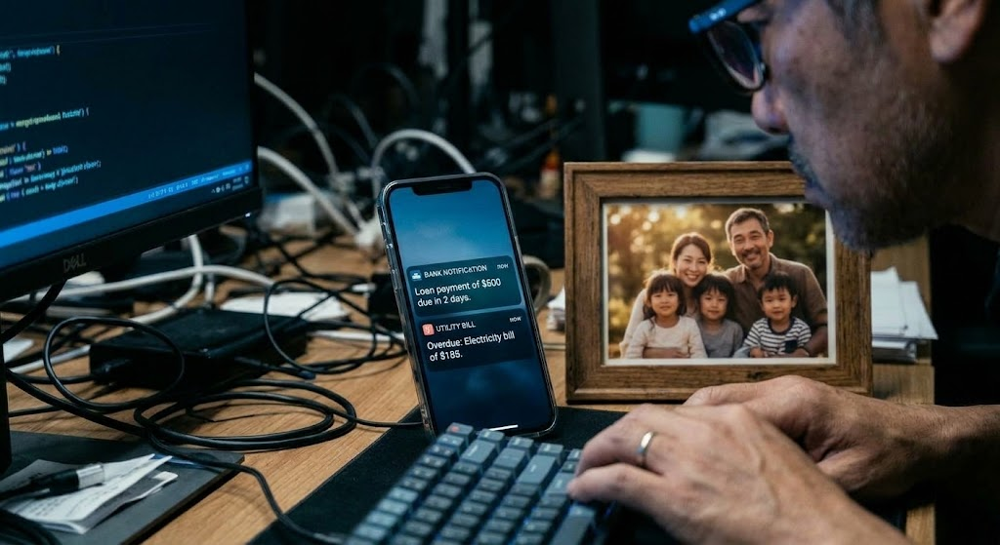
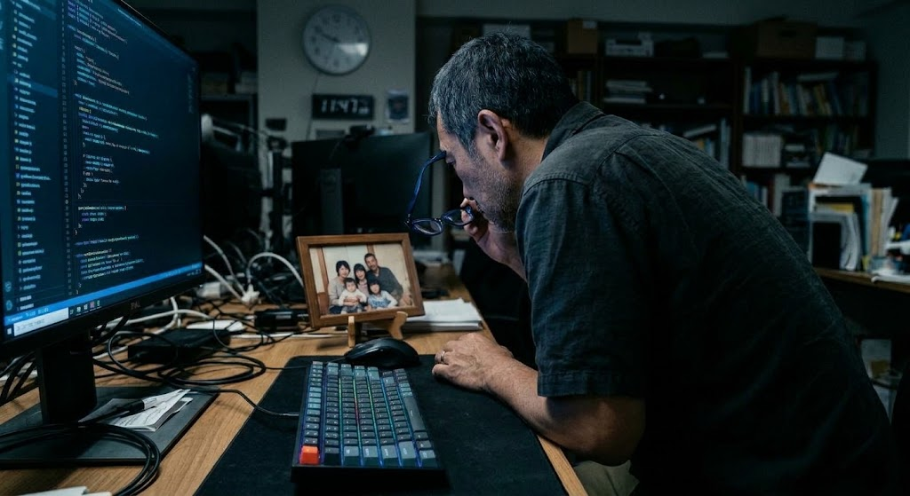

這是一份為您量身打造的 15 秒短影音腳本，透過 3 個畫面深刻呈現中年科技工程師面臨生活重擔的無奈與堅韌。

15秒短影音腳本：《無聲的肩膀》

• 節奏： 沉重、緩慢、真實
• 背景音樂： 低沉、略帶憂傷的鋼琴單音，隨著畫面推進漸漸加入穩定的節拍

🎬 分鏡畫面描述

• 畫面 1（0 - 5秒）｜ 複製貼上的日常
	• 視覺： 昏暗的辦公室角落。藍色螢幕光反射在男主角（約 50 歲）的老花眼鏡上。眼神空洞、疲憊，雙手机械式地在鍵盤上敲擊程式碼, 上下班騎著機車在車正中穿梭。
	• 字幕 / 旁白： 「每天朝九晚五，生活就像被複製貼上……」
• 畫面 2（5 - 10秒）｜ 數字堆疊的重量
	• 視覺： 鏡頭特寫辦公桌。手機螢幕連續彈出三條通知：「房貸扣款成功」、「車貸繳款提醒」、「家庭生活費轉帳成功」。手機旁，擺著一張全家福照片，照片裡兩個20歲的男孩與40愻女性笑得很燦爛。
	• 字幕 / 旁白： 「房貸、車貸、生活費，每一樣，都是卸不下的重量。」
• 畫面 3（10 - 15秒）｜ 無奈卻必須前行
	• 視覺： 男主角深深嘆了一口氣，摘下眼鏡，用力揉了揉酸痛的眉心。他看了一眼全家福，重新戴上眼鏡，深吸一口氣，雙手再次放回鍵盤繼續工作。鏡頭拉遠，拍下他沉重卻堅底的背影。
	• 字幕 / 旁白： 「但因為身後的他們，我只能，繼續扛下去。」
為了讓這支短影音更完美，您可以告訴我：
• 您打算使用哪種風格的配樂？（例如：純鋼琴、都市環境音、還是略帶滄桑的人聲旁白？）
• 是否需要幫您補上拍攝運鏡技巧（如特寫、拉遠）的建議？
• 這支影片主要會發布在哪個平台？（如 Instagram Reels、TikTok 或 YouTube Shorts？）

## 《無聲的肩膀》15秒短影音分鏡腳本
秒數 | 畫面主題 | 視覺與運鏡描述 (Visual) | 音樂與音效 (Audio) | 字幕 / 旁白 (Text / Voiceover)
| ---- | ---- | ---- | ---- | ---- |
0 - 5秒畫面 | 1複製貼上的日常 | • 場景：昏暗的辦公室角落。• 特寫：藍色螢幕光反射在男主角（約 50 歲）的黑框眼鏡上，眼神空洞、疲憊。• 動作：雙手机械式地敲擊鍵盤寫程式碼，接著切換至上下班騎機車在車陣中穿梭的畫面。 | • 音樂：低沉、略帶憂傷的鋼琴單音響起，營造沉重氛圍。 | 「每天朝九晚五，生活就像被複製貼上……」 |
5 - 10秒 | 畫面 2數字堆疊的重量 | • 場景：辦公桌特寫。• 視覺：手機螢幕連續彈出三條通知：1. 「房貸扣款成功」2. 「車貸繳款提醒」3. 「家庭生活費轉帳成功」• 細節：手機旁擺著一張全家福（笑得很燦爛的妻兒）。 | • 音樂：鋼琴單音漸漸加入穩定的低沉節拍。• 音效：手機訊息連續震動/提示音（叮、叮、叮）。 | 「房貸、車貸、生活費，每一樣，都是卸不下的重量。」 | 10 - 15秒 | 畫面 3無奈卻必須前行• 動作：男主角深深嘆氣，摘下眼鏡，用力揉酸痛眉心。• 眼神：看了一眼全家福照片，眼神轉為堅定，重新戴上眼鏡，雙手再次放回鍵盤繼續工作。• 運鏡：鏡頭緩緩拉遠，定格在他沉重卻堅定的背影。 | • 音樂：節拍穩定持續，情緒在此處達到共鳴的高點。• 音效：沉重的嘆氣聲、鍵盤敲擊聲。 | 「但因為身後的他們，我只能，繼續扛下去。」 | 
💡 拍攝與後製小建議
1. 色調（Color Grading）：前段（0-10秒）可使用稍微偏冷、低彩度的藍灰色調，突顯職場的壓抑與疲憊感；結尾（10-15秒）透過全家福與眼神的轉換，帶出一點微弱的暖光，象徵支撐力量的來源。
2. 節奏掌控：短影音節奏明快，畫面 1 的切換（辦公室 ➔ 機車通勤）剪輯要俐落，對應旁白的第一句，瞬間抓住同溫層觀眾的目光。

### 畫面 1（0 - 5秒）｜ 複製貼上的日常

### 畫面 2（5 - 10秒）｜ 數字堆疊的重量

### 畫面 3（10 - 15秒）｜ 無奈卻必須前行

