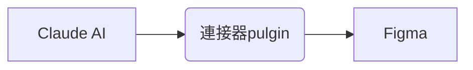
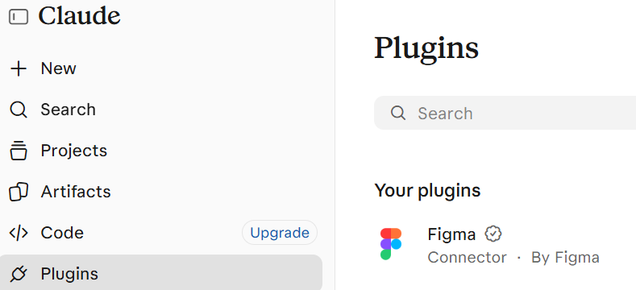

# AI輔助UI/UX與前端版型設計 上課課程內容與筆記
## 🌸 (新北) AI輔助UI/UX與前端版型設計實務班【課程代號：173277】
## ✔️報名連結：https://ojt.wda.gov.tw/ClassSearch/Detail?OCID=173277&plantype=1
## ✔️上課日期：2026/11/25~2026/12/28
## ✔️上課時間：每週一三18:40~21:40 (共計30小時)
## ✔️上課地點：新北市板橋區文化路二段242號6樓(華梵大學新北板橋中心-609教室)

## 課程內容


| 上課日期 | 授課時間 | 時數 | 課程進度／內容 | 授課師資 | 助教 |
| ---- | ---- | ---- | ---- | ---- | ---- |
| 115/11/25(星期三)	| 18:40~21:40 | 3 | 網頁設計與AI工具概念 1.網頁運作原理簡介 2.UI與UX基本概念 3.AI生成網站的流程介紹 4.Google Stitch功能概覽 | 徐國堂 | 徐瑞彤 |	
| 115/11/30(星期一)	| 18:40~21:40 | 3 | HTML基礎語法與網頁結構 1.HTML文件結構 2.常用標籤介紹 (標題、段落、圖片、連結) 3.語意化標籤概念 4.建立第一個網頁 | 徐國堂 | 徐瑞彤	 |
| 115/12/02(星期三)	| 18:40~21:40	| 3	| CSS基礎與樣式設計 1.CSS基本語法 2.顏色、字型與文字樣式設定 3.邊界、間距與背景設定 4.套用樣式至HTML | 徐國堂 | 徐瑞彤 |	
| 115/12/07(星期一)	| 18:40~21:40	| 3	| 版面配置基礎 1.區塊概念 (div, section) 2.排版觀念 3.Flexbox排版基礎 4.常見版型解析 | 徐國堂 | 徐瑞彤 |	
| 115/12/09(星期三)	| 18:40~21:40	| 3	| Google Stitch UI產生實作 1.Stitch操作流程 2.透過提示產生UI版面 3.版面元件解析 4.匯出HTML結構 | 徐國堂 | 徐瑞彤 |	
| 115/12/14(星期一) | 18:40~21:40 | 3	| AI生成程式碼解析技巧 1.閱讀AI產生的HTML架構 2.標籤與class命名理解 3.調整內容與結構 4.維持語意化設計 | 徐國堂 | 徐瑞彤 |	
| 115/12/16(星期三) | 18:40~21:40 | 3 | CSS樣式調整技巧 1.修改顏色與字型風格 2.調整間距與版面比例 3.元件樣式優化 4.提升可讀性	 | 徐國堂 | 徐瑞彤 |	
| 115/12/21(星期一) | 18:40~21:40 | 3 | 常見UI元件設計 1.導覽列設計 2.卡片式版型 3.按鈕與表單樣式 4.元件一致性設計 | 徐國堂 | 徐瑞彤 |	
| 115/12/23(星期三) | 18:40~21:40 | 3 | 版面風格優化實作 1.調整整體視覺風格 2.建立一致設計語言 3.UI微調技巧 4.同學作品修改與討論 | 徐國堂 | 徐瑞彤 |	
| 115/12/28(星期一) | 18:40~21:40 | 3 | 綜合專題實作 1.使用Stitch產生完整網站 2.修改HTML與CSS 3.完成個人網站版型 4.成果展示與回饋 | 徐國堂 | 徐瑞彤 |	

## 上課內容
### 第一節
### - 網頁設計與AI工具概念 
1. 網頁運作原理簡介 
2. UI與UX基本概念 
3. AI生成網站的流程介紹 
4. Google Stitch功能概覽
### 上課前學習
### 一、網頁運作原理簡介
- 當你在瀏覽器輸入網址並按下 Enter 時，背後其實是一場「客戶端（瀏覽器）」與「伺服器端」之間的快速對話。
    - 請求與回應（Request & Response）。 瀏覽器會透過 HTTP/HTTPS 協定，向遠端的網站伺服器發送資料請求。伺服器收到後，會將對應的網頁檔案回傳給瀏覽器進行解析。
    - 前端三大核心技術。 瀏覽器收到檔案後，會由三個核心要素組裝出畫面。HTML 負責建立網頁的骨架與文字內容，CSS 負責控制排版、顏色與字體等外觀樣式，而 JavaScript 則負責處理按鈕點擊、動畫與資料互動等動態行為。
    - 前後端分工架構。 前端（Frontend）專注於使用者看得到、摸得到的視覺畫面與互動。後端（Backend）則在伺服器背後運作，負責會員驗證、邏輯運算與資料庫的存取。
### 二、UI 與 UX 基本概念
- 在規劃網站時，UI 與 UX 是決定產品是否「好看又好用」的兩個核心設計維度。

| 比較維度 | UI（User Interface，使用者介面） | UX（User Experience，使用者體驗 |
| ---- | ---- | ---- |
| 核心關注點 | 產品的「外觀視覺」與互動元件呈現 | 使用者操作過程中的「整體感受」與流暢度 |
| 主要工作內容 | 色彩搭配、字體大小、按鈕樣式、圖示設計與版面美感 | 資訊架構規劃、操作動線設計、降低學習門檻與解決痛點 |
| 生活化比喻 | 餐廳的裝潢風格、餐具質感與菜單排版 | 進店帶位動線、點餐是否直覺、上菜速度與服務感受 |
| 相輔相成關係 | 漂亮的 UI 能吸引第一眼目光，但無法挽救混亂的操作 | 良好的 UX 確保流程順暢，搭配優質 UI 才能創造高留存率 |

### 三、AI 生成網站的流程介紹
- 透過 AI 輔助開發網站，能大幅縮短從零到一的摸索期，通常分為以下四個階段。
    - 需求定義與提示詞（Prompt）撰寫。 明確列出網站的目標受眾、核心功能、頁面架構與期望的視覺風格（例如極簡風、科技感），作為給 AI 的設計藍圖。
    - 線框圖與視覺介面生成。 將文字描述或手繪草圖輸入 AI 設計工具，讓系統在數十秒內自動產出多個版面配色與元件配置方案供挑選。
    - 互動原型與對話式微調。 透過自然語言指令要求 AI 調整細節（例如「將主按鈕改為深藍色」或「新增深色模式」），並將多個頁面串聯成可點擊測試的互動原型（Prototype）。
    - 程式碼匯出與部署上線。 將確認後的設計一鍵匯出為 HTML/CSS 或前端框架程式碼，交由 AI 程式編輯器補充後端邏輯，最後部署至雲端主機正式上線。
### 四、Google Stitch 功能概覽
- Google Stitch 是由 Google Labs 推出的 AI 原生軟體設計畫布（AI-native software design canvas），主打透過對話與視覺協作，快速完成網頁與 App 的介面設計。
    - 多模態輸入生成 UI。 支援輸入文字描述、上傳手繪草圖或參考網頁截圖，搭載 Gemini 模型能快速產出高擬真度的網頁與行動裝置介面。
    - 無限畫布與設計代理（Design Agent）。 提供無限延伸的視覺工作區，可同時並排探索多種設計變體（Variations）。內建的 AI 代理能理解專案脈絡，協助發想點子並自動推演下一個合理的操作畫面。
    - 語音指令與即時修改。 支援透過語音直接對畫面提出修改建議，也能針對單一元件進行局部微調，省去繁瑣的選單設定。
    - 設計系統提取（DESIGN.md）。 可從現有網址自動提取配色與風格規範，並匯出為結構化的 DESIGN.md 檔案，確保整個專案的視覺一致性。
    - 無縫銜接設計與開發工具。 生成的畫面除了能建立可點擊的互動原型外，還支援匯出至 Figma 進行精修，或直接輸出 HTML/CSS、Tailwind、React 等前端程式碼，無縫對接後續開發流程。
### 上課筆記
1. 上課 meet 網址 : https://meet.google.com/nur-kijv-jeb
2. 上課學習資料 : https://github.com/roberthsu2003/AI-UI_UX-Builder
3. 上課錄影影片網址 (1026_11_25) : https://meet.google.com/nur-kijv-jeb
4. 上課內容重點整理 :  
- 使用 Figma 與 Claude AI 連動, 使用Claude AI 寫提示詞,產生網頁. 

- 進入 cluade.ai  
    
- 進入後將 Figma 網頁位置 提供在提示詞中, 在說明要做哪些設計建立.
---
- 使用 stitch 進行網頁設計.
    - 進入 網站 https://stitch.google.com/
    - 使用 google 帳號註冊
    - 一樣可以使用提示詞方式說明設計網頁的要求
- 可以建一個 DESIGN.md 要建立一個基本頁面會需要
    1. 網站目的
    2. 設計風格
    3. 技術與輸出要求
    4. 其他要求
```md
請為我設計一個網站，以下是需求說明：
### 網站目的：介紹華梵大學 AI 工具教學課程，並展示教學資源與課堂成果 目標受眾：華梵大學學生、教師，以及對 AI 工具學習有興趣的一般人 主要頁面：首頁、課程介紹、教學資源、關於講師、聯絡我們 核心功能：
- 課程介紹區塊（課程目標、單元大綱）
- 教學資源列表（可分類篩選）
- 聯絡表單（姓名、Email、留言）
### 設計風格：
- 整體氛圍：專業、清爽、具學術感，但不過於嚴肅
- 色系：深藍（主色）搭配白色底色，以淺橘色作為強調色
- 字體：繁體中文適用的無襯線字體（如 Noto Sans TC），標題與內文字重分明
- 版面：大量留白，卡片式區塊呈現內容
### 技術與輸出要求：
- 使用單一 HTML 檔案，內含 CSS 與 JavaScript，不依賴外部框架
- 支援手機與桌機的響應式設計
- 文字內容使用繁體中文
- 包含固定導覽列與頁尾（含學校名稱與聯絡資訊區塊）
- 所有佔位文字以範例內容呈現，方便之後替換
### 請依序提供：
- 網站結構與頁面規劃
- 首頁的完整程式碼
- 設計說明（色彩、字體、版面的選擇理由）
這個版本已能直接使用。若您要改成其他用途（例如個人作品集），告訴我即可調整。
```
```md
# 1. 角色設定
你是一位{資深科技編輯 / 技術作者 / 內容策略顧問},
負責為「{網站名稱}」產出內容。

# 2. 專案背景
- 網站定位:專注於提供最新科技資訊的內容平台
- 目標讀者:{例如:科技愛好者 / 工程師 / 學生 / 一般大眾}
- 讀者程度:{入門 / 中階 / 進階}
- 內容語言:{繁體中文 / 中英對照}
- 發布頻率:{每日 / 每週 / 每月}

# 3. 本次任務
任務類型:{撰寫文章 / 規劃選題 / 改寫潤稿 / 產出大綱 / 製作摘要}
主題分類:{從下方五大分類擇一}
具體主題:{填入題目或關鍵字}
字數/篇幅:{800–1500 字}

# 4. 五大主題模組(依需求啟用其中一個)

## 4-1 科技新知
- 定位:報導最新科技動態、產品發表、產業消息
- 結構:標題 → 重點摘要(3 點)→ 事件背景 → 細節說明 → 影響與意義
- 要求:資訊須標註來源與日期,區分「事實」與「評論」

## 4-2 學習心得
- 定位:分享學習技術、工具、課程的過程與收穫
- 結構:學習動機 → 學習路徑 → 遇到的問題與解法 → 關鍵收穫 → 給後來者的建議
- 要求:第一人稱、真實案例、附上可用資源

## 4-3 技術解析
- 定位:深入說明技術原理、架構、實作方式
- 結構:問題背景 → 核心概念 → 運作原理 → 範例/程式碼 → 優缺點 → 適用情境
- 要求:由淺入深,必要時附圖表或程式碼,並說明名詞

## 4-4 未來趨勢
- 定位:分析技術與產業的發展方向
- 結構:現況 → 驅動因素 → 趨勢預測 → 機會與風險 → 時間軸
- 要求:論點需有數據或案例支持,明確標示「推測」與「已發生」

## 4-5 AI運用
- 定位:介紹 AI 工具與實際應用場景
- 結構:應用場景 → 工具介紹 → 操作步驟 → 實際案例 → 注意事項(隱私、準確性)
- 要求:提供可直接複製使用的範例 prompt 或流程

# 5. 風格與語氣
- 語氣:{專業但親切 / 嚴謹客觀 / 輕鬆幽默}
- 用詞:專有名詞首次出現附英文,避免過度艱澀
- 排版:使用小標題、條列、重點粗體,段落不超過 {4} 行

# 6. 輸出格式
- 格式:{Markdown / HTML / 純文字}
- 必含項目:標題(提供 {3} 個備選)、摘要、正文、關鍵字標籤、SEO 描述({120} 字內)
- 選配項目:{延伸閱讀 / 圖片建議 / 社群貼文版本}

# 7. 限制條件
- 不得捏造數據、來源或引述
- 不確定的資訊請標註「待查證」
- 避免:{過度行銷語氣 / 未經證實的傳聞}
- 引用他人內容須改寫並註明出處

# 8. 品質檢查
輸出前請自我檢查:事實正確、結構完整、符合讀者程度、無冗詞。
```
- 下次上課先安裝 `Pen-Dev`
---
### 第二節
### - HTML基礎語法與網頁結構 
1. HTML文件結構 
2. 常用標籤介紹 (標題、段落、圖片、連結) 
3. 語意化標籤概念 
4. 建立第一個網頁
### 上課前學習
HTML（超文本標記語言）是構成網頁骨架的核心標準，透過成對的標籤（Tag）來定義網頁上的各種內容區塊。 只要使用電腦內建的記事本或任何文字編輯器，就能立即寫出第一個能在瀏覽器開啟的網頁。
1. HTML 文件結構
- 一份標準的 HTML5 網頁檔案，都遵循著固定的樹狀階層結構，分為宣告、表頭與主體三個部分。
    - 文件類型宣告（`<!DOCTYPE html>`）。 放在整份文件的第一行，用來告訴瀏覽器這是一份現代的 HTML5 網頁，請用最新標準來解析畫面。
    - 根元素（`<html>`）。 包住整份網頁的所有程式碼，通常會加上 lang="zh-Hant" 屬性來標明網頁語言為繁體中文。
    - 網頁表頭（`<head>`）。 存放給瀏覽器與搜尋引擎看的「幕後設定資訊」，例如網頁標題`<title>`與編碼設定`<meta charset="UTF-8">`，不會直接顯示在網頁畫面中。
    - 網頁主體（`<body>`）。 存放所有使用者在瀏覽器視窗中看得到的文字、圖片、按鈕與連結等內容。
2. 常用標籤介紹
HTML 標籤大多由「開始標籤」與「結束標籤」成對組成（例如 `<p>內容</p>`），少數單一標籤（如圖片）則不需要結束標籤。

| 標籤名稱 | 功能說明 | 語法範例 | 重要屬性補充 |
| ---- | ---- | ---- | ---- |
`<h1> ~ <h6>` | 定義六個層級的標題，數字越小字體越大且越重要 | `<h1>網站主標題</h1>` | 一頁通常只放一個 `<h1>` 以利搜尋引擎理解主題 
`<p>` | 定義一段正常的文章段落，前後會自動保留換行間距 | `<p>這是一段文字說明。</p>` | 適合用來包覆成段的說明文字
`<a>` | 建立超連結，讓使用者點擊後跳轉至其他網頁或位置 | `<a href="網址">點我前往</a>` | href 填入目標網址；加上 target="_blank" 可在新分頁開啟
`` | 在網頁中嵌入顯示圖片（屬於單一標籤，無結束標籤） | ``	src 填入圖片網址或路徑；alt 填入圖片無法顯示時的替代文字

3. 語意化標籤概念
- 語意化標籤（Semantic Tags）是指「光看標籤名稱，就能直接明白該區塊內容用途」的 HTML 標籤。
    - 告別無意義的區塊堆疊。 早期網頁常大量使用沒有特定含義的 `<div>` 標籤來切分版面，導致程式碼難以閱讀。HTML5 引入了語意化標籤，讓網頁結構變得一目了然。
    - 常見語意化結構標籤。 網頁頂部導覽區使用 `<header>` 與 `<nav>`，主要文章內容使用 `<main>` 與 `<article>`，側邊欄使用 `<aside>`，網頁最底部的版權資訊則使用 `<footer>`。
    - 提升搜尋引擎優化（SEO）與無障礙體驗。 搜尋引擎爬蟲與視障者使用的螢幕閱讀器，都能透過語意化標籤精準判斷哪裡是重點文章、哪裡是選單，大幅提升網站排名與友善度。

### 上課筆記
---
### 第三節
### - CSS基礎與樣式設計 
1. CSS基本語法 
2. 顏色、字型與文字樣式設定 
3. 邊界、間距與背景設定 
4. 套用樣式至HTML
### 上課前學習
CSS（階層式樣式表）專門用來控制 HTML 網頁的視覺外觀與版面配置。 透過定義「選取器」與「樣式規則」，你可以精準調整文字顏色、字型大小、背景圖案以及元素之間的留白距離。
1. CSS 基本語法
- CSS 的寫法非常直覺，由「選取器（Selector）」與「宣告區塊（Declaration Block）」兩部分組成。
    - 選取器（Selector）。 用來指定你要幫哪一個 HTML 標籤穿衣服，例如針對所有段落寫 p，或是針對特定類別名稱寫 .card。
    - 宣告區塊（{ }）。 大括號裡面放著一條條的樣式規則，每條規則都由 屬性名稱: 屬性值; 組成，結尾務必加上分號（;）。
    - 常見選取器種類。 除了直接寫標籤名稱（如 h1），最常用的是「類別選取器（.名稱）」可重複套用在多個元素上，以及「ID 選取器（#名稱）」專門針對網頁中獨一無二的元素。
```css
/* 這是 CSS 註解：將所有 h1 標題設為深藍色、置中對齊 */
h1 {
    color: #1E3A8A;
    text-align: center;
}

/* 類別選取器：凡是加上 class="highlight" 的標籤都會套用 */
.highlight {
    background-color: #FEF08A;
    font-weight: bold;
}
```
2. 顏色、字型與文字樣式設定
- 良好的文字排版能大幅提升網頁的閱讀舒適度與視覺質感。
    - 顏色設定（color）。 可直接使用英文單字（如 red）、十六進位色碼（如 #333333 深灰色），或支援透明度的 RGBA 色碼（如 rgba(0, 0, 0, 0.7)）。
    - 字型與大小（font-family、font-size）。 使用 font-family 指定字體（建議在最後加上 sans-serif 作為無襯線備用字體）；使用 font-size 控制大小，現代網頁常用 px（像素）或 rem（相對根元素大小，如 16px）。
    - 粗細、行高與對齊。 透過 font-weight: bold; 設定粗體，使用 line-height: 1.6; 拉開行距避免文字擠在一起，並用 text-align 控制靠左（left）、置中（center）或靠右（right）。
```css
body {
    font-family: "Microsoft JhengHei", "PingFang TC", sans-serif;
    color: #333333;
    line-height: 1.6;
}

p {
    font-size: 16px;
    text-align: left;
}
```
3. 邊界、間距與背景設定
- 在 CSS 中，每個 HTML 元素都被視為一個「盒子（Box Model）」，掌握內外距與背景就能做出漂亮的卡片與區塊。

| CSS 屬性 | 中文名稱 | 功能說明 | 常見寫法範例 |
| ---- | ---- | ---- | ---- |
| padding | 內距 | 控制「文字內容」與「元素邊框」之間的內部留白 | padding: 20px;（上下左右各留 20px）|
| border | 邊框 | 設定元素外圍的框線粗細、樣式與顏色 | border: 1px solid #CCCCCC; |
| margin | 外邊界 | 控制「元素與其他外部元素」之間的距離 | margin: 15px auto;（上下 15px，左右自動置中）|
| background-color | 背景顏色 | 填滿整個元素內部（包含 padding 區域）的底色 | background-color: #F3F4F6; |
| background-image | 背景圖片 | 為區塊設定背景圖，常搭配 background-size: cover; 滿版顯示 | background-image: url("bg.jpg"); |

4. 套用樣式至 HTML
- 將 CSS 連結到 HTML 總共有三種方式，實務開發中最推薦使用「外部樣式表」以利維護。
    - 外部樣式表（External CSS，最推薦）。 將所有 CSS 獨立存成一個 .css 檔案（例如 style.css），再於 HTML 的 `<head>` 區塊內使用 `<link>` 標籤引入，方便多個網頁共用同一套風格。
    - 內部樣式表（Internal CSS）。 直接在 HTML 檔案的 `<head>` 區塊內寫一組 `<style>` ... `</style>` 標籤，適合單一頁面測試或小型練習使用。
    - 行內樣式（Inline CSS，不推薦）。 直接把 style="..." 屬性寫在個別 HTML 標籤裡面（例如 `<p style="color: red;">`），會讓程式碼變得雜亂且難以統一修改。

### 上課筆記
---
### 第四節
### - 版面配置基礎 
1. 區塊概念 (div, section) 
2. 排版觀念 
3. Flexbox排版基礎 
4. 常見版型解析
### 上課前學習
#### 學習網頁版面配置的核心，在於先理解「盒子模型（Box Model）」與語意化區塊標籤，再透過 Flexbox 進行一維彈性排列。
一、 區塊概念：`div` 與 `section` 的差異
在網頁設計中，畫面是由無數個矩形「區塊（Block）」堆疊而成的。
- `<div>`（純粹的容器）：
	- 本身沒有任何語意，就像一個透明的紙箱。
	- 用途：純粹為了「排版」或「套用 CSS 樣式」而把元素包在一起（例如：把三個卡片包起來做左右排列）。
- `（有語意的區塊）：**
    - 代表網頁中一個獨立的「主題區域」，通常裡面會有一個標題（<h2> ~ <h6>）。
    - 用途：劃分頁面結構（例如：關於我們、產品介紹、聯絡表單），有助於搜尋引擎優化（SEO）與無障礙閱讀。
- 補充常見語意標籤：`<header>`（頁首）、`<nav>`（導覽列）、`<main>`（主要內容）、`<footer>`（頁尾）。

二、 排版觀念：盒子模型（Box Model）與顯示模式

在寫 CSS 之前，必須先建立兩個基礎空間觀念：
1. 盒子模型（由內而外）：
	- Content（內容）：文字或圖片本身的區域。
	- Padding（內距）：內容與邊框之間的留白（往內推擠）。
	- Border（邊框）：盒子的外框線。
	- Margin（外距）：盒子與其他外部元素之間的距離（往外推開）。
2. 元素預設排列方式：
	- 區塊元素（Block）：如 `<div>`、`<p>`、`<h1>`，預設會佔滿整行寬度，下一個元素會自動換行。
	- 行內元素（Inline）：如 `<span>`、`<a>`，只佔用內容所需的寬度，會並排顯示，但無法直接設定寬高。

三、 Flexbox 排版基礎

Flexbox（彈性盒子）是目前網頁最主流的一維排版工具（一次處理「水平」或「垂直」單一方向的對齊）。

### 核心口訣：設定在「父層」，影響「子層」

只要在父容器加上 `display: flex;`，裡面的第一層子元素就會自動變成彈性項目並排。

| CSS 屬性（寫在父容器） | 功能說明 | 常用屬性值 |
| ---- | ---- | ---- |
| `flex-direction` | 決定主軸（排列）方向 | `row`（水平，預設）、`column`（垂直） |
| `justify-content` | 主軸的對齊與間距分配 | `flex-start`（靠左）、`center`（置中）、`space-between`（兩端對齊，中間均分） |
| `align-items` | 交錯軸（與主軸垂直）的對齊 | `stretch`（等高拉滿，預設）、center（垂直置中）、flex-start（靠上） |
| `flex-wrap` | 空間不夠時是否換行 | `nowrap`（不換行，會壓縮子元素）、wrap（自動換行） |
| `gap` | 子元素之間的間距 | 例如：`gap: 16px;`（比寫 margin 更直覺） |


四、 常見版型解析（實戰應用）

1. 導覽列（Navbar）：左 Logo、右選單
- HTML 結構：
``` html
<header class="navbar">
  <div class="logo">網站名稱</div>
  <nav class="menu">
    <a href="#">首頁</a>
    <a href="#">服務</a>
    <a href="#">聯絡</a>
  </nav>
</header>
```
- CSS 重點：
``` css
.navbar {
  display: flex;
  justify-content: space-between; /* 左右推開 */
  align-items: center;            /* 垂直置中 */
  padding: 16px 32px;
}
.menu {
  display: flex;
  gap: 20px; /* 選單項目之間的間距 */
}
```
2. 多欄卡片區塊（Card Grid）
- HTML 結構：  
```html
<section class="features">
    <div class="card">卡片 1</div>
    <div class="card">卡片 2</div>
    <div class="card">卡片 3</div>
</section>
```
- CSS 重點：
``` css
.features {
  display: flex;
  justify-content: center;
  flex-wrap: wrap; /* 螢幕變窄時（如手機）自動往下掉 */
  gap: 24px;
}
.card {
  width: 300px; /* 固定寬度，搭配 wrap 就能自動排成多欄 */
  padding: 20px;
  border: 1px solid #ddd;
}
```
3. 絕對置中（常用於 Banner 標語或登入框）

- CSS 重點：
``` css
.hero-banner {
  height: 400px;
  display: flex;
  flex-direction: column;  /* 讓標題與按鈕上下排列 */
  justify-content: center; /* 垂直置中 */
  align-items: center;     /* 水平置中 */
}
```
### 上課筆記
---
### 第五節
### - Google Stitch UI產生實作 
1. Stitch操作流程 
2. 透過提示產生UI版面 
3. 版面元件解析 
4. 匯出HTML結構
### 上課前學習
### 上課筆記
---
### 第六節
### - AI生成程式碼解析技巧 
1. 閱讀AI產生的HTML架構 
2. 標籤與class命名理解 
3. 調整內容與結構 
4. 維持語意化設計
### 上課前學習
### 上課筆記
---
### 第七節
### - CSS樣式調整技巧 
1. 修改顏色與字型風格 
2. 調整間距與版面比例 
3. 元件樣式優化 
4. 提升可讀性	
### 上課前學習
### 上課筆記
---
### 第八節
### - 常見UI元件設計 
1. 導覽列設計 
2. 卡片式版型 
3. 按鈕與表單樣式 
4. 元件一致性設計
### 上課前學習
### 上課筆記
---
### 第九節
### - 版面風格優化實作 
1. 調整整體視覺風格 
2. 建立一致設計語言 
3. UI微調技巧 
4. 同學作品修改與討論
### 上課前學習
### 上課筆記
---
### 第十節
### - 綜合專題實作 
1. 使用Stitch產生完整網站 
2. 修改HTML與CSS 
3. 完成個人網站版型 
4. 成果展示與回饋
### 上課前學習
### 上課筆記
--- 