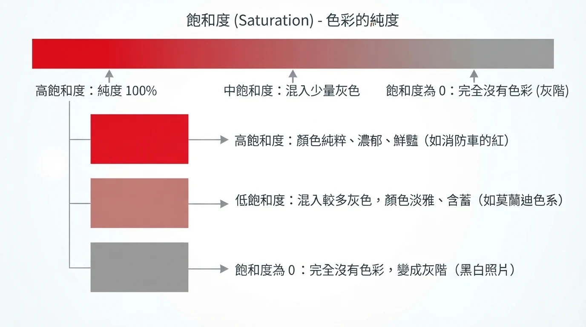
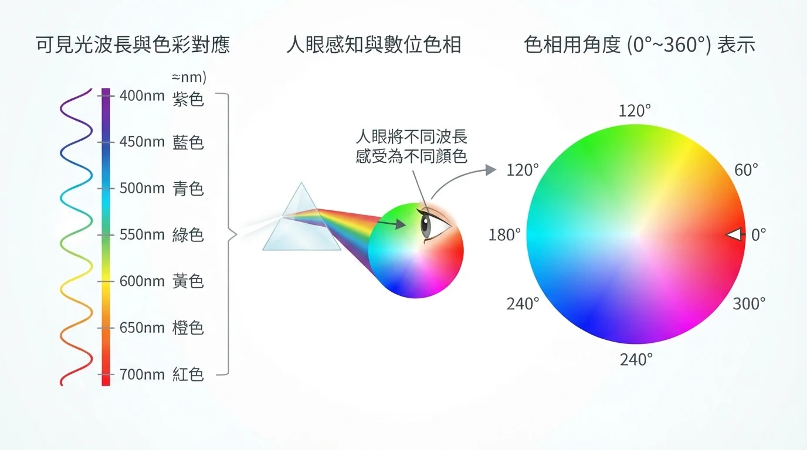
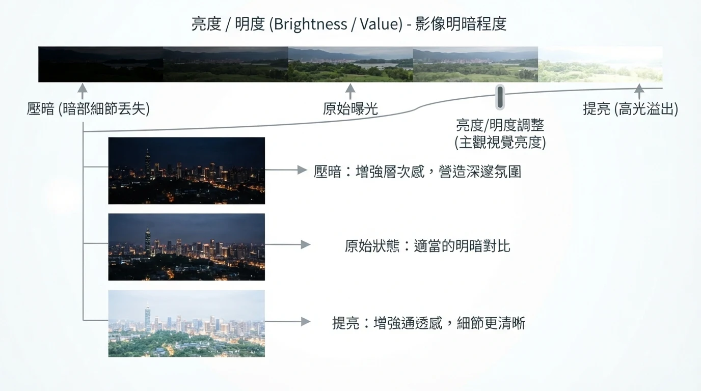
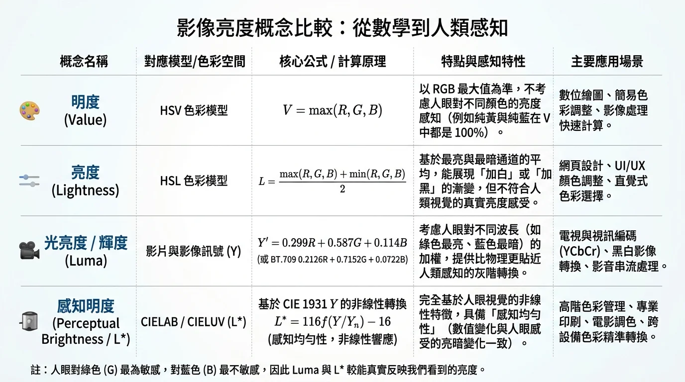
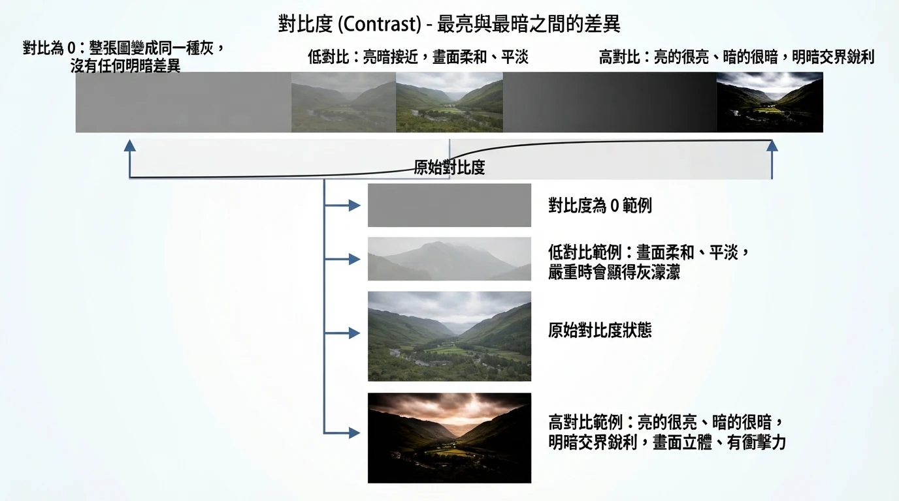
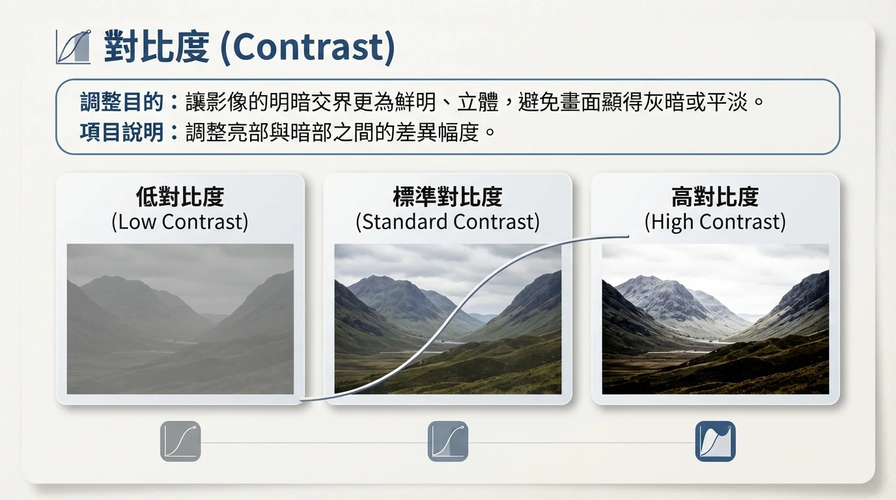

# CPROC（Color Processing，色彩處理）說明
在相機的影像信號處理（ISP）管線中，CPROC（Color Processing，色彩處理）通常位於色彩空間轉換與伽馬校正等核心基礎處理之後、輸出最終 RGB 影像前的階段。它是針對影像進行主觀畫質微調（Fine-tuning）與色彩風格化（Styling）的重要模組。
以下是 CPROC 常見的調整項目與其對應的目的：

# 一、 主要調整目的與項目說明
## 1. 飽和度（Saturation）
### 一、什麼是飽和度？
飽和度描述的是色彩的純度：一個顏色裡「純色成分」佔多少、「灰色成分」佔多少。
 
- 高飽和度：顏色純粹、濃郁、鮮豔（如消防車的紅）
- 低飽和度：混入較多灰色，顏色淡雅、含蓄（如莫蘭迪色系）
- 飽和度為 0：完全沒有色彩，變成灰階（黑白照片）
```
一個簡單的比喻：把一滴紅墨水滴進水裡。水越少，紅越濃（高飽和）；水越多，紅越淡（低飽和）；全是水，就沒有顏色了。
```
#### 調整目的：控制色彩是顯得濃郁、鮮豔，還是淡雅、自然。  
適度提高飽和度能讓景物（如藍天、綠草、花朵）更討好人眼；若過低則會趨近於黑白或灰階。  
#### 項目說明：調整畫面中色彩的純度與鮮豔程度。

### 二、飽和度的數學原理
1. HSV / HSL 色彩模型
- 在 HSV 模型中，飽和度的定義為：

## $$S = \frac{\max(R,G,B) - \min(R,G,B)}{\max(R,G,B)}$$
也就是 RGB 三個通道的差距越大，飽和度越高；三者越接近，越趨近灰色。
舉例（RGB 範圍 0–255）：

| 顏色	| R	| G	| B	| 飽和度 | 說明 | 色塊 |
| ---- | ---- | ---- | ---- | ---- | ---- | ---- |
| 純紅	| 255	| 0	| 0	| 100%	| 通道差距最大 |<span style="display: inline-block; width: 14px; height: 14px; background-color: #FF0000; border-radius: 3px;"></span> 純紅 |
| 淡紅（粉）| 255 | 128 | 128 | 約 50% | 混入一些灰/白 |<span style="display: inline-block; width: 14px; height: 14px; background-color: #FF8080; border-radius: 3px;"></span> 淡紅（粉） |
| 灰紅 | 200 | 150 | 150 | 約 25% | 通道差距小 | <span style="display: inline-block; width: 14px; height: 14px; background-color: #C89696; border-radius: 3px;"></span> 灰紅 |
| 灰色 | 128 | 128 | 128 | 0% | 三通道相等 | <span style="display: inline-block; width: 14px; height: 14px; background-color: #808080; border-radius: 3px;"></span> 灰色 |

2. 調整飽和度的運算概念
軟體調整飽和度，本質上是調整每個像素偏離灰階的程度：
先算出該像素的灰階值（亮度）$Y = 0.299R + 0.587G + 0.114B$
把原色與灰階值做「拉開」或「拉近」：
## $$C_{new} = Y + k \times (C_{old} - Y)$$
## $k > 1$：遠離灰色 → 飽和度提高
## $k = 1$：不變
## $0 < k < 1$：靠近灰色 → 飽和度降低
## $k = 0$：完全等於灰階 → 黑白

數值舉例： 某像素 R=200, G=100, B=100，灰階值 Y≈133。取 k = 1.5：

R' = 133 + 1.5×(200−133) ≈ 233
G' = 133 + 1.5×(100−133) ≈ 84
B' = 133 + 1.5×(100−133) ≈ 84

結果：紅更紅、綠藍更暗，色彩更濃郁。

### 三、影像上的調整效果
1. 提高飽和度
**效果**： 色彩鮮豔、對比感強、畫面有活力。
#### 適合的場景：
- 藍天、海洋：讓藍色更通透
- 綠草、樹葉：讓植物更青翠
- 花朵、水果、美食：更討喜、更有食慾
- 日出日落：強化橘紅天空的戲劇感
#### 常見風險：
- **色彩溢出（Clipping）**：某個通道衝到 255，細節消失，變成一整塊死色
- **膚色失真**：人像變得橘紅、不自然
- **色階斷層（Banding）**：天空漸層出現明顯的條紋
- **雜訊變色**：暗部雜訊被放大成彩色噪點

2. 降低飽和度
效果： 色彩沉靜、內斂、質感高級。
#### 適合的場景：
- **人像**：膚色更自然、柔和
- **復古、膠片風格**：低飽和 + 偏色調
- **極簡、冷淡風**：莫蘭迪色系
- **街拍、紀實攝影**：重視氛圍而非色彩
**極端情況**： 飽和度降為 0 即成黑白照，常用於強調光影、構圖、情緒。
### 四、舉例對照
| 場景 | 原始問題 | 建議調整 | 效果 |
| ---- | ---- | ---- | ---- |
| 陰天風景照 | 灰濛濛、色彩平淡 | 飽和度 +20～+30 | 草地、花朵色彩回來 |
| 晴天藍天 | 已經夠藍 | 小幅 +10 或不動 | 避免天空過度青藍 |
| 人像照 | 皮膚偏橘紅 | 飽和度 −10～−15 | 膚色更自然 |
| 美食照 | 食物看起來不新鮮 | 飽和度 +15～+25 | 更有食慾 |
| 懷舊風格 | 太鮮豔、太現代 | 飽和度 −30 | 柔和復古感 |
| 夕陽 | 色彩不夠戲劇 | 飽和度 +25，搭配加強暖色 | 天空更濃烈 |
### 五、調整時的實務技巧
- 適度原則：多數照片調整 ±10～±30 已足夠，避免過猶不及
- 分色調整：用 HSL 面板單獨調整特定顏色（例如只加強藍天、不動膚色）
- 注意亮度配合：高飽和度的顏色通常也需要適當的明度，否則顯得髒或沉
- 螢幕色域：在廣色域螢幕上看起來剛好的飽和度，在一般螢幕或印刷時可能過頭
- 觀察直方圖：確認 R、G、B 通道沒有被推到邊緣而削頂
### 六、重點整理
- 飽和度 = 色彩的純度，由 RGB 三通道的差距決定
- 提高飽和度 → 色彩濃郁鮮豔；降低 → 淡雅自然，到 0 即灰階
- 本質運算是拉開或拉近色彩與灰階之間的距離
- 調整要適度，並留意膚色、爆色與色階斷層
## 2. 色相（Hue）
### 一、什麼是色相？
色相描述的是 **「這是什麼顏色」**，也就是色彩的相貌：偏紅、偏黃、偏綠還是偏藍。
它對應光的波長：不同波長的可見光，被人眼感受成不同的顏色。在影像處理中，色相用一個角度（0°～360°） 表示，排列在色相環上。
 
| 角度 | 顏色 |
| ---- | ---- |
| 0° / 360° | 紅 |
| 60° | 黃 |
| 120° | 綠 |
| 180° | 青（Cyan） |
| 240° | 藍 |
| 300° | 洋紅（Magenta） |
```
比喻：色相像收音機的頻道旋鈕，轉動時換的是「哪個台」，而不是音量（明度）或訊號清晰度（飽和度）。
```
色相環上**相對 180° 的兩色互為補色**，例如紅↔青、綠↔洋紅、藍↔黃。這對色偏修正很重要。
- 調整目的：微調整體色調傾向，修正微小的環境色偏。  
或者營造特殊的藝術風格與氛圍（例如將膚色或某些色彩導向特定的視覺感受）。
- 項目說明：調整整體畫面色彩的旋轉角度或特定色彩的相貌傾向（例如偏紅、偏黃、偏綠或偏藍）。
## 二、色相的數學原理
1. 由 RGB 計算色相
### 令 $\Delta = \max(R,G,B) - \min(R,G,B)$，則：
$$
H = \begin{cases}
60° \times \left(\dfrac{G-B}{\Delta} \bmod 6\right) & \text{最大值為 R} \\[2mm]
60° \times \left(\dfrac{B-R}{\Delta} + 2\right) & \text{最大值為 G} \\[2mm]
60° \times \left(\dfrac{R-G}{\Delta} + 4\right) & \text{最大值為 B}
\end{cases}
$$
**意義**： 色相取決於哪個通道最強，以及另外兩個通道的相對比例。

舉例：
| 顏色 | R | G | B | 色相 | 說明 |
| ---- | ---- | ---- | ---- | ---- | ---- |
| 純紅 | 255 | 0 | 0 | 0° | R 最大，G=B |
| 橘黃 | 255 | 200 | 0 | 約 47° | R最大，G 偏多，往黃靠 |
| 純綠 | 0 | 255 | 0 | 120°	| G 最大 |
| 天藍 | 0 | 128 | 255 | 約 210° | B 最大，G 偏多，往青靠 |
| 膚色 | 224 | 172 | 140 | 約 23° | R 最大，G 略多於 B，落在紅橙之間 |
| 灰色 | 128 | 128 | 128 | 無定義 | $\Delta = 0$，沒有色相可言 |
```
灰階像素沒有色相，所以調整色相不會影響黑、白、灰。
```
2. 調整色相＝旋轉角度
## $$H_{new} = (H_{old} + \theta) \bmod 360°$$

數值舉例（膚色，原色相約 23°）：
- $\theta = -5°$ → 18°：更偏紅潤
- $\theta = +5°$ → 28°：更偏黃橙
- $\theta = +180°$ → 203°：變成藍色系（顏色反轉成補色）
同一個像素在飽和度、明度不變的情況下，只有「顏色種類」改變。

### 三、影像上的調整方式
1. 全域色相旋轉
整張圖的所有顏色一起旋轉相同角度。
小角度（±5°～±15°）：整體色調微微偏移，可用於風格化
大角度（±90°以上）：顏色完全錯亂，如紅花變藍、綠草變紫，屬於創意特效
2. 分色相調整（HSL 面板）
只針對特定顏色範圍微調，這是實務上最常用的方式。以 Lightroom 為例：

|調整的顏色 | 往負方向 | 往正方向 | 典型用途 |
| ---- | ---- | ---- | ---- |
| 紅 | 偏洋紅／紫 | 偏橙 | 調整嘴唇、紅花 |
| 橙 | 偏紅 | 偏黃 | 調整膚色 |
| 黃 | 偏橙 | 偏綠 | 調整秋葉、燈光 |
| 綠 | 偏黃綠（暖 | 偏青綠（冷） | 調整草地、樹葉 |
| 藍 | 偏青 | 偏紫 | 調整天空、海水 |
### 四、調整目的與舉例
1. 微調色調傾向、修正局部色偏

| 場景 | 問題 | 調整 | 效果 |
| ---- | ---- | ---- | ---- |
| 人像 | 膚色偏黃、顯得氣色差 | 橙色色相 −5～−10 | 膚色偏紅潤、健康 |
| 人像 | 膚色偏紅、像曬傷 | 橙色色相 +5	| 膚色偏黃、自然 |
| 風景 | 草地偏黃綠、顯得枯黃 | 綠色色相 +10～+15	| 草地偏翠綠、青蔥 |
| 風景 | 草地太冷、偏青 | 綠色色相 −10 | 草地偏黃綠、溫暖 |
| 天空 | 藍天偏青、不夠深邃 | 藍色色相 +5～+10 | 偏純藍、更有深度 |
| 室內 | 日光燈下白牆偏綠 |綠色色相往洋紅方向微調 | 色偏減輕 |
2. 營造藝術風格與氛圍
- 青橙色調（Teal & Orange）：將膚色維持在橙色、陰影與天空推向青色，利用補色對比，是電影感調色的經典配方
- 秋日風格：綠色色相往黃色偏移，整片樹葉變金黃
- 冷調科幻感：綠、黃往青藍推
- 夢幻粉紫風：藍天往紫色偏、紅往洋紅偏
- 特效／創意：全域旋轉 180°，製造「負片」或超現實效果
### 五、常見風險與注意事項
1. 膚色最敏感：人眼對膚色變化極為敏銳，±5° 就會明顯改變氣色，人像調整幅度宜小
2. 牽連性：調整某一色相會連帶影響所有該色範圍的物體（例如調整橙色，會同時改變膚色、木頭、橘子）。必要時要搭配遮罩局部調整
3. 明度會跟著感受改變：色相轉動後，感知亮度會變。黃色看起來比藍色亮，所以黃轉藍後可能顯得變暗
4. 色相接縫不自然：如果只調一個色相範圍，邊緣處可能出現生硬的顏色斷層
5. 螢幕與印刷差異：某些色相（如鮮豔的青、洋紅）超出印刷色域，轉換後會被壓縮，與螢幕看到的不同
6. 不要與飽和度過度同步：色相偏移後若飽和度同時拉高，更容易產生不自然的色彩
### 六、重點整理
- 色相 = 色彩的種類／相貌，用色相環上的 0°～360° 角度表示
- 由 RGB 中最強的通道與另外兩通道的比例決定
- 調整色相 = 旋轉角度，不改變明度與飽和度，也不影響灰階
- 小幅調整用來修正局部色偏（膚色、草地、天空）
- 大幅調整用來創造風格與氛圍
- 整體色偏優先用白平衡，局部顏色細修才用色相
## 3. 亮度 / 明度（Brightness / Value）
### 一、什麼是亮度／明度？
亮度描述的是 **「這個顏色有多亮、多暗」**，與色相（什麼顏色）、飽和度（多鮮豔）彼此獨立。
 
- 高明度：明亮、輕盈、通透
- 低明度：深沉、厚重、有重量感
- 明度為 0：純黑
- 明度為最大：純白（或該色相最亮的狀態）
```
比喻：像調光燈的旋鈕。轉動時，房間的顏色種類沒變，只是整體變亮或變暗。
```
- 調整目的：在不破壞整體曝光曲線的前提下，快速提亮或壓暗畫面的主觀視覺亮度，增強整體的通透感或層次感。
- 項目說明：調整影像整體或色彩空間中的明暗程度。
### 二、「亮度」這個詞的不同定義
在影像處理中，「亮度」其實有好幾種意義，容易混淆：

| 名稱 | 英文 | 定義 | 常見出現位置 |
| ---- | ---- | ---- | ---- |
| 明度 | Value（HSV 的 V） | $V = \max(R,G,B)$ | HSV 色彩模型 |
| 亮度 | Lightness（HSL 的 L） |　$L = \dfrac{\max + \min}{2}$ | HSL 色彩模型 |
| 光亮度 | Luma（Y） | $Y = 0.299R + 0.587G + 0.114B$ | 影像／視訊處理 |
| 感知明度 | $L^*$（CIELAB） | 依人眼感知均勻化	| 色彩管理、精確調色 |

 
#### 這四種指標雖然都與「明暗」有關，但計算方式與貼近人眼視覺的程度不同：
1. **明度（Value, HSV）**：取 $R、G、B$ 三通道的最大值，最直接反映某個通道的最高強度，但純色在 $V$ 滿載時仍顯得鮮豔而不像「白」。
2. **亮度（Lightness, HSL）**：以最大與最小通道的平均定義，當 $L=100\%$ 時會趨近白色，適合用來觀察從暗到亮對稱變化的模型。
3. **光亮度（Luma, Y）**：依權重加權（綠光權重最高、藍光最低），比單純取最大或平均更貼近人眼對不同顏色的明暗感受，廣泛用於視訊與影像編碼。
4. **感知明度（$L^*$, CIELAB）**：以人眼視覺感知均勻化為核心設計，在跨色彩空間轉換、色彩管理與精確調色時能維持更一致的明暗步進。
### 為什麼要區分？ 因為人眼對三原色的敏感度不同：
### 綠色最敏感（權重約 0.587）
### 紅色次之（約 0.299）
### 藍色最不敏感（約 0.114）

所以純黃（255,255,0）看起來比純藍（0,0,255）亮非常多，雖然兩者在 HSV 的 V 都是 100%。
舉例對照（RGB 0–255）：

| 顏色 | R | G | B | V（HSV） | Y（Luma） | 視覺感受 | 色塊 |
| ---- | ---- | ---- | ---- | ---- | ---- | ---- | ---- |
| 純黃 | 255 | 255 | 0 | 255 | 約 226 | 很亮 | <span style="display: inline-block; width: 14px; height: 14px; background-color: #FFFF00; border-radius: 3px;"></span> 純黃 |
| 純綠 | 0	| 255 | 0 | 255 | 約 150 | 偏亮 | <span style="display: inline-block; width: 14px; height: 14px; background-color: #00FF00; border-radius: 3px;"></span> 純綠 |
| 純紅 | 255 | 0 | 0 | 255 | 約 76 | 中等 | <span style="display: inline-block; width: 14px; height: 14px; background-color: #FF0000; border-radius: 3px;"></span> 純紅 |
| 純藍 | 0 | 0 | 255 | 255 | 約 29 | 很暗 | <span style="display: inline-block; width: 14px; height: 14px; background-color: #0000FF; border-radius: 3px;"></span> 純藍 |
```
這說明：V 值相同，視覺亮度可以差很多。
```
### 三、亮度調整的數學原理
1. 加法型調整（Brightness，基本亮度）
## $$C_{new} = C_{old} + b$$
對每個像素的每個通道加上（或減去）一個固定值 $b$。  
數值舉例： 某像素 (100, 80, 60)，$b = +40$：
- 結果：(140, 120, 100)，整體變亮
特性：
- 運算簡單，整張圖等量平移
- 整個直方圖左右平移
- 暗部會被拉起來變灰、發白，缺乏層次
- 亮部容易被推到 255 而削頂，細節消失

2. 乘法型調整（增益／曝光）
## $$C_{new} = g \times C_{old}$$
### $g > 1$：變亮；$g < 1$：變暗  
### 黑色（0）永遠保持為 0，不會被拉灰  
### 更接近真實相機曝光值（EV） 的變化：每 +1 EV ≈ 亮度乘以 2  
數值舉例： 某像素 (100, 80, 60)，$g = 1.4$：  
結果：(140, 112, 84)，保留了通道間的比例，色彩關係較自然
3. 伽瑪調整（Gamma，非線性亮度）
### $$C_{new} = 255 \times \left(\frac{C_{old}}{255}\right)^{\gamma}$$
### $\gamma < 1$：中間調提亮，黑點與白點不動
### $\gamma > 1$：中間調壓暗
數值舉例（$\gamma = 0.7$）：

| 輸入 | 輸出 | 變化 |
| ---- | ---- | ---- |
| 0	| 0	| 不變（黑點）|
| 64 | 約 100 | +36（暗部大幅提亮） |
| 128 | 約 156 | +28（中間調提亮） |
| 192 | 約 213 | +21（亮部小幅提亮） |
| 255 | 255 | 不變（白點） |

這正是「在不破壞整體曝光曲線前提下提亮」的關鍵：Gamma 不會讓亮部爆掉，也不會讓暗部發灰。

4. 三種方式比較

| 方式 | 公式 | 黑點 | 白點 | 亮部削頂風險 | 暗部發灰 | 適用情境 |
| ---- | ---- | ---- | ---- | ---- | ---- | ---- |
| 加法 | $C + b$ | 被拉起 | 容易爆 | 高 | 會 | 快速簡易調整 |
| 乘法 | $g \times C$ | 不動 |　容易爆 | 中高 | 不會 | 模擬曝光補償 |
| Gamma	| $C^{\gamma}$ | 不動 | 不動 | 低 | 不會 | 提升通透感、保護高低光 |
### 四、在 HSV／HSL 空間調整明度
若只想改變明度、不改變色相與飽和度，需要轉換色彩空間：
1. RGB → HSV（或 HSL）
2. 只修改 V（或 L）通道
3. 轉回 RGB
優點： 色相和飽和度數值保持不變，不會出現「提亮後顏色偏掉」。
### 注意： 在 HSV 中提高 V，高飽和的顏色看起來未必更亮（如藍色），這是 V 與感知亮度不一致造成的。需要更精確時，建議在 Lab 的 L* 通道調整。
### 五、舉例對照
| 場景 | 原始問題 | 建議調整 | 效果 |
| ---- | ---- | ---- | ---- |
| 逆光人像 | 臉部偏暗 | 提亮陰影或 Gamma 0.8 | 臉部清楚、背景不爆 |
| 陰天風景 | 灰暗沉悶 | 亮度 +10～+20，搭配對比	| 通透、明亮 |
| 過曝天空 | 高光發白 | 降低高光、整體 −10 | 找回雲層細節 |
| 夜景人像 | 太暗、雜訊多 | 適度提亮，搭配降噪 | 主體清楚 |
| 美食照 | 暗沉、不誘人 | 亮度 +15～+25	| 清爽、有食慾 |
| 氛圍人像 | 太亮、缺乏情緒 | 亮度 −15～−25 | 沉穩、有質感 |
### 六、「亮度」與「曝光」的差別
很多軟體同時有「曝光（Exposure）」與「亮度（Brightness）」，兩者不同：
| 項目 | 曝光 Exposure | 亮度 Brightness |
| ---- | ---- | ---- |
| 運算方式 | 偏向乘法／線性空間增益 | 偏向加法或非線性曲線 |
| 白點、黑點 | 白點會被推高（容易爆） | 較平滑地提亮中間調 |
| 對暗部影響 | 暗部保持黑 | 暗部可能被拉灰 |
| 適用情境 | RAW 檔、曝光不足／過度的修正 | JPEG、微調視覺亮度 |
| 效果 | 像「改變拍攝時的進光量」 | 像「螢幕亮度旋鈕」 |
### 實務建議：
1. 曝光明顯不準：先調曝光
2. 想微調整體明暗感：再用亮度或 Gamma
3. 想保護高光與暗部：優先用 Gamma、曲線或陰影／高光工具
### 七、調整時的實務技巧
1. **先看直方圖**：確認亮度分佈是否偏左（太暗）或偏右（太亮），避免只靠肉眼判斷
2. **避免兩端貼邊**：直方圖最左、最右不要有大量堆疊，否則代表死黑或爆白
3. **優先使用非線性工具**：曲線（Curves）、Gamma、陰影／高光，比單純拉亮度滑桿更能保留層次
4. **螢幕亮度會影響判斷**：校正螢幕或在固定環境下調色，避免偏亮或偏暗的誤判
5. **提亮後補對比與飽和度**：提亮常讓畫面變灰、變淡，可適度增加對比或飽和度補償
6. **局部調整**：用遮罩或漸層濾鏡只調整需要的區域（如只提亮臉部、只壓暗天空）

### 八、重點整理
- 明度／亮度 = 色彩的明暗程度，與色相、飽和度互相獨立
- 有多種定義：V、L、Y（Luma）、L*，視覺亮度與數值不一定一致
- 常見運算：加法（平移）、乘法（增益）、Gamma（非線性）
- Gamma 與曲線最能達成「不破壞曝光曲線」的提亮或壓暗
- 提亮要小心高光削頂與暗部發灰；壓暗要小心死黑與色彩混濁
- 精確調整建議在 Lab 的 L*，或使用曲線工具
## 4. 對比度（Contrast） (部分平台或架構會納入 CPROC 範疇)
### 一、什麼是對比度？
對比度描述的是畫面中最亮與最暗之間的差異幅度，也包括相鄰區域之間明暗差異的強弱。
 
- 高對比：亮的很亮、暗的很暗，明暗交界銳利，畫面立體、有衝擊力
- 低對比：亮暗接近，畫面柔和、平淡，嚴重時會顯得灰濛濛
- 對比為 0：整張圖變成同一種灰，沒有任何明暗差異
```
比喻：像拉開或收攏一把尺的刻度。對比度高，是把刻度拉開，亮暗差距大；對比度低，是把刻度擠在一起，差距小。
```
**與明度的差別**： 亮度是整體「平移」明暗，對比度是「拉開」明暗的距離。
 
- 調整目的：讓影像的明暗交界更為鮮明、立體，避免畫面顯得灰暗或平淡。
- 項目說明：調整亮部與暗部之間的差異幅度。
### 二、對比度的數學定義
1. 常見的量化方式

| 名稱 | 公式 | 適用情境 |
| ---- | ---- | ---- |
| Michelson 對比 |  $C = \dfrac{L_{max} - L_{min}}{L_{max} + L_{min}}$ | 週期性圖案、條紋、MTF 分析 |
| Weber 對比 | $C = \dfrac{L - L_b}{L_b}$ | 小目標在均勻背景上 |
| RMS 對比 | $C = \sqrt{\dfrac{1}{N}\sum (I_i - \bar{I})^2}$（即灰階標準差） | 自然影像的整體對比 |
| 對比比（Contrast Ratio） | $\dfrac{L_{white}}{L_{black}}$	| 螢幕、投影機規格（如 1000:1） |

舉例： 某影像最亮 200、最暗 50：

## $$C = \frac{200-50}{200+50} = 0.6$$

若拉開成最亮 250、最暗 10：

## $$C = \frac{250-10}{250+10} \approx 0.92$$

對比明顯提高。
```
這個 Michelson 對比正是 MTF 中「調變度」的定義，和你之前學習的解析度指標直接相關：影像細節的對比度保留得越多，MTF 越高。
```
### 三、對比度調整的運算原理
1. 線性對比（以中間灰為軸心拉伸）
## $$C_{new} = k \times (C_{old} - 128) + 128$$
### $k > 1$：以 128 為中心，亮的更亮、暗的更暗 → 對比提高
### $k = 1$：不變
### $0 < k < 1$：向中間灰收攏 → 對比降低
### $k = 0$：全部變成 128 灰

數值舉例（$k = 1.5$）：

| 輸入 | 計算 | 輸出 | 變化 |
| ---- | ---- | ---- | ---- |
| 50 | 1.5×(50−128)+128 | 11 | 更暗 |
| 100 |	1.5×(100−128)+128 |	86	| 更暗 |
| 128 |	128	| 128 | 不變（軸心）|
| 160 |	1.5×(160−128)+128 | 176 | 更亮
| 200 |	1.5×(200−128)+128 | 236 | 更亮
| 230 |	1.5×(230−128)+128 | 255（削頂） | 超出範圍被截斷 |

重點： 兩端的資訊會被擠出 0～255 範圍，造成暗部死黑、亮部爆白，細節永久遺失。

2. S 型曲線對比（Curves）
實務上更常用 S 形曲線：
- 暗部往下壓（更暗）
- 亮部往上拉（更亮）
- 中間調斜率變大（對比增強）
- 曲線兩端斜率趨緩，柔和過渡，不容易硬性削頂

常見的數學形式是 Sigmoid 函數：
## $$C_{new} = \frac{255}{1 + e^{-a(C_{old}-128)/255}}$$
### 其中 $a$ 越大，S 曲線越陡，對比越強。

3. 直方圖均衡化（Histogram Equalization）
**原理**： 把集中在某段灰階的像素，重新分散到整個 0～255 範圍。
- 自動提高對比
- 對於灰濛濛、直方圖擠在中間的影像效果明顯
- 缺點：可能讓雜訊、背景過度強化，色彩不自然
改良版 CLAHE（限制對比度自適應直方圖均衡化）：將影像分成小區塊分別處理，並限制放大倍率，避免過度強化。

### 四、全域對比與局部對比
| 類型 | 說明 | 常見工具 | 效果 |
| ---- | ---- | ---- | ---- |
| 全域對比 | 整張圖套用同一條曲線 | 對比度滑桿、曲線 | 整體明暗反差 |
| 局部對比 | 依鄰近區域的明暗差異調整 | 清晰度（Clarity）、紋理（Texture）、非銳化遮罩 | 強化質感、細節立體感 |

局部對比的概念：
- 與周圍像素比較，放大邊緣附近的明暗差
- 小半徑：增強細節、紋理（類似銳化）
- 大半徑：增強中尺度明暗層次，讓畫面更立體通透
### 五、影像上的調整效果
1. 提高對比度
效果： 畫面銳利、立體、有力量，色彩看起來更飽滿。  
適合場景：
- 陰天、霧氣、逆光照片：消除灰濛感
- 建築、機械、工業題材：強調線條與質感
- 黑白照片：對比是黑白攝影的靈魂
- 風景照：強化雲層、光影層次
常見風險：
- 高光爆白、暗部死黑：細節永久遺失
- 色彩飽和度上升：對比增強時色彩也變濃，易失真
- 膚色變粗糙：人像的毛孔、皺紋被強化
- 色階斷層：天空漸層出現條紋
- 雜訊增加：暗部雜訊被放大
2. 降低對比度
效果： 柔和、朦朧、溫柔，亮暗過渡平順。  
適合場景：
- 人像：膚色更柔嫩、皺紋不明顯
- 高對比光線：如正午強烈日光，壓縮動態範圍
- 復古、膠片、夢幻風格：霧面感、低反差
- HDR 合成後的收尾：避免過度誇張
常見風險：
- 畫面發灰、沒精神
- 層次感消失，前後景分不開
- 主體不突出
### 六、舉例對照
| 場景 | 原始問題 | 建議調整 | 效果 |
| ---- | ---- | ---- | ---- |
| 霧天風景 | 灰濛、無層次 | 對比 +25～+40，或 S 曲線	景深、層次回來
| 陰天街拍 | 平淡、沒張力 | 對比 +15～+25	更有質感
| 正午人像 | 臉上陰影過重 | 對比 −10～−20，提亮陰影	膚色柔和
| 黑白照 | 層次平平	| 對比 +30，S 曲線 | 戲劇感強
| 逆光剪影 | 想強調輪廓 | 對比 +30～+50	剪影更純粹 | 
| 復古風格 | 太銳利、太現代 | 對比 −15～−25，提黑點 | 霧面膠片感 |

### 七、對比度與其他參數的關係
| 搭配參數 | 關係 | 說明 |
| ---- | ---- | ---- |
| 亮度 | 兩者獨立但相互影響 | 對比拉高時，常需要重新調整亮度，避免整體過亮或過暗 |
| 飽和度 | 對比提高 → 色彩感受變濃 | 增加對比後，可能需要降低飽和度 |
| 高光／陰影 | 更精準的分區控制 | 降低高光、提亮陰影 = 壓縮動態範圍，降低「整體對比」但保留細節 |
| 白點／黑點 | 決定對比的上下界 | 設定得當，直方圖剛好鋪滿，對比最佳 |
| 清晰度 | 局部對比 | 針對中間調邊緣，增強立體感 |

### 八、對比度與影像品質指標
對比度與銳利度、解析度的概念密不可分：
- 影像中的邊緣，本質是明暗之間的快速過渡
- 邊緣處的對比度越高，人眼感覺越「清晰」
- 相機鏡頭的MTF 曲線，本質是描述「不同空間頻率下，對比度被保留了多少」
因此：**對比度 ≠ 只是畫面看起來有沒有力道，也直接關係到細節是否可被辨識**。

### 九、調整時的實務技巧
1. 看直方圖：理想情況是左右剛好鋪滿，不貼邊；若集中在中間，代表對比不足
2. 設定黑白點：先把黑點、白點定好，再微調中間調
3. 優先用曲線：S 型曲線比單純拉對比滑桿更自然，且可分別控制暗部、中間調、亮部
4. 配合局部對比：全域對比不足時，可加入少量清晰度，增加立體感
5. 人像保守調整：對比過高會讓膚質變粗糙，建議 ±10 內
6. 避免「過度處理感」：對比、飽和度、清晰度三者同時拉高，最容易產生廉價的 HDR 感
7. 螢幕差異：不同螢幕的對比表現不同，校正後再調色，更可靠

### 十、重點整理
- 對比度 = 亮部與暗部之間的差異幅度
- 量化方式：Michelson、RMS、對比比，其中 Michelson 與 MTF 的「調變度」概念一致
- 亮度是平移，對比度是拉伸
- 基本公式：$C_{new} = k(C_{old} - 128) + 128$，但容易削頂；S 曲線更自然
- 提高對比讓畫面立體、有力；過度則死黑、爆白、失去細節
- 降低對比讓畫面柔和；過度則灰暗、缺乏層次
- 整體反差用全域對比，質感與立體感用局部對比（清晰度）

## 5. 3D / 2D NR (Noise Reduction，二維/三維降噪)
- 調整目的：在低光或高感光度（High ISO）環境下，有效去除畫面中的隨機噪點與顆粒感，同時最大程度地保留影像的主體邊緣與細節。
- 項目說明：
    - 2D NR (空間降噪)：針對單張畫面的相鄰像素進行平滑濾波（如空間低通或雙邊濾波），消除單幀中的空間噪點。
    - 3D NR (時間降噪)：利用連續多幀影像的時域資訊，進行運動估計與補償（ME/MC）。靜止區域透過多幀平均大幅消除噪點，運動區域則自動降低時域權重以避免產生拖影（Ghosting）。
## 6. HDR / WDR (High Dynamic Range / Wide Dynamic Range，高動態範圍)
- 調整目的：在高反差場景（如強烈逆光、明暗落差極大）下，平衡畫面明暗，使亮部不死白、暗部不失真，完整保留豐富的層次細節。  
- 項目說明：
    - 多重曝光擷取：透過捕捉不同曝光時間的畫面（如長曝光獲取暗部、短曝光獲取亮部），或藉由特殊 Sensor 架構輸出多重曝光數據。  
    - 色調映射 (Tone Mapping)：將高動態範圍的數據壓縮並對應到一般顯示器可呈現的動態範圍內。  
## 7. Crosstalk / Green Equal (通道串擾與綠色平衡)
- 調整目的：修正感光元件上相鄰像素或濾光片之間的光學/電學干擾，並消除 Bayer 陣列中兩個綠色通道（Gr 與 Gb）不一致所產生的棋盤格紋理。
- 項目說明：
    - Crosstalk 補償：利用串擾矩陣扣除色彩溢出，防止色彩失真。
    - Green Equal (綠色平衡)：統計並匹配 Gr 與 Gb 通道的響應差異，消除高頻紋理下的網格狀偽影。
## 8. PFC (Purple Fringing Compensation，紫邊補償)
- 調整目的：消除高對比邊緣（如樹枝與亮天空交界處）因光學鏡頭色差所產生的紫紅色色邊。
- 項目說明：檢測畫面中明暗交界劇烈且異常出現洋紅/紫色調的邊緣區域，並透過局部的色彩抑制或取代，將色邊融於背景中。
## 9. False Color (假色抑制)
- 調整目的：消除在去馬賽克（Demosaic）插值過程或高頻細節區域中，因頻率混疊產生的錯誤彩色斑塊與條紋。
- 項目說明：透過高頻紋理識別，在容易產生混疊的區域適度降低色度解析度或進行平滑濾波，確保細節呈現正確的中性色彩或灰階。
## 10 Sharpness (銳利度調整)
- 調整目的：增強影像中物體的邊緣輪廓與紋理對比，讓畫面看起來更清晰、立體，避免影像顯得模糊。
- 項目說明：
    - 高通濾波 / 邊緣提取：利用算子（如 Sobel、Laplacian）檢測影像的高頻邊緣訊號。
    - 邊緣加強 (Edge Enhancement)：在邊緣處增加微對比（使亮側更亮、暗側更暗），但需控制增益以避免產生過衝（Overshoot）或明顯的白邊雜訊。