## ESP-32 P4 menuconfig 設定說明

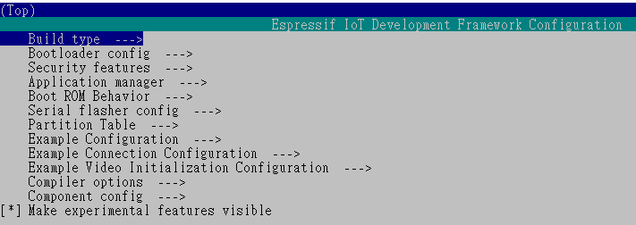

---
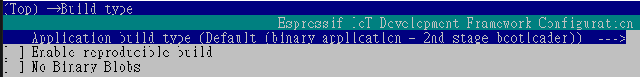
---

---
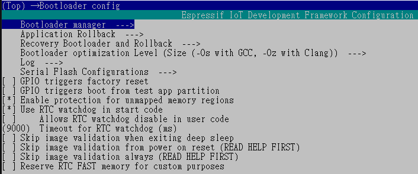
---
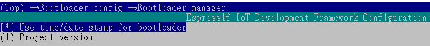
---

---

---
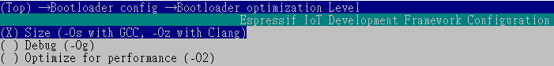
---
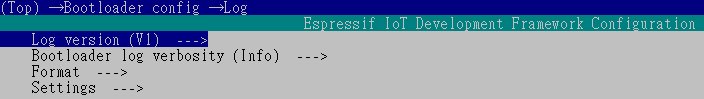
---

---
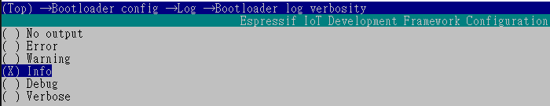
---

---
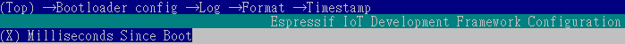
---
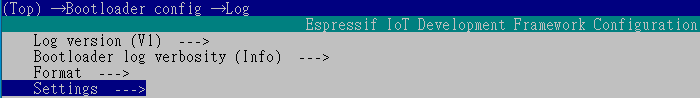
---

---

---
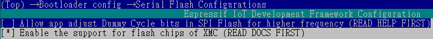
---
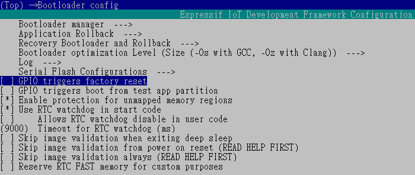
---
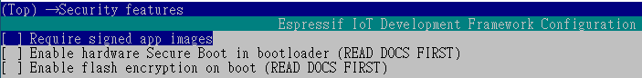
---

---
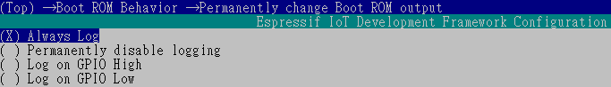
---
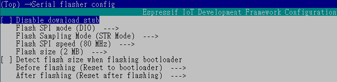
---
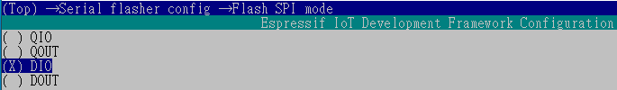
---

---
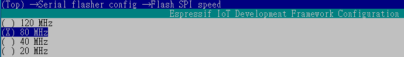
---
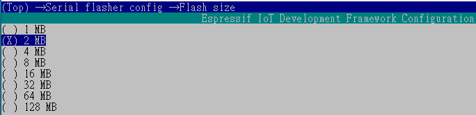
---

---

---
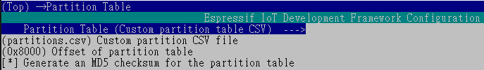
---
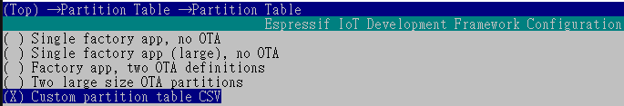
---
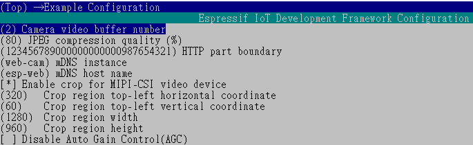
---

# managed_components/esp_ipa 功能與環境說明
## 一、 它到底是什麼
esp_ipa 是 ESP32-P4 的 ISP 影像處理演算法（Image Process Algorithm）管線系統，屬於 esp-video-components 開源倉庫中的一個 managed component。

### 基礎資訊
| 項目	| 內容 |
| ---- | ---- |
| 宣告版本	| 2.4.0 (idf_component.yml) |
| 目標晶片	| 僅限 esp32p4 |
| IDF 需求	| $\ge 5.4$ |
| 授權 Espressif  | MIT |
| 上游路徑	| esp-video-components/esp_ipa |
| 程式碼性質 | 演算法本體為封閉式預編譯 .a 庫；本資料夾僅提供 Header、JSON $\to$ C 產生器、少量 Glue Code 與測試程式 |
### 一句話總結： 讀取 ISP 統計值 $\to$ 執行演算法 $\to$ 計算下一幀要寫回 ISP/Sensor 的參數（曝光、增益、白平衡、色調、LSC 等），它是 IQ（Image Quality）自動調校 的核心。

## 二、 執行環境與相依性
### 1. 執行時期相依 (Runtime Dependencies)
- esp_driver_isp：取得 ISP 硬體驅動型別（如 isp_lsc_gain_t / isp_window_t）。
- esp_timer：用於時間管理。
- 核心依賴：esp_ipa_types.h 直接 #include "driver/isp.h"，所有結構體欄位皆依賴 ISP 驅動的常數（如 ISP_AE_REGIONS、ISP_HIST_SEGMENT_NUMS 等）。
- 同步機制：內部使用 pthread_mutex_t (於 esp_ipa_pipeline_t::mutex)。
### 2. 建置時期相依 (Build-time Dependencies)
- cmake_utilities：使用 cu_pkg_define_version()。
- Python 3：建置時執行 tools/config/esp_ipa_config.py 將 JSON 設定檔轉為 C 陣列。
### 3. 預編譯庫選擇矩陣 (CMakeLists.txt)
- 系統根據 IDF 版本與配置選擇對應的 .a 檔：

| IDF 版本	| 目錄	 | 選擇邏輯 |
| ---- | ---- | ---- |
| $\ge 6.0$	| v6.0+ | 預設 libesp_ipa.a；若 CONFIG_LIBC_NEWLIB=y 則選 _newlib 版 |
| $== 5.5$	| v5.5	 | libesp_ipa.a |
| 其他	| v5.4-	 | libesp_ipa.a |
- 特殊配置	-	若 CONFIG_ESP32P4_SELECTS_REV_LESS_V3 $\to$ 選用 _p4_less_v3 版
- 本專案實際選用結果（經 build\isp_tuning_fw.map 驗證）： managed_components/esp_ipa/lib/esp32p4/v6.0+/libesp_ipa.a (原因：IDF v6.1, CONFIG_LIBC_PICOLIBC=y, CONFIG_ESP32P4_SELECTS_REV_LESS_V3 未設定)

## 三、 資料夾結構說明
### 1. include/ —— 對外 API (核心開發重點)
| 檔案	| 功能 |
| ---- | ---- |
| esp_ipa.h	| Pipeline 生命週期管理 API |
| sp_ipa_types.h | 最核心：所有資料結構、列舉、Flags 定義 |
| esp_ipa_cmd.h	| esp_ipa_pipeline_ioctl() 的命令碼定義 |
| esp_ipa_detect.h	| 演算法自動註冊機制 ESP_IPA_DETECT_FN() 巨集 |
| esp_ipa_version.h	| 版本列印函式 |
- Pipeline API (esp_ipa.h)
- esp_ipa_pipeline_create(config, &handle)：依據名稱偵測並建立管線。
- esp_ipa_pipeline_init(handle, sensor, &metadata)：產生初始 ISP 參數。
- esp_ipa_pipeline_process(handle, stats, sensor, &metadata)：每幀核心流程（統計 $\to$ 參數）。
- esp_ipa_pipeline_set_config(handle, cfg, sensor, &metadata)：熱換 JSON 設定。
- esp_ipa_pipeline_ioctl(handle, cmd, data)：查詢/設定 AGC 狀態與曝光極值。
- 核心資料流型別 (esp_ipa_types.h)
    - esp_ipa_config_t：配置資訊（名稱、版本、各演算法指標）。
    - esp_ipa_ops_t：演算法實作表 { type, init, process, ioctl, destroy }。
    - esp_ipa_pipeline_t：管線實體（含 Mutex, IPA 陣列與全域變數 Map）。
    - esp_ipa_stats_t：輸入（ISP 統計：AWB, AE, Hist, Sharpen, AF 等）。
    - esp_ipa_sensor_t：輸入（Sensor 當前曝光、增益、AE 目標範圍等）。
    - esp_ipa_metadata_t：輸出（寫回 ISP 的參數：Gain, Exposure, BLC, Gamma, CCM, LSC 等）。
### 2. src/ —— 少量 Glue Code
- version.c：實作 esp_ipa_print_version()。
- esp_ipa_detect.c：實作 __wrap_esp_ipa_detect_get_array()，將偵測函式陣列交給預編譯庫。
### 注意：演算法本體全在 .a 庫中（如 esp_ipa_awb.c.obj, esp_ipa_agc.c.obj 等）。
### 3. linker.lf —— 動態註冊機制
- 當啟用 CONFIG_ESP_IPA_DETECT_METHOD_DYNAMIC_LINK 時，透過 Linker Script 將所有 ESP_IPA_DETECT_FN() 產生的結構體排列在 Flash 的 .esp_ipa_detect 區段，形成連續陣列供預編譯庫走訪。

### 4. Kconfig —— 功能開關
- 提供 10 個演算法的開啟/關閉選項（預設全開）。
- CONFIG_ESP_IPA_CONFIG_PARAM_VERSION：必須與 JSON 的 version 欄位一致。
- ESP_IPA_DETECT_METHOD：選擇 DYNAMIC_LINK (預設) 或 STATIC_STORE。
### 5. tools/config/ —— JSON $\to$ C 產生器
- 此為唯一擁有完整原始碼邏輯的部分，將感測器 JSON 轉為 C 代碼：

- esp_ipa_config.py：主程式，處理多檔合併與驗證。
- 模組化產生器：isp/acc.py (CCM/LSC), isp/agc.py (AE/Gain), isp/awb.py (AWB), isp/aen.py (Gamma/Sharpen) 等。
## 四、 內含的 10 個演算法對照表
| JSON 鍵 | 演算法名稱 | 主要產出的 Metadata |
| ---- | ---- | ---- |
| ian	| Image Analyze	| 色溫 (CT)、環境亮度 (Env Luma) $\to$ 寫入管線 KV |
| awb	| Auto White Balance	| red_gain, blue_gain (支援 4 種 Model) |
| agc	| Auto Gain/Exposure	| exposure, gain (含防閃爍、PWL 目標偏移) |
| acc	| Auto Color Correction	| ccm, lsc (兩層表), saturation, blc |
| aen	| Auto Enhancement	| gamma (含背光表), sharpen, contrast |
| adn	| Auto Denoising	| bf (Bayer 濾波), demosaic |
| dpc	| Dead Pixel Correction	| dpc 動態壞點門檻 |
| atc	| Auto Sensor AE Target	| ae_target_level (針對自帶 AEG 的 Sensor) |
| af	| Auto Focus	| af 視窗, focus_pos (馬達位置) |
| ext	| Extended	| hue, brightness, stats_region |
## 五、 實際使用狀況分析 (驗證結果)
- JSON 來源：由 esp_cam_sensor 指定 $\to$ sc2336_default_p4_eco5.json $\to$ 附加至 ESP_IPA_JSON_CONFIG_FILE_PATH。
- 產生結果：產生 esp_video_ipa_config.c (約 212 KB)，包含 SC2336 的 AWB Zones 及 Ref Points 等常數表。
- 執行狀態：⚠️ 目前未在執行。
- 原因：CONFIG_ESP_VIDEO_ENABLE_ISP_PIPELINE_CONTROLLER 為 未設定 (Not set)。
- 現狀：雖然 .a 庫被強行鏈入 Flash (佔用空間)，但 esp_video_isp_pipeline 相關符號未被使用，因此執行期不會跑 IPA 管線。
## 六、 既有問題觀察 (Bug/Issues)
- API 命名不一致：esp_ipa_config.py 產生的 stub 函式名為 esp_video_isp_pipeline_get_ipa_config()，但 Header 宣告為 esp_ipa_pipeline_get_config()。
- 型別不符：Stub 函式回傳 const void *，而 Header 要求 const esp_ipa_config_t *。
- 語法瑕疵：esp_ipa_version.h:18 的函式宣告後缺少分號 ;。
- 型別轉換告警：esp_ipa_cmd.h 的 IO 巨集展開為 long，但 ioctl 參數為 uint32_t，在嚴格編譯下會觸發轉換告警。
- 版控污染：tools/config/ 下包含 .pyc 快取檔案，應被 .gitignore 排除。
## 七、 最終總結
- managed_components/esp_ipa 是 ESP32-P4 專用的 ISP 自動調參引擎。

### 它以 JSON 設定檔為基礎，建立一條由 10 個演算法組成的 Pipeline。每幀輸入 ISP 統計值 與 Sensor 狀態，輸出 ISP 硬體參數 (esp_ipa_metadata_t)。其本體為封閉的預編譯庫，公開 API 與 JSON 產生工具。在本韌體中，該組件已被鏈入但因配置未開啟而處於閒置狀態。