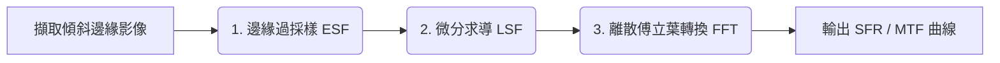

# MTF 與 SFR 的差異與測試詳細方法說明

**MTF（調製傳遞函數）是一個理論與物理概念，而 SFR（空間頻率響應）則是測量該概念的具體數位演算方法。** 

簡單來說，MTF 描述了光學系統（如鏡頭）將鏡頭前的線條對比度還原到感測器上的能力；而 SFR 則是國際標準（如 ISO 12233）所定義，透過拍攝「斜邊影像（Slanted Edge）」並經由數學計算來推導出該系統 MTF 的實作方法。

---

## 一、 MTF 與 SFR 的核心差異

| 比較項目 | MTF (Modulation Transfer Function) | SFR (Spatial Frequency Response) |
| :--- | :--- | :--- |
| **定義** | 光學系統對不同空間頻率的**對比度傳遞能力**。 | 經由特定演算法（如斜邊法）計算出的**空間頻率響應曲線**。 |
| **本質** | 偏向**理論與光學物理**的基礎概念。 | 偏向**數位影像訊號處理**的量化量測方法。 |
| **測試標的** | 傳統上使用純黑白相間的**正弦波或矩形波條紋**圖表。 | 使用帶有特定傾斜角度的**黑白高對比斜邊**圖表。 |
| **影響因素** | 純光學表現（鏡頭衍射、像差等）。 | 光學表現 + 感測器像素、雜訊與影像銳化演算法（ISP）。 |

---

## 二、 詳細測試過程與方法

目前最主流且被廣泛應用的測試方法為 **ISO 12233 斜邊法（Slanted-Edge Method）**，以下為其詳細的測試步驟與數學推導過程：

### 1. 環境與硬體架設
* **測試圖卡準備**：準備一張符合標準的測試圖卡（如 ISO 12233 圖卡），圖卡上必須包含與水平或垂直方向**傾斜 2 到 5 度**的黑白交界斜邊（Slanted Edge）。
* **光源與照明**：使用高均勻度、無頻閃的測試燈箱或光源。確保圖卡表面照度均勻（均勻度 > 90%），避免產生眩光或不必要的反射。
* **相機對齊**：將待測相機固定於堅固的翻拍台或三腳架上。確保相機感光元件（CMOS/CCD）與測試圖卡**完全平行**，並將光軸對準圖卡中心。
* **拍攝參數設定**：關閉相機內建的自動銳化、降噪等 ISP 處理（通常使用 RAW 檔拍攝）。設定適當的曝光，確保黑白交界處**沒有過曝（飽和）或過暗（剪裁）**。

### 2. 影像擷取與感興趣區域（ROI）選取
* 拍攝高畫質影像後，在電腦分析軟體中選取包含該傾斜邊緣的**感興趣區域（ROI, Region of Interest）**。
* ROI 必須跨越黑白兩側，且包含足夠的像素以進行統計。

### 3. SFR 數學演算法處理流程
選定 ROI 後，測試軟體（如 Imatest 或自行撰寫的 MATLAB 程式）會執行以下四個關鍵數學步驟：

* **計算邊緣擴散函數（ESF, Edge Spread Function）**
  * 因為邊緣是傾斜的，每一行（Row）像素穿過黑白邊界的像素坐標會有微小的水平位移。
  * 演算法會精準計算出邊緣的精確角度與中心線。
  * 將多行像素的灰階數值（Pixel Profiles）沿著邊緣方向投影、疊加並重組，形成一條超高解析度（通常是 4 倍過採樣）的灰階過渡曲線，這條曲線稱為 **ESF**。
* **計算線擴散函數（LSF, Line Spread Function）**
  * 對上述的 ESF 曲線進行**一階微分（Mathematical Differentiation）**。
  * 微分後的結果會從「階梯狀的過渡曲線」變成一個「類似鐘形的脈衝波（Impulse Response）」，這個脈衝波曲線即為 **LSF**。LSF 的寬度反映了邊緣的模糊程度。
* **執行快速傅立葉轉換（FFT）**
  * 將時域/空域的 LSF 曲線進行**快速傅立葉轉換（FFT）**，將其轉換至「空間頻率域（Spatial Frequency Domain）」。
* **歸一化輸出（Normalization）**
  * 將 0 空間頻率（DC 分量）的對比度值設為 1（即 100%）。
  * 最終得到的頻率與對比度關係曲線，就是該影像系統的 **SFR 曲線**（在排除了演算法干擾的前提下，即等同於該系統的 MTF）。

---

## 三、 常見的測試數據解讀

光學與鏡頭測試中指的是調變轉換函數（Modulation Transfer Function，簡稱 MTF）在不同對比度下降幅度的臨界點，用來量化評估鏡頭的解像力、銳利度與對比度。

簡單來說，MTF 的數值（如 50、30、10）代表影像對比度衰減到特定百分比時，所能呈現的空間頻率（通常以 lp/mm 線對/毫米，或 cycles/pixel 每個像素的週期表示）。頻率數值越高，代表鏡頭在該對比度下能看清越細微的紋理。

在分析 SFR 曲線時，業界通常會關注以下幾個關鍵指標：

* **MTF50（或 SFR50）**：對比度下降到初始值 **50%** 時的空間頻率（單位通常為 `LP/mm` 或 `Cycles/Pixel`）。這是評估人類視覺感知「銳利度（Sharpness）」最常用的指標。
* **MTF10（或 SFR10）**：對比度下降到 **10%** 時的空間頻率。這通常被視為人類肉眼能分辨出線條邊界的極限，用來評估系統的「極限解析度（Resolution）」。
* **過沖（Overshoot / Undershoot）**：如果測試出來的 SFR 曲線在低頻處大於 1（> 100%），代表相機內部進行了**人為的數位銳化處理**（Edge Enhancement），這在評估純光學鏡頭時需要特別注意並加以剔除。

## 四、 MTF 與 SFR:計算公式與原理
### 1. 基本概念
### `MTF(Modulation Transfer Function,調制傳遞函數)`  
描述光學/成像系統在不同空間頻率下,能保留多少對比度。數值介於 0~1(或 0~100%),越高代表細節越清楚。
### `SFR(Spatial Frequency Response,空間頻率響應)`
是量測 MTF 的一種方法(ISO 12233 標準),透過拍攝「斜邊(slanted edge)」圖卡,從邊緣影像推算出 MTF 曲線。

### 簡單說:MTF 是「指標」,SFR 是「用斜邊量出這個指標的方法」。
### 2. MTF 的定義與公式
1. `對比度(調制度)`  
對一組正弦條紋:
## $$M = \frac{I_{max} - I_{min}}{I_{max} + I_{min}}$$

2. MTF 定義
## $$MTF(f) = \frac{M_{image}(f)}{M_{object}(f)}$$
即「影像對比度 ÷ 物體對比度」,f 為空間頻率(單位:lp/mm、cycles/pixel 或 cycles/mm)。

3. 與 PSF/LSF 的關係(核心原理)
系統對點光源的響應稱為 PSF(Point Spread Function)。MTF 是 PSF 傅立葉轉換後的振幅:
## $$MTF(f) = \left| \mathcal{F}\{PSF\} \right|$$
由於一維量測使用線擴散函數 LSF:
## $$MTF(f) = \left| \int LSF(x)\, e^{-j2\pi f x}\, dx \right|$$
4. 系統 MTF 的串接
各元件(鏡頭、感測器、濾光片、演算法)的 MTF 相乘:
## $$MTF_{system} = MTF_{lens} \times MTF_{sensor} \times MTF_{processing}$$

### 3. SFR(斜邊法)計算步驟
ISO 12233 的流程如下:
| 步驟	| 內容	| 目的 |
| ---- | ---- | ---- |
| 1	| 拍攝傾斜約 5° 的黑白邊緣 | 利用傾角做超取樣 |
| 2	| 擷取 ROI,線性化(去 gamma / OECF) | 還原線性亮度 |
| 3	| 估計邊緣位置與角度(線性擬合)	| 找出精確斜率 |
| 4	| 將各列像素依到邊緣的距離投影,合併成超取樣 ESF(4 倍)	| 突破像素取樣限制 |
| 5	| 微分:ESF → LSF	| 取得線擴散函數 |
| 6	| 加窗(如 Hamming)	| 降低截斷造成的頻譜洩漏 |
| 7	| FFT 後取絕對值並正規化(f=0 時為 1)	| 得到 MTF/SFR 曲線 |

關鍵公式
ESF → LSF(微分):

## $$LSF(x) = \frac{d\,ESF(x)}{dx}$$

離散形式:$LSF[n] = ESF[n+1] - ESF[n]$
LSF → SFR(傅立葉轉換):

## $$SFR(f) = \frac{\left|\,FFT\{LSF[n]\cdot w[n]\}\,\right|}{\left|\,FFT\{LSF[n]\cdot w[n]\}\,\right|_{f=0}}$$
### 為什麼要斜邊?
### 若邊緣完全垂直,每列取樣位置相同,只能得到像素級取樣(會混疊 aliasing)。傾斜 5° 後,不同列相對邊緣的位移不同,合併後可得到子像素級的 ESF,等於 4 倍超取樣。

### 4. 常用評價指標
| 指標	| 說明 |
| ---- | ---- |
| MTF50	| MTF 降到 50% 的頻率,最常用於比較銳利度 |
| MTF30 / MTF20	| 接近人眼可辨識極限(約 10%~30%) |
| Nyquist 頻率	| 0.5 cycles/pixel,取樣理論極限 |
| MTF @ Nyquist/4	| 常用於相機模組規格 |
| Acutance	| 結合人眼對比敏感度(CSF)的主觀銳利度 |

### 5. 頻率單位換算
cycles/pixel:最直接的數位單位,Nyquist = 0.5
lp/mm(線對/毫米):
## $$f_{lp/mm} = \frac{f_{cycles/pixel}}{\text{pixel pitch (mm)}}$$

例:像素大小 1.4 μm → Nyquist = 0.5 / 0.0014 ≈ 357 lp/mm

***LW/PH***(Line Widths per Picture Height):用於跨不同解析度相機比較

### 6. 實務注意事項
1. ***ROI 不要太小***:建議至少 40×40 像素以上,否則頻譜解析度不足。
2. ***需做線性化***:未去 gamma 會讓 MTF 偏高/偏低。
3. ***雜訊影響***:高頻端受雜訊墊高,可能出現 MTF 異常上升。
4. ***銳化(Sharpening)***:會讓 MTF 超過 1(過衝),量測時要注意 ISP 設定。
5. ***邊緣對比***:建議使用約 4:1 對比(非純黑白),避免飽和。
6. ***多視場位置量測***:中心、0.5 視場、0.8 視場,以及切向(Tangential)/徑向(Sagittal)分別量。
## 各指標的核心定義與代表意義

指標 | 核心定義 | 實務代表意義
| ---- | ---- | ---- |
| MTF50 | 對比度降至低頻（初始）值 50% 時的空間頻率 | 人眼視覺感受的「銳利度」。許多研究指出，MTF50 是人類主觀判斷影像是否清晰、銳利的關鍵分水嶺，為業界最通用的評估基準。| 
| MTF50P | 對比度降至「峰值（Peak）」50% 時的空間頻率 | 防過度銳化的修正指標。若影像經過軟體過度銳化（Oversharpening），MTF50 的數值會虛高；此時改用 MTF50P 能排除偽影干擾，更穩定地反應真實畫質。 |
| MTF30 | 對比度降至 30% 時的空間頻率 | 工業或商用鏡頭的清晰度門檻。在很多機器視覺與光學系統評估中，MTF30 被視為可接受影像質量的下限。 | 
| MTF20 | 對比度降至 20% 時的空間頻率 | 低對比度環境下的解析極限。常用於模擬早期類比電視線（TV Lines）或測試極端光照條件下的細節留存能力。 |
| MTF10 | 對比度降至 10% 時的空間頻率 | 鏡頭的「絕對極限解像力」。對比度低於 10% 時人眼已幾乎無法分辨，此指標代表鏡頭能勉強捕捉到的最微小細節（極限邊緣），接近光學物理上的繞射極限（瑞利準則）。 |