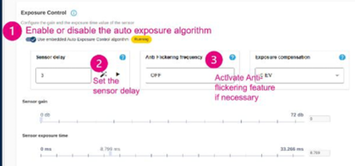
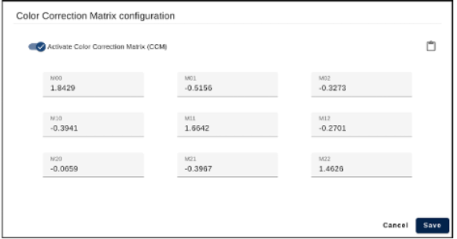
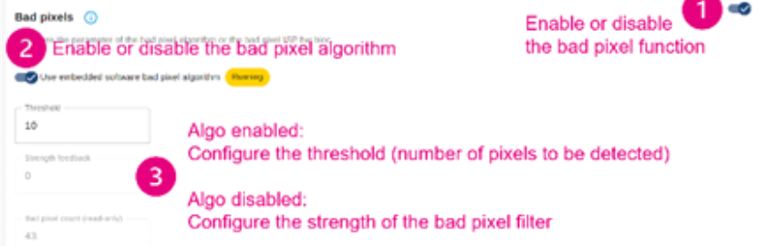
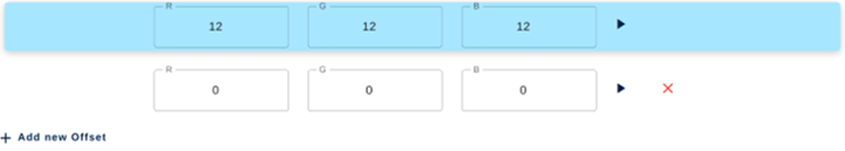
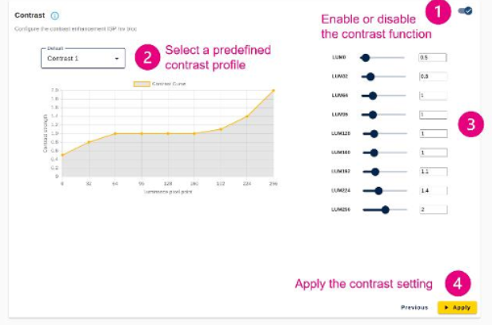
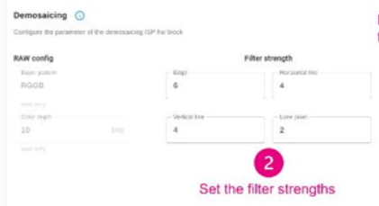
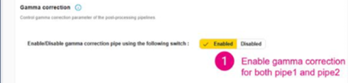

# STM-32 IQ 影像參數說明

ov08f10.yaml 是由 STM32 ISP IQTune 工具針對 OmniVision OV08F10 感測器在 STM32 DCMIPP（數位攝像機記憶體介面像素處理器）IPA（影像處理演算法）環境下自動產生的 YAML 格式配置文件。
該檔案定義了 8 個核心影像處理演算法（Algorithms）模組的參數與啟閉狀態，以下為每一個模組與參數的詳細功能與數值解析：
## 1. Aec（Auto Exposure Control / 自動曝光控制）
配置感測器的自動曝光演算法參數，負責調控影像的整體亮度。
```
- Aec:
      AnalogueGain_dB: 5.743     # 目前/初始感測器類比增益 (dB)
      ExposureTime: 51543        # 目前/初始曝光時間 (μs)
      AeEnable: true             # 自動曝光算法已啟用
      ExposureValue: 0.0         # 曝光補償 EV 值
      AntiFlickerFreq: 0         # 抗閃爍頻率設定
      SensorDelay: 3             # 感測器反應延遲 (frames)
      LuxRef:                    # 照度與曝光對照校準矩陣
        Lux: [1000, 250]
        Expo: [5000, 30000, 10000, 30000]
        Lum: [20, 100, 10, 30]
        CalibFactor: 1.000
```
- ### AnalogueGain_dB: 5.743：初始/預設的感測器類比增益（單位：分貝 dB）。5.743 dB 約等於 1.93 倍的硬體訊號放大率。
- ### ExposureTime: 51543：初始/預設曝光時間（單位：微秒 μs，即約 51.54 ms）。
- ### AeEnable: true：自動曝光演算法開關（true 表示啟用自動曝光，由演算法根據畫面亮度動態調整曝光與增益）。
- ### ExposureValue: 0.0：曝光補償值（Exposure Compensation，單位為 EV），0.0 代表預設基準目標亮度（+1 EV 為亮度翻倍，-1 EV 為減半）。
- ### AntiFlickerFreq: 0：抗閃爍頻率設定（0 代表關閉抗閃爍，可設為 50Hz 或 60Hz 以消除日光燈電力頻率造成的畫面條紋）。
- ### SensorDelay: ：感測器反應延遲影格數，即寫入曝光/增益暫存器後，感測器需要經過 3 幀（Frames） 才能將新設定反映在畫面中。
- ### LuxRef：照度（Lux）與曝光關係的參考對照表，用於估算環境光照度：
    - Lux: ：測試環境的照度參考點（1000 Lux 高照度與 250 Lux 低照度）。ㄋ
    - Lum:：目標畫面輝度/亮度參考值。
    - CalibFactor: 1.000：照度校準因子（預設校準係數為 1.0）。
  

## 2. Awb（Auto White Balance / 自動白平衡）
管理不同光源下色彩還原的增益與色彩校正矩陣 (CCM)。
```
- Awb:
      FixedGainEnable: true
      FixedGainR: 182000000
      FixedGainG: 100000000
      FixedGainB: 139000000
      FixedCconvEnable: true
      FixedCconv: [384600000, -267770000, -16830000, 16769999, 77470000, 5760000, 45780000, -298030000, 352250000]
      AwbEnable: true
      ProfileName: ["JudgeII-A-cp", "JudgeII-TL84-cp", "JudgeII-DAY-cp", "Free Slot", "Free Slot"]
      RefColorTemp: [2810, 4015, 6650, 0, 0]
      GainR: [112000000, 145000000, 182000000, 0, 0]
      GainG: [100000000, 100000000, 100000000, 0, 0]
      GainB: [225000000, 204999999, 139000000, 0, 0]
      Cconv: [68560000, 33030000, -1590000, 479998, 80830000, 18700000, 410000, -32210000, 131800000, 56520000, 46370000, -2900000, -1020000, 88480000, 12540000, -10000, -3420000, 103430000, 384600000, -267770000, -16830000, 16769999, 77470000, 5760000, 45780000, -298030000, 352250000, 0, 0, 0, 0, 0, 0, 0, 0, 0, 0, 0, 0, 0, 0, 0, 0, 0, 0]
      ReferenceRGB: [62, 67, 38, 54, 70, 42, 46, 71, 56, 0, 0, 0, 0, 0, 0]
```
- ### FixedGainEnable: true：是否啟用固定白平衡增益（true 表示套用預設的靜態增益）。
- ### FixedGainR: 182000000 / FixedGainG: 100000000 / FixedGainB: 139000000：固定白平衡 R/G/B 通道增益（使用定點數表示，需除以 $10^8$）。綠色 (G) 1.0 倍為基準，紅色 (R) 為 1.82 倍，藍色 (B) 為 1.39 倍。
- ### FixedCconvEnable: true：是否啟用固定的 3x3 色彩校正矩陣 (CCM)810。
- ### FixedCconv：9 個數值組成的 3x3 色彩轉換矩陣係數（定點數除以 $10^8$）。例如第一個係數 $384600000 / 10^8 = 3.846$。
- ### AwbEnable: true：自動白平衡演算法總開關（true 表示啟動 AWB 動態切換）。
- ### ProfileName：演算法管理的白平衡設定檔名稱（最多支援 5 組）9： 
    - ## ["JudgeII-A-cp", "JudgeII-TL84-cp", "JudgeII-DAY-cp", "Free Slot", "Free Slot"]：
    包含 A 光（鎢絲燈）、TL84（室內螢光燈）、DAY（日光）三組實測設定檔，其餘 2 組為預留空位。
- ### RefColorTemp: ：對應三組光源的測得色溫（開爾文 K）：A 光 2810K、TL84 4015K、日光 6650K。
- ### GainR / GainG / GainB：不同色溫光源下對應的白平衡增益數值：
    - GainR：[1.12, 1.45, 1.82, 0, 0]
    - GainG：[1.0, 1.0, 1.0, 0, 0]（綠色固定為 1.0x）
    - GainB：[2.25, 2.05, 1.39, 0, 0]
  
- ### Cconv：5 組設定檔展平後的 CCM 矩陣係數陣列（共 45 個數值），演算法會根據色溫自動插值套用。
  
- ### ReferenceRGB：校準時 ColorChecker 色卡上參考色塊的基準 RGB 數值。

## 3. BadPixel（壞點校正）
用於偵測與修補感測器上的異常亮點（死點/熱點）。
```
  - BadPixel:
      Enable: false
      Strength: 0
      Threhsold: 0
```
- ### **Enable**: false：壞點校正功能開關（此處設為 false，代表停用，因為現代感測器硬體多已自行修正）。
- ### **Strength**: 0：濾波器強度（0 至 7，0 代表最高容忍度，7 代表最激進偵測）。
- ### **Threhsold**: 0：自動壞點軟體演算法預期偵測的壞點數量閾值。
  

## 4. BlackLevelCorrection（黑位補償 / BLC）
```
- BlackLevelCorrection:
      Enable: true
      Level: [15, 15, 15]
```
扣除感測器在全黑狀態下的正像暗電流偏移量，確保黑景不偏色。
- Enable: true：黑位補償功能開關（true 表示啟用）。
- Level:9：R、G、B 通道各自扣除的黑位偏移數值（此處各通道統一扣除 15 LSB，使全黑時 $R=G=B=0$）。
  

## 5. Contrast（對比度調整）
透過非線性曲線調整影像亮度與對比度。
```
- Contrast:
      Enable: false
      LuminanceFactor: [0, 0, 0, 0, 0, 0, 0, 0, 0]
```
- Enable: false：對比度模組開關（目前設為 false 停用）。
- LuminanceFactor: ：亮度分段調整係數（皆為 0 代表無額外調整）。
  

## 6. Demosaicing（去馬賽克 / 色彩插值）
將感測器原始的 RAW Bayer 格式轉換為 24-bit RGB888 彩色影像。
```
- Demosaicing:
      Enable: true
      Filter: [2, 4, 4, 6]
```
- ### nable: true：去馬賽克模組開關（true 表示啟用）。
- ### Filter:：內部 3x3 啟發式自適應濾波器的強度設定（數值範圍 07，0 為純線性插值，17 為偵測強度递增）：
    1. Edge（邊緣偵測強度）：
    2. Horizontal line（水平線偵測強度）：
    3. Vertical line（垂直線偵測強度）：
    4. Lone pixel（孤立像素/點雜訊偵測強度）：  
    

## 7. Statistic（統計區域配置）
定義 3A（AE/AWB）演算法計算畫面統計數據的區域。
```
- Statistic:
      Area: [0, 0, 1632, 1224]
      Profile: 2
```
- ### Area: ：統計區域座標 
**[Top-Left X, Top-Left Y, Width, Height]**。此處設為從左上角 $(0,0)$ 開始，涵蓋寬度 1632 像素、高度 1224 像素的範圍。
- ### Profile: 2：目前選用的統計模式編號（預設使用 Profile 2 模式進行數據統計）。

## 8. GammaCorrection（伽瑪校正）將影像進行 Gamma 壓縮以符合顯示器 sRGB 呈現。
```
- ### GammaCorrection:
      Enable: false
```
- ### Enable: false：配置文件中目前設為 false 停用（若啟用，ISP 硬體會套用標準 2.2 伽瑪指數曲線進行非線性壓縮）。  
    

### 總結：這份檔案完整紀錄了 OV08F10 在該硬體平台上經過 IQTune 調校後的最佳化參數，涵蓋了黑位 (BLC)、去馬賽克 (Demosaicing)、自動曝光 (AEC) 以及三種標準光源（A光、TL84、日光）下的 AWB 增益與色彩校正矩陣 (CCM)。