# SigmaStat ISP API 參數說明

SigmaStar 平台的 ISP API 主要是由底層系統庫（如 `libmi_isp.so`、`libmi_ldc.so`）及標頭檔（`mi_isp.h`、`mi_isp_iq.h`、`mi_isp_cus3a_api.h`、`mi_ldc.h`）所提供。API 涵蓋了系統控制、3A 演算法、基礎校正、降噪與銳化、色彩與動態範圍控制，以及鏡頭畸變校正（LDC）等各大模組。

以下為您按功能領域分類列舉的主要 ISP API：

---

### **1\. 系統控制與通用管理 API**

負責 ISP 初始化狀態確認、版本獲取、模組 Bypass 與檔案載入：

* **MI\_ISP\_IQ\_GetVersionInfo** **/** **MI\_ISP\_IQ\_SetVersionInfo**：取得與設定 IQ 版本資訊。
* **MI\_ISP\_IQ\_GetParaInitStatus**：查詢 ISP 初始化是否 Ready（狀態為 1 時才可載入 Bin 檔或呼叫 API）。
* **MI\_ISP\_IQ\_GetIQind**：取得當前的曝光指數 (ISO Index)。
* **MI\_ISP\_IQ\_SetIQMode** **/** **MI\_ISP\_IQ\_GetIQMode**：設定與取得日夜模式（Day / Night Mode，適用於 RGBIR 夜視）。
* **MI\_ISP\_IQ\_SetAPIBypassMode** **/** **MI\_ISP\_IQ\_GetAPIBypassMode**：設定/取得特定 ISP 模組的 Bypass（略過）狀態。
* **MI\_ISP\_API\_CmdLoadBinFile**：載入由 IQ Tool 調校輸出的 API 指令 Bin 檔案（`*.bin`）。
* **MI\_ISP\_API\_CmdLoadCaliData**：載入離線校正產出的資料檔案（`*.data`）。

---

### **2\. 3A 控制與自訂 3A API (3A &amp; Custom 3A APIs)**

包含自動曝光（AE）、自動白平衡（AWB）與自動對焦（AF）的底層控制與客製化介面：

* **AE (Auto Exposure) API**：
  * **MI\_ISP\_AE\_QueryExposureInfo**：查詢目前曝光資訊。
  * **MI\_ISP\_AE\_GetManualShortExpo** **/** **MI\_ISP\_AE\_SetState**：取得手動短曝光值與控制 AE 運作狀態（Normal / Pause）。
  * **MI\_ISP\_AE\_SetPlainLongExpoTable** **/** **MI\_ISP\_AE\_SetPlainShortExpoTable**：設定長/短曝光行程表。
  * **MI\_ISP\_AE\_SetStrategy** **/** **MI\_ISP\_AE\_GetStrategyEX**：設定與查詢曝光策略與防過曝參數。
  * **MI\_ISP\_CUS3A\_SetAECropSize** **/** **SetAEWindowBlockNumber** **/** **SetAEHistogramWindow**：自訂 AE 統計裁切、分塊數與直方圖視窗。
* **AWB (Auto White Balance) API**：
  * **MI\_ISP\_AWB\_QueryInfo**：查詢白平衡當前狀態。
  * **MI\_ISP\_AWB\_SetMultiLSAttr**：設定多光源/混光色偏校正屬性。
  * **MI\_ISP\_AWB\_GetStabilizer**：設定與取得 AWB 穩定器參數。
  * **MI\_ISP\_CUS3A\_SetAWBCropSize** **/** **SetAwbSampling**：設定 AWB 統計區域與採樣率。
* **AF (Auto Focus) API**：
  * **MI\_ISP\_AF\_QueryInfo** **/** **MI\_ISP\_AF\_SetHWRoiMode** **/** **MI\_ISP\_AF\_GetHWWin**：查詢 AF 資訊、設定 ROI 模式與取得統計視窗。
  * **MI\_ISP\_AF\_SetHWFilterAttr** **/** **MI\_ISP\_AF\_SetHWFilterSq**：設定 AF 濾波器與 Square 統計參數。
  * **MI\_ISP\_AF\_SetHWSource** **/** **SetHWYMap** **/** **SetHWLdg**：設定統計值抽樣位置、Y Mapping 及 LDG 衰減係數。
  * **MI\_ISP\_AF\_SetAttr** **/** **SetMotor** **/** **SetOneShot** **/** **SetSearch**：設定 AF 屬性、馬達驅動、單次對焦與對焦搜尋範圍。

---

### **3\. 基礎硬體校正 API (Calibration APIs)**

* **OBC (黑電平校正)**：`MI_ISP_IQ_SetOBC` / `MI_ISP_IQ_GetOBC`。
* **LSC / ALSC (陰影與自適應陰影補償)**：`MI_ISP_IQ_SetLSC` / `GetLSC` / `SetLSC_CTRL` / `SetALSC` / `GetALSC_CTRL`。
* **CCM (色彩矩陣)**：`MI_ISP_IQ_QueryCCMInfo`。
* **DPC (動態壞點校正)**：`MI_ISP_IQ_SetDynamicDP` / `GetDynamicDP` 及 `MI_ISP_IQ_SetDynamicDP_CLUSTER` (群聚壞點)。

---

### **4\. 降噪與邊緣增強 API (Denoise &amp; Edge Enhancement APIs)**

* **3D 降噪 (NR3D)**：`MI_ISP_IQ_SetNR3D` / `GetNR3D` / `SetNR3D_EX`。
* **DeSpike 降噪**：`MI_ISP_IQ_SetNRDeSpike` / `GetNRDeSpike`。
* **空域亮度降噪 (NRLuma)**：`MI_ISP_IQ_SetNRLuma` / `GetNRLuma` 及進階版 `MI_ISP_IQ_SetNRLuma_Adv` / `GetNRLuma_Adv`。
* **色彩降噪 (NRChroma)**：`MI_ISP_IQ_SetNRChroma` / `SetNRChroma_Adv` / `SetNRChroma_Pre`[46]。
* **銳利度 (Sharpness)**：`MI_ISP_IQ_SetSharpness` / `GetSharpness` 及進階版 `MI_ISP_IQ_SetSHP_EX`。
* **Crosstalk (串擾補償)**：`MI_ISP_IQ_SetCrossTalk` / `GetCrossTalk`。
* **去偽彩 (False Color)**：`MI_ISP_IQ_GetFalseColor`。
* **紫邊抑制 (PFC)**：`MI_ISP_IQ_SetPFC` / `GetPFC` / `GetPFC_EX`。

---

### **5\. 色彩、對比度與動態範圍 API (Color &amp; Dynamic Range APIs)**

* **Gamma 曲線**：`MI_ISP_IQ_SetAdaptiveGamma` / `GetAdaptiveGamma`。
* **基礎畫質 (Brightness / Contrast / Lightness / Saturation)**：`MI_ISP_IQ_SetBrightness` / `GetContrast` / `SetLightness` / `SetSaturation`。
* **HSV (局部色相與飽和度)**：`MI_ISP_IQ_GetHSV`。
* **寬動態與去霧 (WDR / Defog)**：`MI_ISP_IQ_SetWDR` / `GetWDR` / `SetWDRCurveFull` / `SetDefog`。
* **HDR (高動態範圍)**：`MI_ISP_IQ_SetHDR_EX`。
* **色彩空間轉換與插值**：`MI_ISP_IQ_SetDEMOSAIC` / `SetR2Y` / `SetCOLORTRANS`。
* **環境與日夜偵測**：`MI_ISP_IQ_SetDayNightDetection` / `SetTEMP` / `GetTEMP_INFO`。

---

### **6\. 鏡頭畸變校正 API (LDC APIs)**

專門處理鏡頭魚眼或廣角畸變修正的獨立模組：

* **設備與通道管理**：`MI_LDC_CreateDevice`, `MI_LDC_DestroyDevice`, `MI_LDC_CreateChannel`, `MI_LDC_DestroyChannel`, `MI_LDC_StartChannel`, `MI_LDC_StopChannel`。
* **組態與初始化**：`MI_LDC_SetConfig`, `MI_LDC_InitDev`, `MI_LDC_DeInitDev`, `MI_LDC_SetBatchViewConfig`。

---

### **7\. 內部 API ID 列舉 (** **MI\_ISP\_API\_ID\_e** **)**

在底層 API Bypass 或內部模組開關時，系統會以列舉編號（如 `MI_ISP_API_ID_e`）來代表各模組，例如：`API20_OBC` (4)、`API20_NR_3D` (10)、`API20_SHP2` (9)、`API20_DEFOG` (17)、`API20_WDR_LOC` (21)、`API20_ALSC` (37)、`API20_HSV` (20) 等。

## 💡camera 中 AE index 如何判定
在相機與 ISP（影像訊號處理器）系統中，AE Index（自動曝光索引，在 SigmaStar 系統中常稱作 ISO Index、IQ Index 或 BV 值） 是系統用來衡量當前環境光照強度與系統感光度的核心指標。
AE Index 的判定主要透過「硬體採樣 ➔ 加權計算 ➔ APEX 算式推導 ➔ 離散映射與收斂」四個階段完成：
### 一、 AE Index 的判定與計算流程
#### 1. 硬體採樣與分塊統計 (Hardware Statistics)
- **畫面分割**：ISP 硬體將 Raw 畫面切分為 $M \times N$ 個分塊（例如 $32 \times 32$ 或 $128 \times 90$）。
- **採樣數據**：統計每個分塊內像素的 R、G、B、Y 平均值 (ISP_AE_SAMPLE)，並收集全畫面的亮度直方圖 (Histogram)。
#### 2. 加權平均亮度計算 (Weighted Luma)
- 空間測光權重 (WindowWeighting)：根據設定的測光模式（平均測光、中央重點測光、點測光或 16x16 權重矩陣），給予不同區域分塊不同的計算權重。
- 亮度增益加權 (AELumaWeight)：針對過亮或過暗的像素給予動態權重，算出當前畫面的加權平均亮度 WeightY。
#### 3. 結合曝光三要素與 APEX 公式計算 $BV$
AE 演算法依據國際標準 APEX (Additive System of Photographic Exposure) 系統算式： 
$$\text{EV} = \text{Av} + \text{Tv} = \text{Sv} + \text{Bv}$$
- 已知參數：
    - 光圈 $Av$（FNx10）
    - 快門時間 $Tv$（Shutter / $\mu s$）
    - 總增益 $Sv$（Total Gain = Sensor Gain × ISP Gain）
- 推算 $BV$ (Brightness Value)：AE 演算法比較加權平均亮度（Cur Y）與目標亮度（AE Target），計算出當前環境的實際亮度估測值 BV (u4BVx16384) 以及光照度 LV (LVx10)。
#### 4. 離散化映射與 ISO Index 判定
- 對應 IQ Index 節點：系統將計算出的 $BV$ 或 Total Gain，映射到 IQ Table 設定的離散節點（例如 Index 0 ~ 15，分別對應 Gain 1x, 2x, 4x, 8x... 或是不同的 $BV$ 區間）。
- 收斂與穩定控制：
    - 收斂區間：當前亮度需落在 Target ± ConvThdOut 外才會重新觸發 AE Index 調整，進入 Target ± ConvThdIn 內則判定為穩定收斂。
    - 平滑過渡：透過 ConvSpeedY 控制 AE 逼近的速度，避免 AE Index 頻繁跳動造成畫面閃爍。
### 二、 影響 AE Index 判定的進階動態機制
#### 1. 動態曝光策略 (ExposureStrategyEx)：
- 當系統開啟強光抑制（BrightTone）或背光補償（DarkTone）時，直方圖會分析前千分比的最亮/最暗平均亮度。若發生嚴重背光或過曝，AE Target 會自動向上或向下浮動，進而拉高或降低最終判定的 AE Index / Total Gain。
#### 2. 日夜模式判定 (Day/Night Detection)：
- 當計算出的 $BV$ 低於 D2N_BvThd 閥值時，系統判定進入低照度夜間模式，將切換至對應夜間的 AE / IQ 參數集。
#### 三、 AE Index 的主要應用
判決出來的 AE Index 是整個 ISP Pipeline 的「指揮官」，主要用來作為後續模組的 by-ISO / by-BV 參數內插索引（例如：根據不同的 AE Index 自動調整 3DNR 降噪強度、Sharpness 銳化增益、ALSC 補償比例與 CCM 色彩矩陣）。

## 💡使用 手動曝光模式 是如何計算 index
在手動曝光模式（Manual Exposure Mode，如 M_Mode 或 Manual SV Mode）下，自動曝光（AE）演算法雖然不再自動調整快門與增益，但後級的 IQ 畫質模組（如 3DNR 降噪、Sharpness 銳化、ALSC 陰影補償等）仍然需要一個 ISO Index（0 ~ 15）作為參數檢索與內插的基準。
此時 Index 的計算與判定機制 主要依循以下步驟：
### 一、 手動曝光模式下的 Index 計算流程
#### 1. 計算總增益 (Total Gain)
在手動曝光下，開發者會透過 API（如 MI_ISP_AE_SetManualExpo）或在 IQ Tool 的 <ManualExposure> 面板中設定曝光參數：
- SensorGain（Sensor 類比/數位增益，1024 = 1x）
- ISPGain（ISP 數位增益，1024 = 1x）
系統會先計算出當前畫面的實際總增益 (Total Gain)： 
$$\text{Total Gain} = \frac{\text{SensorGain} \times \text{ISPGain}}{1024}$$
#### 2. 對映標準 ISO Index 節點 (Gain Node Mapping)
系統將計算出的 Total Gain 對比標準的 16 個 ISO Index 增益倍率列舉（SS_IQ_INDEX_0 ~ SS_IQ_INDEX_15）：
- Index 0：1x（1024）
- Index 1：2x（2048）
- Index 2：4x（4096）
- Index 3：8x（8192）
- Index 4：16x（16384）
- Index 5：32x（32768）
- ... 依此類推直至 Index 15 (32768x)
#### 3. 跨節點線性內插 (Linear Interpolation)若手動設定的 Total Gain 並非剛好等於 2 的次方倍（例如手動設為 3x 增益 = 3072）：
1. 系統會判定此增益介於 Index 1 (2x) 與 Index 2 (4x) 之間。
2. 系統會計算出比例（50%），並自動對後級 3DNR、Sharpness 等依 ISO 切換的 IQ 參數進行線性內插，確保畫質轉換平順自然。
### 二、 兩種常見的手動情境與應用
1. 一般手動拍照/固定曝光情境 (Application M-Mode)
    - 快門時間 (US) 與光圈 (FNx10)：主要控制 Sensor 的實體進光時間與感光量（影響畫面實際明暗），不影響依據增益計算出的 ISO Index。
    - 系統完全依據您傳入的 SensorGain 與 ISPGain 計算出的 Total Gain 來決定 ISO Index，並加載對應增益區間的 IQ 參數。
2. 畫質調校情境 (IQ Tuning Manual SV Mode)
    - 在進行降噪（3DNR/2DNR）或銳化（Sharpness）等畫質調校時，工程師會將 AE 設為 Manual SV Mode。
    - 調校時會手動將 Total Gain 依序固定在各個 Index 節點上（例如先固定在 Index 0 的 1x, 再切換至 Index 1 的 2x, Index 2 的 4x...），以便逐一調校並儲存 16 個 ISO Index 節點的獨立降噪與銳化設定。
### 三、 補充說明：手動 IQ 模組 (Manual IQ Mode)
若不希望 IQ 參數跟隨手動曝光計算出的 ISO Index 進行自動內插，可將特定的 IQ 模組（如 Sharpness 或 NRLuma）工作模式（OpType）由 Auto 設為 Manual。設為 Manual 後，系統會完全鎖定使用單一手動數值，不再參考任何 ISO Index。

## 💡如何使用 API 設定手動曝光與增益？
在 SigmaStar 系統中，透過 API 設定手動曝光與增益主要需要包含 標頭檔 `mi_isp_iq.h` 並連結 `libmi_isp.so` 動態庫。設定過程分為兩個關鍵步驟：將曝光模式切換為手動模式 (`SS_AE_MODE_M`)，以及呼叫 API 設定對應的光圈、快門與增益數值。
### 一、 核心 API 與資料結構
1. 設定曝光模式：`MI_ISP_AE_SetExpoMode`
    - 將曝光模式列舉 `MI_ISP_AE_MODE_TYPE_e` 設定為 `SS_AE_MODE_M`（全手動曝光）。
2. 設定手動曝光與增益：`MI_ISP_AE_SetManualExpo`
    - 傳入參數結構體 `MI_ISP_AE_EXPO_VALUE_TYPE_t`，其各欄位定義如下：
        - `u32FNx10`：光圈值 $\times 10$（例如：光圈 F1.8 則填寫 18）。
        - `u32SensorGain`：Sensor 類比與數位增益總和，1024 代表 1 倍 (1x)（例如：2x 增益填入 2048）。
        - `u32ISPGain：ISP` 數位增益，1024 代表 1 倍 (1x)（一般建議設為 1024，優先使用 Sensor Gain）。
        - `u32US`：快門時間（曝光時間），單位為微秒 ($\mu s$)（例如：$1/30$ 秒約為 33333）。
3. HDR 短曝手動設定 (若為 HDR 模式)：
MI_ISP_AE_SetManualShortExpo
    - 若系統運行於 HDR 長短曝模式下，需額外呼叫此 API 填入短曝光的快門與增益。
### 二、 C/C++ 範例程式碼以下為呼叫 API 設定手動曝光與增益的完整參考實作：
```C
#include <stdio.h>
#include "mi_isp.h"
#include "mi_isp_iq.h"

MI_S32 SetManualExposureAndGain(MI_U32 DevId, MI_U32 Channel)
{
    MI_S32 s32Ret = MI_ISP_OK;

    // 1. 將 AE 模式切換為全手動模式 (SS_AE_MODE_M)
    MI_ISP_AE_MODE_TYPE_e eExpoMode = SS_AE_MODE_M;
    s32Ret = MI_ISP_AE_SetExpoMode(DevId, Channel, &eExpoMode);
    if (s32Ret != MI_ISP_OK) {
        printf("Failed to set AE mode to Manual, ret = 0x%X\n", s32Ret);
        return s32Ret;
    }

    // 2. 準備手動曝光與增益參數
    MI_ISP_AE_EXPO_VALUE_TYPE_t stManualExpo;
    stManualExpo.u32FNx10      = 18;     // 光圈 F1.8 (1.8 * 10)
    stManualExpo.u32SensorGain = 2048;   // Sensor Gain = 2x (2 * 1024)
    stManualExpo.u32ISPGain     = 1024;   // ISP Gain = 1x (1024)
    stManualExpo.u32US          = 10000;  // 快門時間 = 10000 us (10 ms)

    // 3. 寫入手動曝光與增益數值 (長曝 / Linear 模式)
    s32Ret = MI_ISP_AE_SetManualExpo(DevId, Channel, &stManualExpo);
    if (s32Ret != MI_ISP_OK) {
        printf("Failed to set manual exposure, ret = 0x%X\n", s32Ret);
        return s32Ret;
    }

    // 4. (選用) 若目前為 HDR 模式，設定短曝光手動參數
    /*
    MI_ISP_AE_EXPO_VALUE_TYPE_t stManualShortExpo;
    stManualShortExpo.u32FNx10      = 18;
    stManualShortExpo.u32SensorGain = 1024;  // 短曝 Sensor Gain = 1x
    stManualShortExpo.u32ISPGain     = 1024;  // 短曝 ISP Gain = 1x
    stManualShortExpo.u32US          = 1000;  // 短曝快門時間 = 1000 us (1 ms)

    s32Ret = MI_ISP_AE_SetManualShortExpo(DevId, Channel, &stManualShortExpo);
    if (s32Ret != MI_ISP_OK) {
        printf("Failed to set manual short exposure, ret = 0x%X\n", s32Ret);
        return s32Ret;
    }
    */

    printf("Successfully set Manual Exposure: Gain=%ux, Shutter=%u us\n", 
           stManualExpo.u32SensorGain / 1024, stManualExpo.u32US);

    return MI_ISP_OK;
}
```
### 三、 調校與開發注意事項
1. 暫停 AE 運算 (Pause AE)：若不想修改模式，僅需臨時將當前自動曝光數值鎖定凍結，可改為呼叫 `MI_ISP_AE_SetState` 並將狀態傳入 `SS_ISP_STATE_PAUSE`。
2. 查詢當前寫入結果：設定完成後，可呼叫 `MI_ISP_AE_GetManualExpo` 或 `MI_ISP_AE_QueryExposureInfo` 讀回目前實際生效的曝光資訊，驗證寫入狀態是否收斂或觸及硬體上下界。

# 🔥 API 對應 IQ tool WIN 介面
## ************************************* IQ  API START ***********************************
```C
    MI_S32 MI_ISP_IQ_GetVersionInfo(MI_U32 Channel, MI_ISP_IQ_VERSION_INFO_TYPE_t *data);
    MI_S32 MI_ISP_IQ_SetVersionInfo(MI_U32 Channel, MI_ISP_IQ_VERSION_INFO_TYPE_t *data);
```
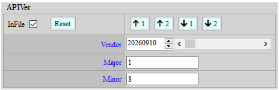
```C
    MI_S32 MI_ISP_IQ_GetParaInitStatus(MI_U32 Channel, MI_ISP_IQ_PARAM_INIT_INFO_TYPE_t *data);
```
取得ISP初始化 ready 狀態的參數值  

```C
    MI_S32 MI_ISP_IQ_SetColorToGray(MI_U32 Channel, MI_ISP_IQ_COLORTOGRAY_TYPE_t *data);
    MI_S32 MI_ISP_IQ_GetColorToGray(MI_U32 Channel, MI_ISP_IQ_COLORTOGRAY_TYPE_t *data);
```

```C
    MI_S32 MI_ISP_IQ_SetContrast(MI_U32 Channel, MI_ISP_IQ_CONTRAST_TYPE_t *data);
    MI_S32 MI_ISP_IQ_GetContrast(MI_U32 Channel, MI_ISP_IQ_CONTRAST_TYPE_t *data);
```
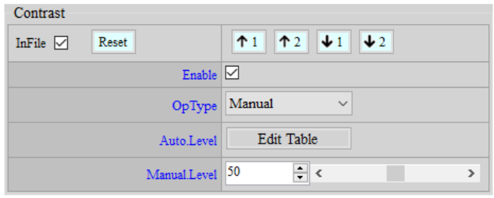
```C
    MI_S32 MI_ISP_IQ_SetBrightness(MI_U32 Channel, MI_ISP_IQ_BRIGHTNESS_TYPE_t *data);
    MI_S32 MI_ISP_IQ_GetBrightness(MI_U32 Channel, MI_ISP_IQ_BRIGHTNESS_TYPE_t *data);
```
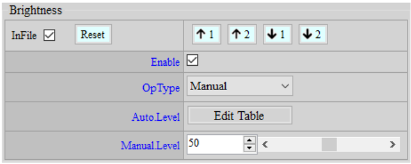
```C
    MI_S32 MI_ISP_IQ_SetLightness(MI_U32 Channel, MI_ISP_IQ_LIGHTNESS_TYPE_t *data);
    MI_S32 MI_ISP_IQ_GetLightness(MI_U32 Channel, MI_ISP_IQ_LIGHTNESS_TYPE_t *data);
```
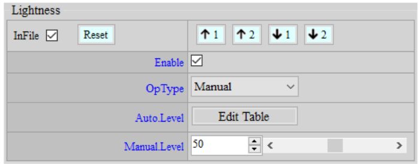
```C
    MI_S32 MI_ISP_IQ_SetRGBGamma(MI_U32 Channel, MI_ISP_IQ_RGBGAMMA_TYPE_t *data);
    MI_S32 MI_ISP_IQ_GetRGBGamma(MI_U32 Channel, MI_ISP_IQ_RGBGAMMA_TYPE_t *data);
```
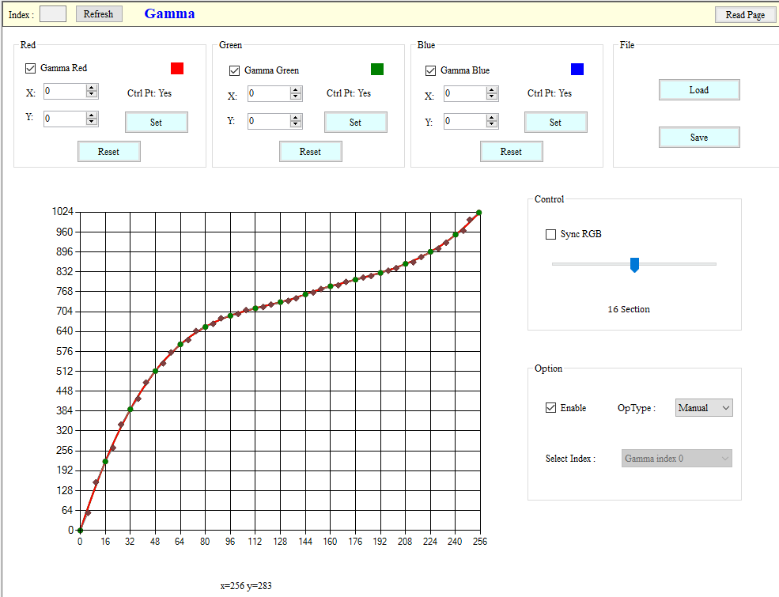
```C
    MI_S32 MI_ISP_IQ_SetYUVGamma(MI_U32 Channel, MI_ISP_IQ_YUVGAMMA_TYPE_t *data);
    MI_S32 MI_ISP_IQ_GetYUVGamma(MI_U32 Channel, MI_ISP_IQ_YUVGAMMA_TYPE_t *data);
```

```C
    MI_S32 MI_ISP_IQ_SetSaturation(MI_U32 Channel, MI_ISP_IQ_SATURATION_TYPE_t *data);
    MI_S32 MI_ISP_IQ_GetSaturation(MI_U32 Channel, MI_ISP_IQ_SATURATION_TYPE_t *data);
```
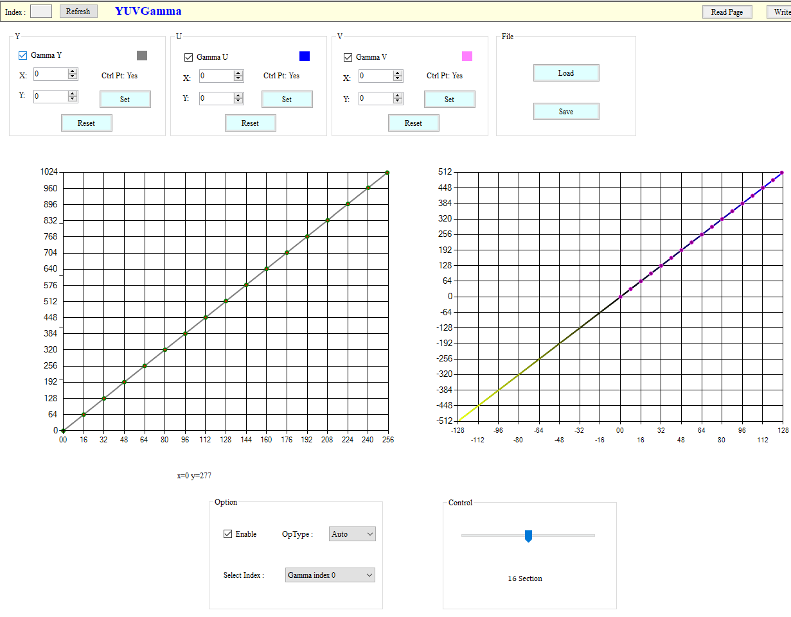
```C
    MI_S32 MI_ISP_IQ_SetDefog(MI_U32 Channel, MI_ISP_IQ_DEFOG_TYPE_t *data);
    MI_S32 MI_ISP_IQ_GetDefog(MI_U32 Channel, MI_ISP_IQ_DEFOG_TYPE_t *data);
```
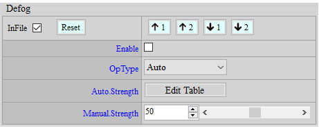
```C
    MI_S32 MI_ISP_IQ_SetRGBMatrix(MI_U32 Channel, MI_ISP_IQ_RGBMATRIX_TYPE_t *data);
    MI_S32 MI_ISP_IQ_GetRGBMatrix(MI_U32 Channel, MI_ISP_IQ_RGBMATRIX_TYPE_t *data);
```
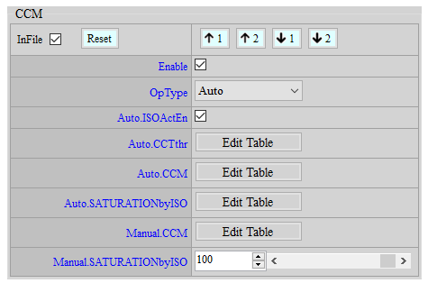
```C
    MI_S32 MI_ISP_IQ_SetFalseColor(MI_U32 Channel, MI_ISP_IQ_FALSECOLOR_TYPE_t *data);
    MI_S32 MI_ISP_IQ_GetFalseColor(MI_U32 Channel, MI_ISP_IQ_FALSECOLOR_TYPE_t *data);
```    
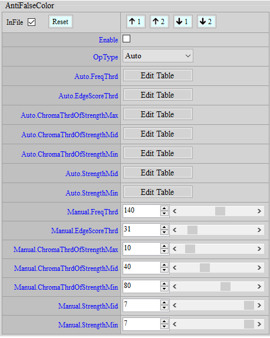
```C
    MI_S32 MI_ISP_IQ_SetNR3D(MI_U32 Channel, MI_ISP_IQ_NR3D_TYPE_t *data);
    MI_S32 MI_ISP_IQ_GetNR3D(MI_U32 Channel, MI_ISP_IQ_NR3D_TYPE_t *data);
```
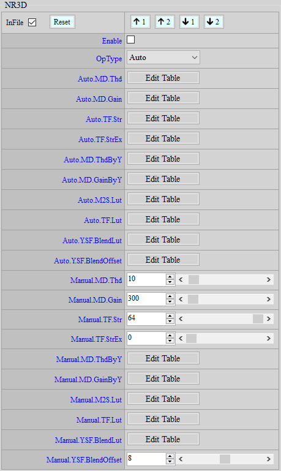
```C
    MI_S32 MI_ISP_IQ_SetNR3D_P1(MI_U32 Channel, MI_ISP_IQ_NR3D_P1_TYPE_t *data); //[not support chip] macaron, pudding
    MI_S32 MI_ISP_IQ_GetNR3D_P1(MI_U32 Channel, MI_ISP_IQ_NR3D_P1_TYPE_t *data); //[not support chip] macaron, pudding
```
### 與 NR3D 相同設定,[not support chip] macaron, pudding
```C
    MI_S32 MI_ISP_IQ_SetNRDeSpike(MI_U32 Channel, MI_ISP_IQ_NRDESPIKE_TYPE_t *data);
    MI_S32 MI_ISP_IQ_GetNRDeSpike(MI_U32 Channel, MI_ISP_IQ_NRDESPIKE_TYPE_t *data);

```

```C
    MI_S32 MI_ISP_IQ_SetNRLuma(MI_U32 Channel, MI_ISP_IQ_NRLUMA_TYPE_t *data);
    MI_S32 MI_ISP_IQ_GetNRLuma(MI_U32 Channel, MI_ISP_IQ_NRLUMA_TYPE_t *data);
```
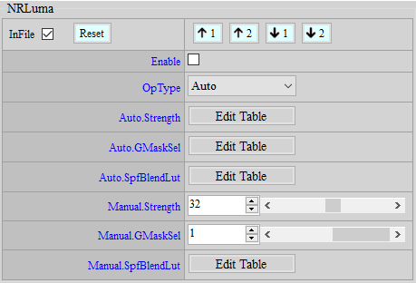
```C
    MI_S32 MI_ISP_IQ_SetNRChroma(MI_U32 Channel, MI_ISP_IQ_NRChroma_TYPE_t *data);
    MI_S32 MI_ISP_IQ_GetNRChroma(MI_U32 Channel, MI_ISP_IQ_NRChroma_TYPE_t *data);
```
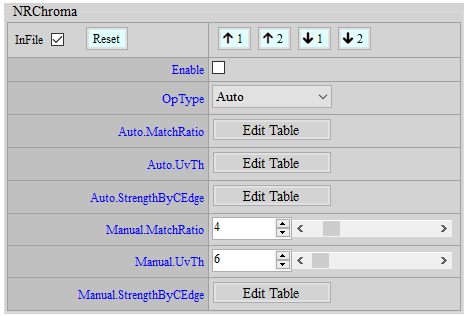
```C
    MI_S32 MI_ISP_IQ_SetSharpness(MI_U32 Channel, MI_ISP_IQ_SHARPNESS_TYPE_t *data);
    MI_S32 MI_ISP_IQ_GetSharpness(MI_U32 Channel, MI_ISP_IQ_SHARPNESS_TYPE_t *data);
```
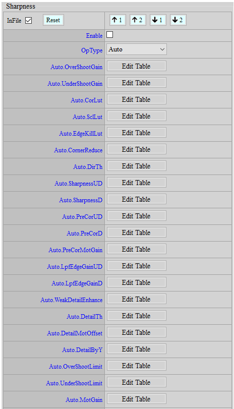
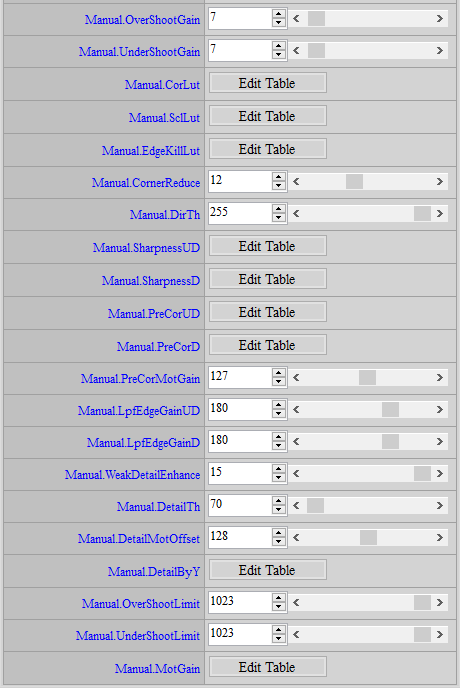
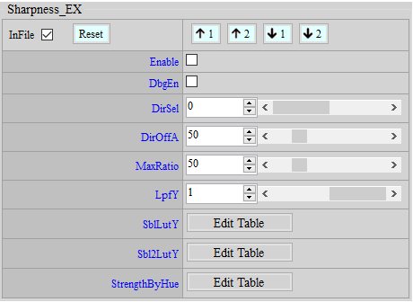
```C
    MI_S32 MI_ISP_IQ_SetCrossTalk(MI_U32 Channel, MI_ISP_IQ_CROSSTALK_TYPE_t *data);
    MI_S32 MI_ISP_IQ_GetCrossTalk(MI_U32 Channel, MI_ISP_IQ_CROSSTALK_TYPE_t *data);
```
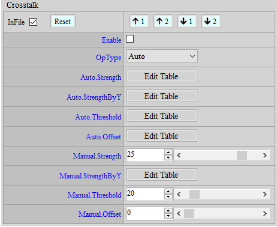
```C
    MI_S32 MI_ISP_IQ_SetOBC(MI_U32 Channel, MI_ISP_IQ_OBC_TYPE_t *data);
    MI_S32 MI_ISP_IQ_GetOBC(MI_U32 Channel, MI_ISP_IQ_OBC_TYPE_t *data);
```
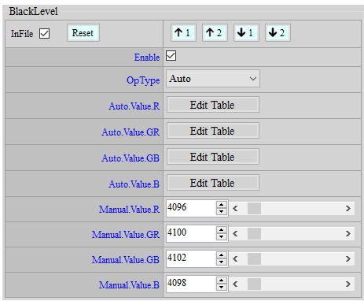
```C
    MI_S32 MI_ISP_IQ_SetOBC_P1(MI_U32 Channel, MI_ISP_IQ_OBC_TYPE_t *data);
    MI_S32 MI_ISP_IQ_GetOBC_P1(MI_U32 Channel, MI_ISP_IQ_OBC_TYPE_t *data);
```
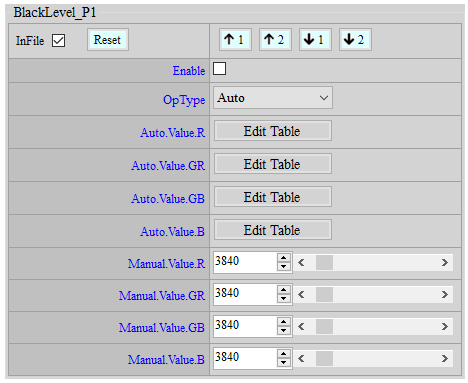
```C
    MI_S32 MI_ISP_IQ_SetWDR(MI_U32 Channel, MI_ISP_IQ_WDR_TYPE_t *data);
    MI_S32 MI_ISP_IQ_GetWDR(MI_U32 Channel, MI_ISP_IQ_WDR_TYPE_t *data);
```
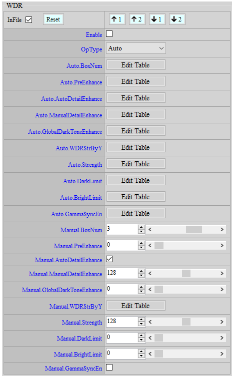
```C
    MI_S32 MI_ISP_IQ_SetWDRCurveAdv(MI_U32 Channel, MI_ISP_IQ_WDRCurveAdv_TYPE_t *data);
    MI_S32 MI_ISP_IQ_GetWDRCurveAdv(MI_U32 Channel, MI_ISP_IQ_WDRCurveAdv_TYPE_t *data);
```
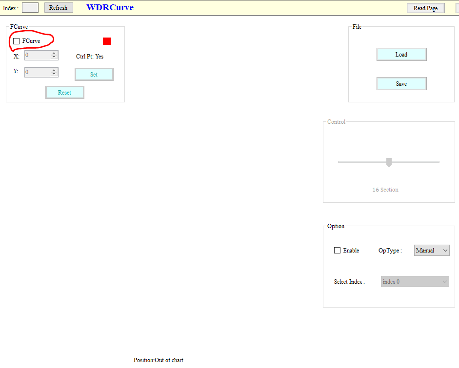
```C
    MI_S32 MI_ISP_IQ_SetWDRCurveFull(MI_U32 Channel, MI_ISP_IQ_WDRCurveFull_TYPE_t *data);
    MI_S32 MI_ISP_IQ_GetWDRCurveFull(MI_U32 Channel, MI_ISP_IQ_WDRCurveFull_TYPE_t *data);
```
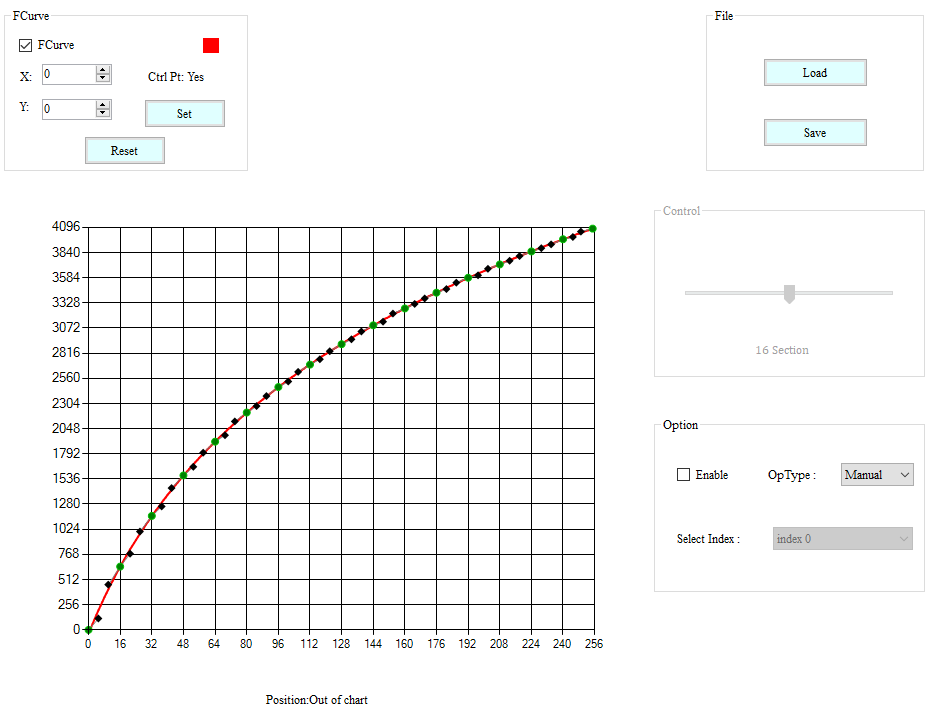
```C
    MI_S32 MI_ISP_IQ_SetDynamicDP(MI_U32 Channel, MI_ISP_IQ_DYNAMIC_DP_TYPE_t *data);
    MI_S32 MI_ISP_IQ_GetDynamicDP(MI_U32 Channel, MI_ISP_IQ_DYNAMIC_DP_TYPE_t *data);
```
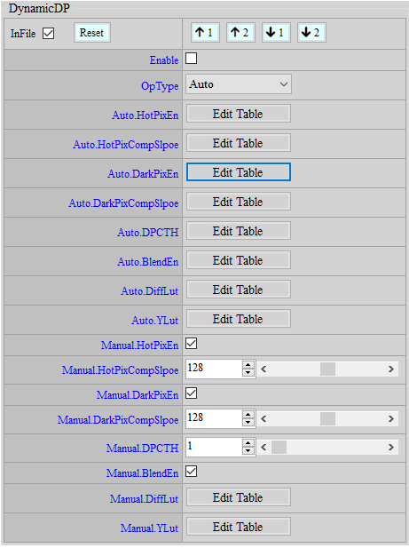
```C
    MI_S32 MI_ISP_IQ_SetDynamicDP_CLUSTER(MI_U32 Channel, MI_ISP_IQ_DYNAMIC_DP_CLUSTER_TYPE_t *data);
    MI_S32 MI_ISP_IQ_GetDynamicDP_CLUSTER(MI_U32 Channel, MI_ISP_IQ_DYNAMIC_DP_CLUSTER_TYPE_t *data);
```
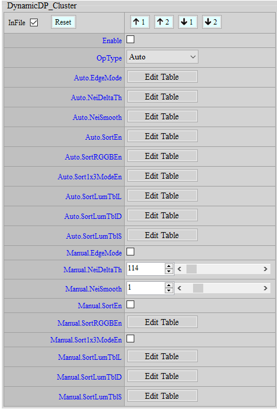
```C
    MI_S32 MI_ISP_IQ_SetHSV(MI_U32 Channel, MI_ISP_IQ_HSV_TYPE_t *data);
    MI_S32 MI_ISP_IQ_GetHSV(MI_U32 Channel, MI_ISP_IQ_HSV_TYPE_t *data);
```
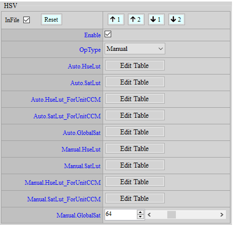
```C
    MI_S32 MI_ISP_IQ_SetRGBIR(MI_U32 Channel, MI_ISP_IQ_RGBIR_TYPE_t *data);
    MI_S32 MI_ISP_IQ_GetRGBIR(MI_U32 Channel, MI_ISP_IQ_RGBIR_TYPE_t *data);
```
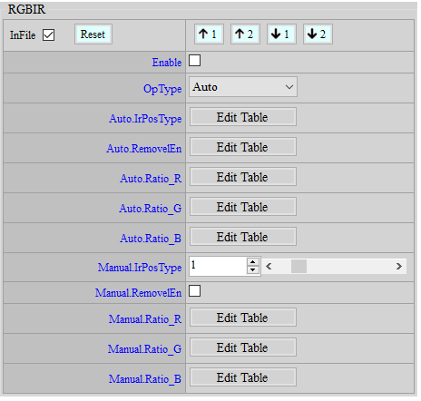
```C
    MI_S32 MI_ISP_IQ_SetFPN(MI_U32 Channel, MI_ISP_IQ_FPN_TYPE_t *data); //[not support chip] macaron, pudding
    MI_S32 MI_ISP_IQ_GetFPN(MI_U32 Channel, MI_ISP_IQ_FPN_TYPE_t *data); //[not support chip] macaron, pudding

```
## [not support chip] macaron, pudding
```C
    MI_S32 MI_ISP_IQ_SetPFC(MI_U32 Channel, MI_ISP_IQ_PFC_TYPE_t *data); //[not support chip] macaron
    MI_S32 MI_ISP_IQ_GetPFC(MI_U32 Channel, MI_ISP_IQ_PFC_TYPE_t *data); //[not support chip] macaron

```
## [not support chip] macaron
```C
    MI_S32 MI_ISP_IQ_SetDEMOSAIC(MI_U32 Channel, MI_ISP_IQ_DEMOSAIC_TYPE_t *data);
    MI_S32 MI_ISP_IQ_GetDEMOSAIC(MI_U32 Channel, MI_ISP_IQ_DEMOSAIC_TYPE_t *data);
```
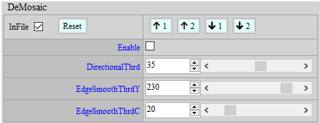
```C
    MI_S32 MI_ISP_IQ_SetR2Y(MI_U32 Channel, MI_ISP_IQ_R2Y_TYPE_t *data);
    MI_S32 MI_ISP_IQ_GetR2Y(MI_U32 Channel, MI_ISP_IQ_R2Y_TYPE_t *data);
```
## [not support chip] macaron
## no interface for adjusting the project in the IQ tool.
```C
    MI_S32 MI_ISP_IQ_SetCOLORTRANS(MI_U32 Channel, MI_ISP_IQ_COLORTRANS_TYPE_t *data);
    MI_S32 MI_ISP_IQ_GetCOLORTRANS(MI_U32 Channel, MI_ISP_IQ_COLORTRANS_TYPE_t *data);
```
## no interface for adjusting the project in the IQ tool.
```C
    MI_S32 MI_ISP_IQ_SetHDR(MI_U32 Channel, MI_ISP_IQ_HDR_TYPE_t *data);
    MI_S32 MI_ISP_IQ_GetHDR(MI_U32 Channel, MI_ISP_IQ_HDR_TYPE_t *data);
```
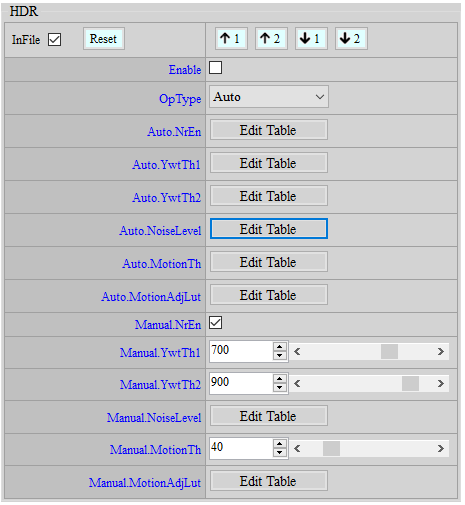
```C
    MI_S32 MI_ISP_IQ_SetLSC(MI_U32 Channel, MI_ISP_IQ_LSC_TYPE_t *data);
    MI_S32 MI_ISP_IQ_GetLSC(MI_U32 Channel, MI_ISP_IQ_LSC_TYPE_t *data);
```
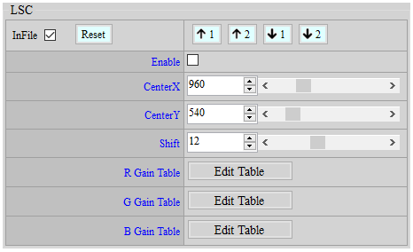
```C
    MI_S32 MI_ISP_IQ_SetLSC_CTRL(MI_U32 Channel, MI_ISP_IQ_LSC_CTRL_TYPE_t *data);
    MI_S32 MI_ISP_IQ_GetLSC_CTRL(MI_U32 Channel, MI_ISP_IQ_LSC_CTRL_TYPE_t *data);
```
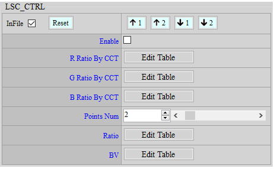
```C
    MI_S32 MI_ISP_IQ_SetALSC(MI_U32 Channel, MI_ISP_IQ_ALSC_TYPE_t *data);
    MI_S32 MI_ISP_IQ_GetALSC(MI_U32 Channel, MI_ISP_IQ_ALSC_TYPE_t *data);
```
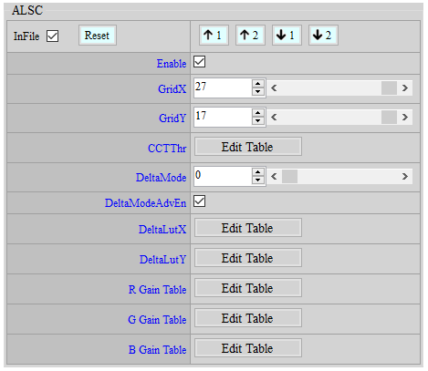
```C
    MI_S32 MI_ISP_IQ_SetALSC_CTRL(MI_U32 Channel, MI_ISP_IQ_ALSC_CTRL_TYPE_t *data);
    MI_S32 MI_ISP_IQ_GetALSC_CTRL(MI_U32 Channel, MI_ISP_IQ_ALSC_CTRL_TYPE_t *data);
```
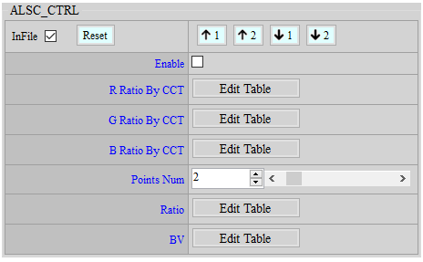
```C
    MI_S32 MI_ISP_IQ_SetNRLuma_Adv(MI_U32 Channel, MI_ISP_IQ_NRLuma_Adv_TYPE_t *data); //[not support chip] macaron
    MI_S32 MI_ISP_IQ_GetNRLuma_Adv(MI_U32 Channel, MI_ISP_IQ_NRLuma_Adv_TYPE_t *data); //[not support chip] macaron
```
## [not support chip]
```C
    MI_S32 MI_ISP_IQ_SetNRChroma_Adv(MI_U32 Channel, MI_ISP_IQ_NRChroma_Adv_TYPE_t *data); //[not support chip] macaron
    MI_S32 MI_ISP_IQ_GetNRChroma_Adv(MI_U32 Channel, MI_ISP_IQ_NRChroma_Adv_TYPE_t *data); //[not support chip] macaron
```
## [not support chip]
```C
    MI_S32 MI_ISP_IQ_SetNRChroma_Pre(MI_U32 Channel, MI_ISP_IQ_NRChroma_Pre_TYPE_t *data); //[not support chip] macaron, pudding, ispahan
    MI_S32 MI_ISP_IQ_GetNRChroma_Pre(MI_U32 Channel, MI_ISP_IQ_NRChroma_Pre_TYPE_t *data); //[not support chip] macaron, pudding, ispahan
```
## [not support chip]
```C
    MI_S32 MI_ISP_IQ_SetPFC_EX(MI_U32 Channel, MI_ISP_IQ_PFC_EX_TYPE_t *data); //[not support chip] macaron
    MI_S32 MI_ISP_IQ_GetPFC_EX(MI_U32 Channel, MI_ISP_IQ_PFC_EX_TYPE_t *data); //[not support chip] macaron
```
## [not support chip] macaron
```C
    MI_S32 MI_ISP_IQ_SetHDR_EX(MI_U32 Channel, MI_ISP_IQ_HDR_EX_TYPE_t *data); //[not support chip] macaron
    MI_S32 MI_ISP_IQ_GetHDR_EX(MI_U32 Channel, MI_ISP_IQ_HDR_EX_TYPE_t *data); //[not support chip] macaron
```
## [not support chip] macaron
```C
    MI_S32 MI_ISP_IQ_SetSHP_EX(MI_U32 Channel, MI_ISP_IQ_SHARPNESS_EX_TYPE_t *data); //[not support chip] macaron
    MI_S32 MI_ISP_IQ_GetSHP_EX(MI_U32 Channel, MI_ISP_IQ_SHARPNESS_EX_TYPE_t *data); //[not support chip] macaron
```
## [not support chip] macaron
```C
    MI_S32 MI_ISP_IQ_SetNR3D_EX(MI_U32 Channel, MI_ISP_IQ_NR3D_EX_TYPE_t *data); //[not support chip] macaron
    MI_S32 MI_ISP_IQ_GetNR3D_EX(MI_U32 Channel, MI_ISP_IQ_NR3D_EX_TYPE_t *data); //[not support chip] macaron
```
## [not support chip] macaron

##  ************************************* AE  API START *************************************/
```C
    /************************************* AE  API START *************************************/
    MI_S32 MI_ISP_AE_GetHistoWghtY(MI_U32 Channel, MI_ISP_AE_HIST_WEIGHT_Y_TYPE_t *data);
    MI_S32 MI_ISP_AE_QueryExposureInfo(MI_U32 Channel, MI_ISP_AE_EXPO_INFO_TYPE_t *data);
```
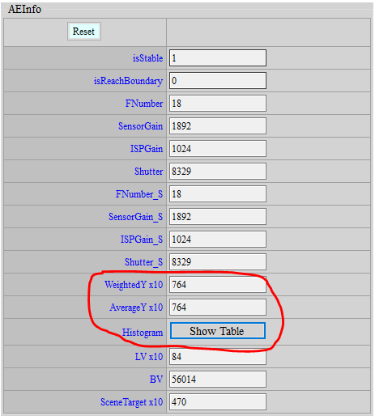
```C
    MI_S32 MI_ISP_AE_SetEVComp(MI_U32 Channel, MI_ISP_AE_EV_COMP_TYPE_t *data);
    MI_S32 MI_ISP_AE_GetEVComp(MI_U32 Channel, MI_ISP_AE_EV_COMP_TYPE_t *data);
```
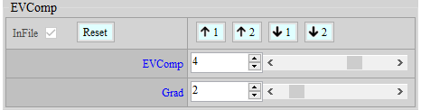
```C
    MI_S32 MI_ISP_AE_SetExpoMode(MI_U32 Channel, MI_ISP_AE_MODE_TYPE_e *data);
    MI_S32 MI_ISP_AE_GetExpoMode(MI_U32 Channel, MI_ISP_AE_MODE_TYPE_e *data);
```
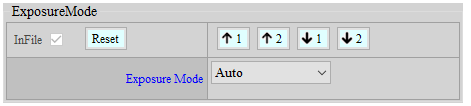
```C
    MI_S32 MI_ISP_AE_SetManualExpo(MI_U32 Channel, MI_ISP_AE_EXPO_VALUE_TYPE_t *data);
    MI_S32 MI_ISP_AE_GetManualExpo(MI_U32 Channel, MI_ISP_AE_EXPO_VALUE_TYPE_t *data);
```
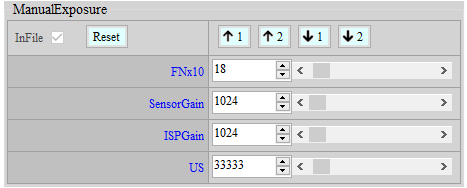
```C
    MI_S32 MI_ISP_AE_SetManualShortExpo(MI_U32 Channel, MI_ISP_AE_EXPO_VALUE_TYPE_t *data);
    MI_S32 MI_ISP_AE_GetManualShortExpo(MI_U32 Channel, MI_ISP_AE_EXPO_VALUE_TYPE_t *data);
```

```C
    MI_S32 MI_ISP_AE_SetState(MI_U32 Channel, MI_ISP_SM_STATE_TYPE_e *data);  // Pause, Resume
    MI_S32 MI_ISP_AE_GetState(MI_U32 Channel, MI_ISP_SM_STATE_TYPE_e *data);
```

```C
    MI_S32 MI_ISP_AE_SetTarget(MI_U32 Channel, MI_ISP_AE_INTP_LUT_TYPE_t *data);
    MI_S32 MI_ISP_AE_GetTarget(MI_U32 Channel, MI_ISP_AE_INTP_LUT_TYPE_t *data);
```
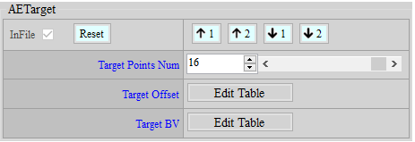
```C
    MI_S32 MI_ISP_AE_SetConverge(MI_U32 Channel, MI_ISP_AE_CONV_CONDITON_TYPE_t *data);
    MI_S32 MI_ISP_AE_GetConverge(MI_U32 Channel, MI_ISP_AE_CONV_CONDITON_TYPE_t *data);
```
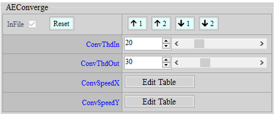
```C
    MI_S32 MI_ISP_AE_SetExposureLimit(MI_U32 Channel, MI_ISP_AE_EXPO_LIMIT_TYPE_t *data);
    MI_S32 MI_ISP_AE_GetExposureLimit(MI_U32 Channel, MI_ISP_AE_EXPO_LIMIT_TYPE_t *data);
```
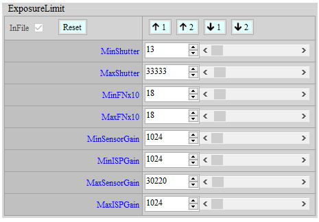
```C
    MI_S32 MI_ISP_AE_SetPlainLongExpoTable(MI_U32 Channel, MI_ISP_AE_EXPO_TABLE_TYPE_t *data);
    MI_S32 MI_ISP_AE_GetPlainLongExpoTable(MI_U32 Channel, MI_ISP_AE_EXPO_TABLE_TYPE_t *data);
```
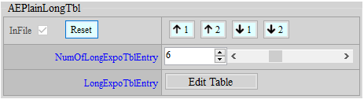
```C
    MI_S32 MI_ISP_AE_SetPlainShortExpoTable(MI_U32 Channel, MI_ISP_AE_EXPO_TABLE_TYPE_t *data);
    MI_S32 MI_ISP_AE_GetPlainShortExpoTable(MI_U32 Channel, MI_ISP_AE_EXPO_TABLE_TYPE_t *data);
```

```C
    MI_S32 MI_ISP_AE_SetWinWgtType(MI_U32 Channel, MI_ISP_AE_WIN_WEIGHT_MODE_TYPE_e *data);
    MI_S32 MI_ISP_AE_GetWinWgtType(MI_U32 Channel, MI_ISP_AE_WIN_WEIGHT_MODE_TYPE_e *data);
```

```C
    MI_S32 MI_ISP_AE_SetWinWgt(MI_U32 Channel, MI_ISP_AE_WIN_WEIGHT_TYPE_t *data);
    MI_S32 MI_ISP_AE_GetWinWgt(MI_U32 Channel, MI_ISP_AE_WIN_WEIGHT_TYPE_t *data);
```
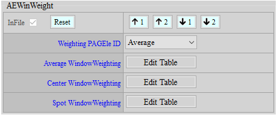
```C
    MI_S32 MI_ISP_AE_SetFlicker(MI_U32 Channel, MI_ISP_AE_FLICKER_TYPE_e *data);
    MI_S32 MI_ISP_AE_GetFlicker(MI_U32 Channel, MI_ISP_AE_FLICKER_TYPE_e *data);
```

```C
    MI_S32 MI_ISP_AE_SetFlickerEX(MI_U32 Channel, MI_ISP_AE_FLICKER_EX_TYPE_t *data);
    MI_S32 MI_ISP_AE_GetFlickerEX(MI_U32 Channel, MI_ISP_AE_FLICKER_EX_TYPE_t *data);
```
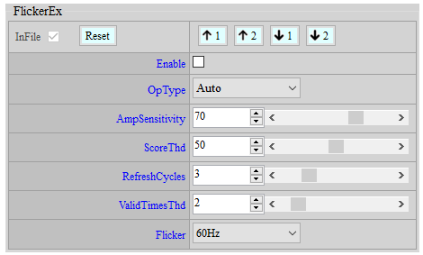
```C
    MI_S32 MI_ISP_AE_SetStrategy(MI_U32 Channel, MI_ISP_AE_STRATEGY_TYPE_t *data);
    MI_S32 MI_ISP_AE_GetStrategy(MI_U32 Channel, MI_ISP_AE_STRATEGY_TYPE_t *data);
```
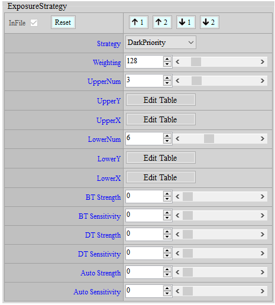
```C
    MI_S32 MI_ISP_AE_SetStrategyEX(MI_U32 Channel, MI_ISP_AE_STRATEGY_EX_TYPE_t *data);
    MI_S32 MI_ISP_AE_GetStrategyEX(MI_U32 Channel, MI_ISP_AE_STRATEGY_EX_TYPE_t *data);
```
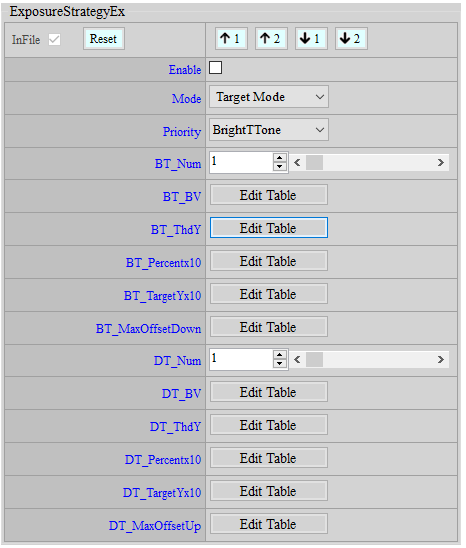
```C
    MI_S32 MI_ISP_AE_SetRGBIRAE(MI_U32 Channel, MI_ISP_AE_RGBIR_AE_TYPE_t *data);
    MI_S32 MI_ISP_AE_GetRGBIRAE(MI_U32 Channel, MI_ISP_AE_RGBIR_AE_TYPE_t *data);
```
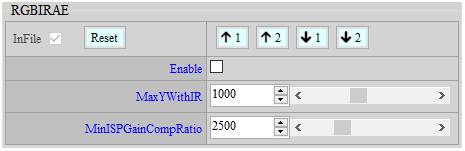
```C
    MI_S32 MI_ISP_AE_SetHDR(MI_U32 Channel, MI_ISP_AE_HDR_TYPE_t *data);
    MI_S32 MI_ISP_AE_GetHDR(MI_U32 Channel, MI_ISP_AE_HDR_TYPE_t *data);
```
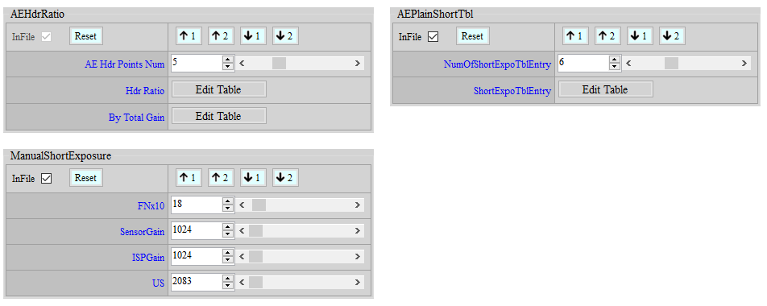
```C
    MI_S32 MI_ISP_AE_SetStabilizer(MI_U32 Channel, MI_ISP_AE_STABILIZER_TYPE_t *data);
    MI_S32 MI_ISP_AE_GetStabilizer(MI_U32 Channel, MI_ISP_AE_STABILIZER_TYPE_t *data);
```
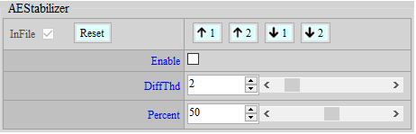


## ************************************* AWB API START *************************************

```C
    MI_S32 MI_ISP_AWB_QueryInfo(MI_U32 Channel, MI_ISP_AWB_QUERY_INFO_TYPE_t *data);
```
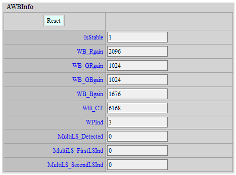
```C
    MI_S32 MI_ISP_AWB_SetAttr(MI_U32 Channel, MI_ISP_AWB_ATTR_TYPE_t *data);
    MI_S32 MI_ISP_AWB_GetAttr(MI_U32 Channel, MI_ISP_AWB_ATTR_TYPE_t *data);
```
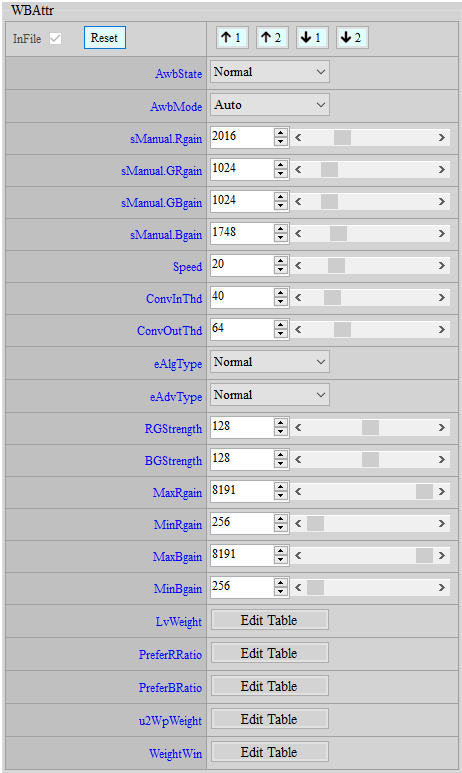
```C
    MI_S32 MI_ISP_AWB_SetAttrEx(MI_U32 Channel, MI_ISP_AWB_ATTR_EX_TYPE_t *data);
    MI_S32 MI_ISP_AWB_GetAttrEx(MI_U32 Channel, MI_ISP_AWB_ATTR_EX_TYPE_t *data);
```
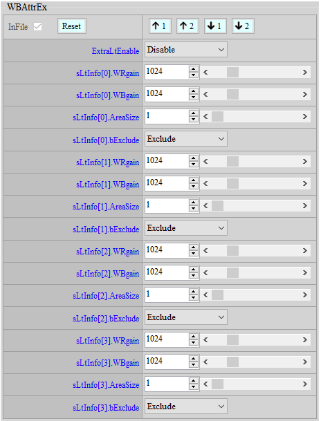
```C
    MI_S32 MI_ISP_AWB_SetMultiLSAttr(MI_U32 Channel, MI_ISP_AWB_MULTILS_LS_TYPE_t *data);
    MI_S32 MI_ISP_AWB_GetMultiLSAttr(MI_U32 Channel, MI_ISP_AWB_MULTILS_LS_TYPE_t *data);
```
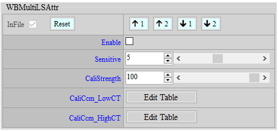
```C
    MI_S32 MI_ISP_AWB_SetCTWeight(MI_U32 Channel, MI_ISP_AWB_CT_WEIGHT_TYPE_t *data); //Not works now, please use MI_ISP_AWB_SetAttr to set LvWeight indstead.
    MI_S32 MI_ISP_AWB_GetCTWeight(MI_U32 Channel, MI_ISP_AWB_CT_WEIGHT_TYPE_t *data); //Not works now, please use MI_ISP_AWB_GetAttr to set LvWeight indstead.
```
## Not works now, please use MI_ISP_AWB_SetAttr to set LvWeight indstead.
```C
    MI_S32 MI_ISP_AWB_SetCTCaliAttr(MI_U32 Channel, MI_ISP_AWB_CT_CALI_TYPE_t *data);
    MI_S32 MI_ISP_AWB_GetCTCaliAttr(MI_U32 Channel, MI_ISP_AWB_CT_CALI_TYPE_t *data);
```

```C
    MI_S32 MI_ISP_AWB_GetCurCTCaliAttr(MI_U32 Channel, MI_ISP_AWB_CUR_CT_CALI_TYPE_t *data);
```

```C
    MI_S32 MI_ISP_AWB_GetCTStats(MI_U32 Channel, MI_ISP_AWB_CT_STATISTICS_TYPE_t *data);
    MI_S32 MI_ISP_AWB_GetHWStats(MI_U32 Channel, MI_ISP_AWB_HW_STATISTICS_TYPE_t *data);
```
## no interface for adjusting the project in the IQ tool.
```C
    MI_S32 MI_ISP_AWB_SetCTMwbAttr(MI_U32 Channel, MI_ISP_AWB_CTMWB_PARAM_t *data);
    MI_S32 MI_ISP_AWB_GetCTMwbAttr(MI_U32 Channel, MI_ISP_AWB_CTMWB_PARAM_t *data);
```
## no interface for adjusting the project in the IQ tool.

```C
   /******************* AF  API START ( 目前產品沒有需求, 先不列入)************************/
    MI_S32 MI_ISP_AF_QueryInfo(MI_U32 Channel, MI_ISP_AF_QUERY_INFO_TYPE_t *data);
    MI_S32 MI_ISP_AF_SetHWRoiMode(MI_U32 Channel, MI_ISP_AF_HW_ROI_MODE_TYPE_t *data);
    MI_S32 MI_ISP_AF_GetHWRoiMode(MI_U32 Channel, MI_ISP_AF_HW_ROI_MODE_TYPE_t *data);
    MI_S32 MI_ISP_AF_SetHWWin(MI_U32 Channel, MI_ISP_AF_HW_WIN_TYPE_t *data);
    MI_S32 MI_ISP_AF_GetHWWin(MI_U32 Channel, MI_ISP_AF_HW_WIN_TYPE_t *data);
    MI_S32 MI_ISP_AF_SetHWFilterAttr(MI_U32 Channel, MI_ISP_AF_HW_FILTER_ATTR_TYPE_t *data);
    MI_S32 MI_ISP_AF_GetHWFilterAttr(MI_U32 Channel, MI_ISP_AF_HW_FILTER_ATTR_TYPE_t *data);
    MI_S32 MI_ISP_AF_SetHWFilterSq(MI_U32 Channel, MI_ISP_AF_HW_FILTERSQ_TYPE_t *data);
    MI_S32 MI_ISP_AF_GetHWFilterSq(MI_U32 Channel, MI_ISP_AF_HW_FILTERSQ_TYPE_t *data);
    MI_S32 MI_ISP_AF_SetAttr(MI_U32 Channel, MI_ISP_AF_ATTR_TYPE_t *data);
    MI_S32 MI_ISP_AF_GetAttr(MI_U32 Channel, MI_ISP_AF_ATTR_TYPE_t *data);
    MI_S32 MI_ISP_AF_SetMotor(MI_U32 Channel, MI_ISP_AF_MOTOR_TYPE_t *data);
    MI_S32 MI_ISP_AF_GetMotor(MI_U32 Channel, MI_ISP_AF_MOTOR_TYPE_t *data);
    MI_S32 MI_ISP_AF_SetAccWeight(MI_U32 Channel, MI_ISP_AF_ACC_WEIGHT_TYPE_t *data);
    MI_S32 MI_ISP_AF_GetAccWeight(MI_U32 Channel, MI_ISP_AF_ACC_WEIGHT_TYPE_t *data);
    MI_S32 MI_ISP_AF_SetOneShot(MI_U32 Channel, MI_ISP_AF_ONESHOT_TYPE_t *data);
    MI_S32 MI_ISP_AF_GetOneShot(MI_U32 Channel, MI_ISP_AF_ONESHOT_TYPE_t *data);
    MI_S32 MI_ISP_AF_SetSceneChange(MI_U32 Channel, MI_ISP_AF_SCENE_CHANGE_TYPE_t *data);
    MI_S32 MI_ISP_AF_GetSceneChange(MI_U32 Channel, MI_ISP_AF_SCENE_CHANGE_TYPE_t *data);
    MI_S32 MI_ISP_AF_SetSearchStart(MI_U32 Channel, MI_ISP_AF_SEARCH_START_TYPE_t *data);
    MI_S32 MI_ISP_AF_GetSearchStart(MI_U32 Channel, MI_ISP_AF_SEARCH_START_TYPE_t *data);
    MI_S32 MI_ISP_AF_SetSearch(MI_U32 Channel, MI_ISP_AF_SEARCH_TYPE_t *data);
    MI_S32 MI_ISP_AF_GetSearch(MI_U32 Channel, MI_ISP_AF_SEARCH_TYPE_t *data);
    /************************************* AF  API END   *************************************/
```

```C
    MI_S32 MI_ISP_ALGO_SET_ALL(int Channel, MI_U16 ApiId, MI_U32 ApiLen, MI_U8* pApiBuf);
    MI_S32 MI_ISP_ALGO_GET_ALL(int Channel, MI_U16 ApiId, MI_U32* ApiLen, MI_U8* pApiBuf);
```