# RockChip IQ tune flow
根據 Rockchip 官方文件（如 《Rockchip IQ Tools Guide》、《Rockchip Color Optimization Guide》等）的說明，Rockchip ISP 的圖像品質（IQ）調校與優化整體流程可以分為 **四個核心階段**

## 一、 調校環境準備與工程建立 (Preparation &amp; Project Setup)

1. **搭建連線環境**：
  * 將運行 PC（安裝 RKISP Tuner / IQ Tools）與運行 AIQ 框架的板卡設備（如 RK356X、RK3588、RV1106 等）連接至同一區域網絡。
  * 在板卡端推送並啟動 `rkaiq_tool_server` 服務應用，實現 Tuner 工具與設備端 AIQ 框架之間的通訊與數據交互。
  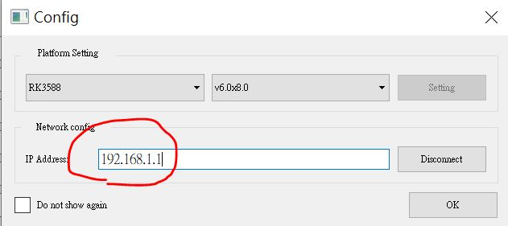
  ```linux
  進入 IQ Tool 的方式 :
  1. 關閉原本rkaiq 3A server
      sudo killall rkaiq_3A_server
  2. 建立兩個檔案關聯
      sudo ln -s /tmp/UNIX.domain3 /tmp/UNIX.domain <-- for camera 31
  3. 在HDMI 螢幕看到畫面,開啟 camera 影像 
    sudo gst-launch-1.0 v4l2src device=/dev/video31 ! video/x-raw,format=NV12,width=400,height=400,framerate=120/1 ! videoconvert ! autovideosink
  4. 載入 rkaiq_tool_server 服務
    sudo /data/rkaiq_tool_server-V2.0.5-20240930_174512-aarch64 -w 400 -h 400 -c /dev/video0 -s /dev/video31
  5. 工具使用 : RKISP_Tuner_v2.3.6_Release
  ```
  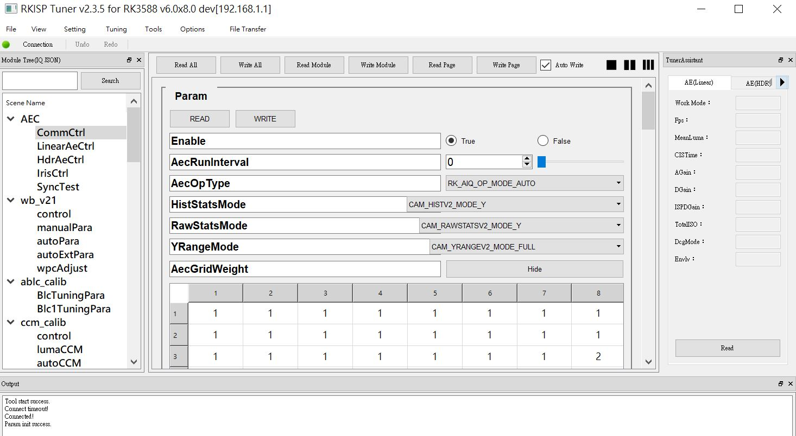
2. **設定 Sensor 資訊與生成基礎 IQ 檔**：
  * 在 Tuner 中填寫/匯入 Sensor Information（包含分辨率、曝光行/Gain 轉換註冊表的係數等 Datasheet 參數）。
    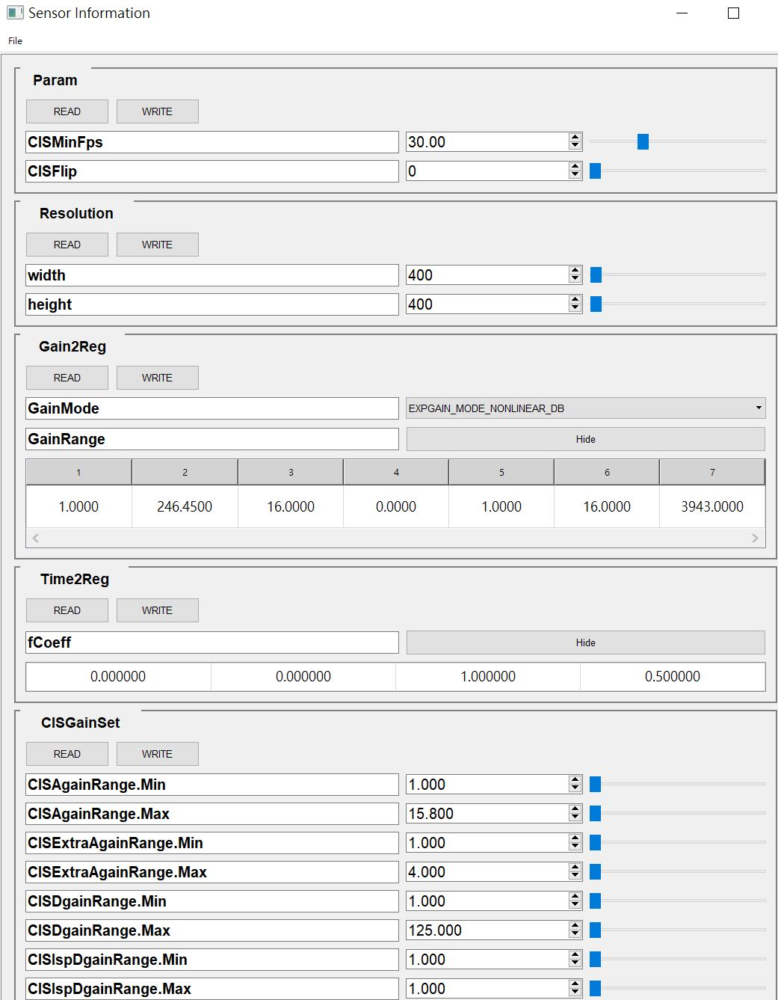
  * 生成全新的 `.json` 格式基礎 IQ 檔，該檔案記載了開放調優的所有 ISP 模組參數。
    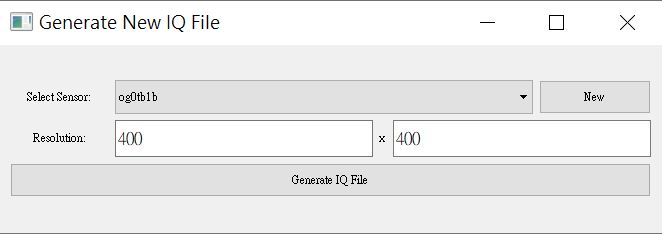
---

## 二、 Raw 圖像採集 (Raw Image Capture)

使用 Tuner 隨附的 **RK Capture Tool** 工具連接設備進行圖像採集：

1. **曝光控制**：支援手動曝光（Manual Exposure）與自動曝光（Auto Exposure），並可設定標準光源名稱（如 D65、D50、TL84、A、CWF、HZ、D75）與模組分類。
2. **特定場景拍攝**：
  * **遮黑拍攝**：用於黑電平校正。
  * **加貼均光片/毛玻璃拍攝**：在標準燈箱內拍攝均勻光場，用於鏡頭陰影校正。
  * **拍攝標準圖卡**：如 X-Rite 24 色卡（白平衡與 CCM 校正）、黑白/漸變卡（NR 噪聲曲線標定）、棋盤格（FEC/LDCH 鏡頭畸變校正）。

---

## 三、 基礎模組標定 (Basic Module Calibration)

基礎模組標定需遵循**嚴格的模組依賴順序**（後級模組依賴前級模組的標定結果：  
### $$\text{黑電平 (BLC)} \longrightarrow \text{RawNR / GIC} \longrightarrow \text{靜態壞點 (DPCC)} \longrightarrow \text{鏡頭陰影 (LSC)} \longrightarrow \text{AWB / CCM} \longrightarrow \text{YUV NR / 3DNR} \longrightarrow \text{畸變校正 (LDCH/FEC)}$$

1. **黑電平校正 (BLC - Black Level Correction)**：
  * **步驟**：全遮黑鏡頭，遍歷 Gain（1x, 2x, 4x, 8x...Max）拍攝 Raw 圖。
  * **目的**：扣除 Sensor 暗電流與 Base Pedestal 偏移量。所有後續模組標定皆需扣除此值。 
2. **Raw 域降噪與綠通道平衡 (Bayer NR / GIC)**：
  * 校正 Gr/Gb 不平衡（GIC），並對 Bayer 2DNR/3DNR 噪聲曲線進行採樣與標定。
  * **目的**：Raw 域降噪與 GIC 直接作用於未校正暗角的原始 Bayer 數據，可以在最前端擬合 Sensor 的基礎噪聲模型，避免 LSC 補償矩陣介入後改變噪聲的非均勻分佈。
3. **RawNR（Raw 域靜態降噪）與 DPCC（靜態壞點標定）**
  * **步驟**：標定基礎降噪曲線與校正 Sensor 上的固定亮/暗壞點。
  * **目的**：校正鏡頭引起的亮度暗角（Luma Shading）與邊角偏色（Color Shading）。
4. **鏡頭陰影校正 (LSC - Lens Shading Correction)**：
  * **步驟**：覆蓋均光片/毛玻璃，在 7 種標準光源（HZ, A, CWF, TL84, D50, D65, D75）下拍攝，將最大亮度控制在約 200（8-bit）。
  * **目的**：LSC 負責修復鏡頭邊角的暗角（Luma Shading）與偏色（Color Shading）。若未先完成 LSC，畫面四周與中心的色溫不一致，會直接破壞後續 AWB 的白點檢測與 CCM 24 色卡的採樣準確度。
5. **自動白平衡標定 (AWB - Auto White Balance)**：
  * *依賴 LSC 標定結果*。導入各光源下拍攝的 24 色卡 Raw 圖，自動/手動識別色塊，調整 UV 域、XY 域及 YUV 域的白點檢測邊界與框選條件。
6. **色彩校正矩陣標定 (CCM - Color Correction Matrix)**：
  * *依賴 LSC 與 AWB 標定結果*。在各標準光源下拍攝 24 色卡，設定目標 Gamma 曲線與指定色塊權重，計算生成不同色溫下的 3x3 CCM 矩陣及 Offset。
  * **目的**：AWB 與 CCM 需在黑電平扣除準確、LSC 校正完成的基礎上進行。通常在標準燈箱（7 種光源）下拍攝 24 色卡 RAW 圖，計算出白點條件框與 $3 \times 3$ 色彩校正矩陣3。
7. **亮度降噪標定 (YNR / MFNR)**：
  * *依賴 AWB 與 Raw 降噪*。導入漸變卡/黑白卡 Raw 圖，標定不同 ISO 增益下的 Y 通道噪聲 Sigma 曲線。
  * **目的**：當 Gamma、AWB 與 CCM 確定後，影像的色彩與亮度對比度已固定，此時才能精確標定並調適 YUV 域的空域/時域降噪強度與噪聲模型。
8. **畸變校正標定 (FEC / LDCH)**：
  * 導入棋盤格圖像，自動檢測內角點，計算鏡頭畸變參數並生成下採樣映射表（Mesh Map）。
  * **目的**：畸變校正涉及網格插值運算，放在最後階段可避免破壞前面 Raw 圖標定時的像素點陣對應關係。
---

## 四、 實時在線調優與風格化 (Online Parameter Tuning)
完成標定並寫入 IQ JSON 檔後，可連線進行在線實時微調（Online Tuning）：
## **3A 控制策略調優**：
### **AEC**：調整曝光 Route、目標亮度、抗閃爍（Anti-Flicker）、HDR 曝光比率與動態範圍壓縮（ADRC/AMerge）。  
- **主要模組**：**AE (Auto Exposure)**
- **步驟**：
  1. 設定 **AE 權限地圖（Weight Grid）**，將關注主體（如中央區域）權重調高。
  2. 設定 AE 曝光路由（AE Route），平衡曝光時間與 Gain 的分配。
  3. 設定目標亮度（Target Luma）以及 AE 收斂速度和平滑度。
###  **AWB**：微調偏色修正（CT Line / CRI Line）、白點權重與穩定度門檻（Tolerance）。
- **主要模組**：**AWB**、**CCM**、**3DLUT**。
- **步驟**：
  1. 使用前面標定的 AWB 與 CCM 參數，在燈箱測試 24 色卡（使用 imatest 軟體量測 Delta E 等指標）。
  2. 在實際自然場景（順光、背光、陰天、夕陽、夜間）進行微調。
  3. 若灰色區塊還原不準調整 AWB；若特定顏色過飽和或偏色，調整 CCM 矩陣或 3DLUT（針對記憶色如膚色、天空微調）。
  * **CCM 手動微調**：針對特定偏色場景（如膚色偏黃綠、紅色偏橘）手動修改 CCM 矩陣元素或重新調整色塊權重。
  * **3DLUT 標定**：在 LAB 色彩空間中進行高精度的 3D 色彩映射（如獨立增強植物綠色飽和度或優化人臉膚色，而不影響其他相近顏色）。
###  **畫質與對比度微調**：
- **主要模組**：**Demosaic**、**GIC**、**YNR**、**CNR**、**Sharpen**、**3DNR (BayerTNR)**、**DPCC**。
- **步驟**：
  1. **Demosaic / GIC**：在 D65 光源（ISO 50）下拍攝解析度卡與星圖，調適去除偽色與網格，確保最大解析力。
  2. **Sharpen (銳化)**：在降噪前先將銳化細節表現出來，確保線條清晰。
  3. **YNR / CNR (空域降噪)**：分別針對亮度噪點（YNR）與彩噪（CNR）進行各 ISO 檔位的強度調適。
  4. **3DNR / BayerTNR (時域降噪)**：調整多幀時域降噪，平衡動態物體的拖影（Ghosting）與靜止畫面的乾淨度。
  5. **DPCC (動態壞點校正)**：在低照度（高 ISO）下調適動態壞點剔除強度。
  6. **ISO 聯動驗證**：在各 ISO 照度下綜合測試並做最終微調，達成清晰度與噪聲的良好平衡。
### **離線仿真與部署 (Simulator &amp; Deployment)**：
  * 利用離線仿真器（Simulator）對抓取的極端或異常 Raw 圖進行倒灌驗證。
  * 確認無誤後，將最終的 IQ JSON 檔存檔，推送到設備端的指定目錄（如 `/etc/iqfiles/`）並重啟相機應用完成部署。
# 1. 調整項目內容 (可標定調整項目)
## 一、 BLC（黑電平校正 - Black Level Correction）
用於扣除 Sensor 本身因暗電流（Optical Black Level）及底層基底（Pedestal）導致的無光輸出電壓。**BLC 是所有 ISP 模組標定的最首要步驟**，若 BLC 計算不準確，會直接影響後續所有模組（如 LSC、AWB、CCM、NR 等）的標定結果。
### 1. 拍攝 BLC Raw 圖的要求與準備
由於黑電平主要受到 **Gain（感光增益 / ISO）** 與 **溫度** 的影響，拍攝時需要遍歷不同的 Gain 檔位：
1. **完全遮黑**：將相機模組放置於無光環境，並使用黑布或鏡頭蓋將鏡頭完全蓋緊，確保沒有任何外部光線進入。*(注意：若設備板卡上有電源或狀態指示燈，需注意避免漏光)*。
2. **遍歷 Gain 檔位**：需遍歷拍攝 Gain = `1x, 2x, 4x, 8x, 16x ... Max`（按 2 的次方步長遞增至驅動支援的最大增益）。
3. **固定曝光時間**：曝光時間不影響 BLC 標定，統一設定為 **10ms** **（0.010s）** 即可。
  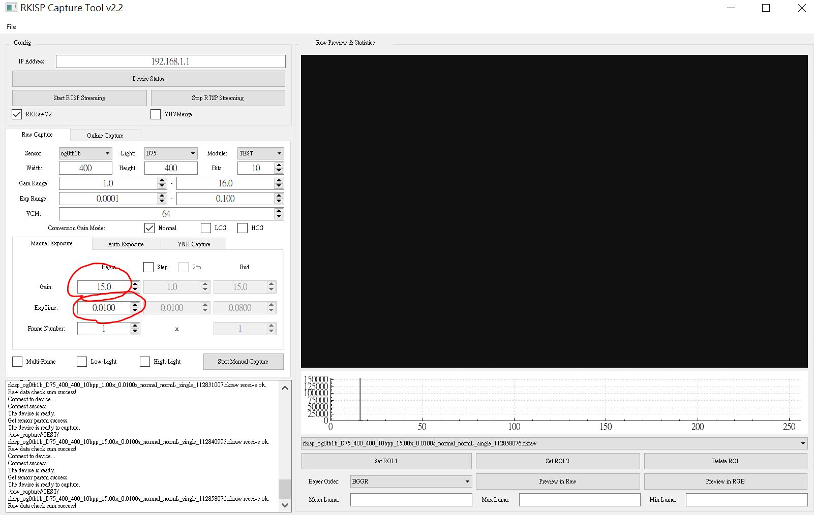

---

### 2. 使用工具進行拍攝與標定步驟
#### 步驟 1：使用 RK Capture Tool 拍攝 Raw 圖
1. 開啟 **RK Capture Tool** 並連接至板卡設備，光源名稱（Light）選擇 **unknow**（無光），模組名稱（Module）選擇 **BLC**。
  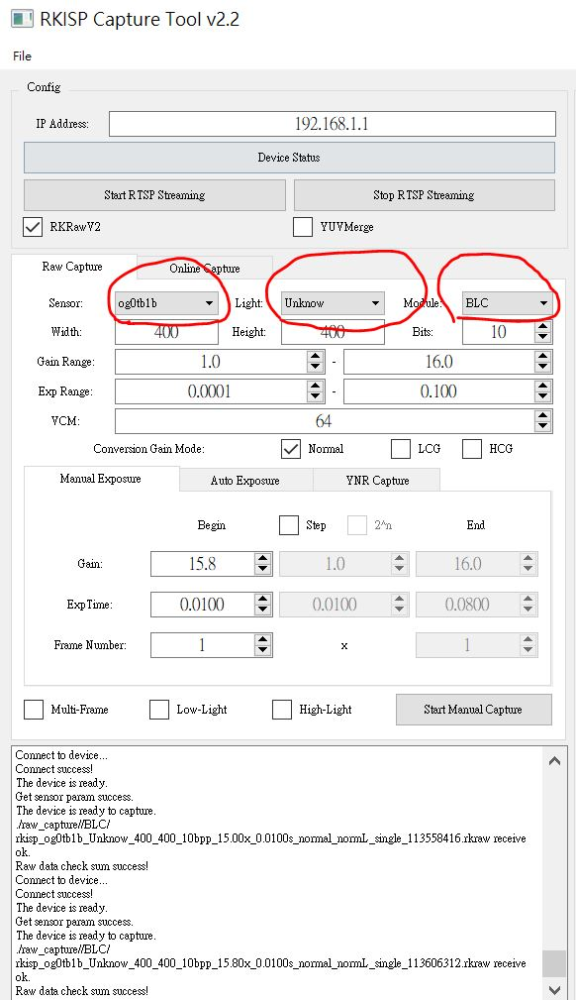 
2. 切換至 **Manual Exposure** 頁面，勾選 **Step** 與 **2^n**。
3. 設定 `Gain Begin = 1.0`，`Gain End = Max`（依 Sensor 驅動支援的最大增益），`ExpTime = 0.010`。
4. 點擊 **Start Manual Capture**，工具會自動按照 2 的次方步長批量拍攝不同 Gain 檔位下的全黑 Raw 圖。
#### 步驟 2：使用 RK Calibration Tool 計算標定參數
1. 開啟 **RK Calibration Tool**，點擊左上角的 **Edit Options**，輸入 Raw 圖的解析度尺寸（Width / Height）、位寬（Bits）及 Bayer 陣列順序。
2. 切換至 **BLC** 標籤頁，點擊下方的 **Load Raw Files** 載入剛剛拍攝的黑場 Raw 圖資料夾。
3. 點擊 **Calibrate** 按鈕開始進行標定計算。
4. 工具會繪製出各通道（R、Gr、Gb、B）黑電平隨 ISO 變化的曲線圖，並在下方表格中顯示各 ISO 檔位的黑電平數值。
  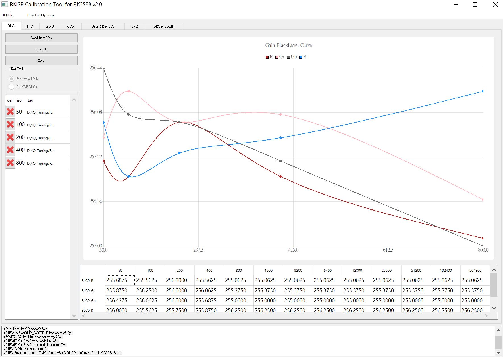
5. 確認數值無異常後，點擊 **Save** 保存 BLC 參數至 IQ JSON 檔案中。
---
### 3. IQ JSON 檔案中的 BLC 參數結構
標定完成保存後，數值會寫入 JSON 檔的 **ablc\_calib -&gt; BlcTuningPara** 節點中。其結構如下：

```
"ablc_calib": {
  "BlcTuningPara": {
    "enable": 1,
    "BLC_Data": {
      "ISO": [8, 9],
      "R_Channel":  ,
      "Gr_Channel": ,
      "Gb_Channel": ,
      "B_Channel":  
    }
  }
}

```

* **說明**：陣列中每個欄位填寫不同 ISO 等級下四通道（R, Gr, Gb, B）需要扣除的黑電平數值（例如 10-bit / 12-bit 規範下的 256 或 200）。
## 二、 Bayer NR / GIC(Raw 域降噪與綠通道平衡)
**BayerNR (Raw 域降噪)** 與 **GIC (綠通道平衡校正 - Green Imbalance Correction)** 是 Raw 域非常關鍵的兩個模組
1. **GIC 模組**：主要用於校正 Bayer 陣列中 **Gr (R 行的 Green)** 與 **Gb (B 行的 Green)** 兩個通道之間的響應不平衡。若 Gr/Gb 失衡，畫面在拉亮或高頻邊緣處容易出現像網格狀的偽影與噪點。
2. **BayerNR 模組**：包含 Bayer2DNR（空域降噪）與 BayerTNR/3DNR（時域降噪），基於 Sensor 的 Raw 域噪聲模型，在 Demosaic 之前進行初步的降噪處理。
在 **RKISP Calibration Tool** 中，**GIC 的標定與 BayerNR 是完全集成在一起的，且共用同一頁面與同一套 Raw 圖資料**。
### 1. 標定前 Raw 圖準備

GIC 與 BayerNR 的標定**直接使用與先前 YNR/MFNR 標定相同的那套 Raw 圖數據**：

* **圖卡與環境**：在標準燈箱（TL84 或 CWF）下拍攝 **24/28 色階灰階漸變卡**。
* **拍攝方法**：使用 **RK Capture Tool** 的 `YNR Capture` 頁面，遍歷 Gain（1x, 2x, 4x, 8x, 16x...），分別拍攝低光 (Low-Light) 與高光 (High-Light) 的 single（單幀）與 multiple（32 幀疊加）Raw 圖。

---

### 2. 使用 RK Calibration Tool 進行標定計算

1. **設定基礎選項**：
  * 開啟 **RK Calibration Tool**，點擊左上角 `Edit Options` 輸入 Raw 圖的尺寸、Bit 數與 Bayer 格式。
2. **進入標定頁面與載入檔案**：
  * 切換至 **GIC &amp; Bayer NR** 標籤頁。
  * 點擊 **Load Raw Files** 載入剛剛拍攝的所有 Low-Light / High-Light Raw 圖列表。
3. **選擇 ROI 區塊**：
  * 點擊 **Find ROI**，確保紅框精確選中並覆蓋灰階卡上的各個色塊。
4. **執行標定計算 (Calibrate)**：
  * 點擊 **Calibrate** 按鈕。
  * 工具會同時擬合出 **BayerNR 的 噪聲 Sigma 曲線** 以及 **GIC 模組的噪聲標準差參數 (** **noiseCurve\_0** **,** **noiseCurve\_1** **,** **NoiseScale** **,** **NoiseBase** **)**。
5. **保存結果**：
  * 計算完成後右側會繪製出噪聲曲線，點擊 **Save** 保存結果至 IQ JSON 檔中（會更新 `bayer2dnr_v2`、`bayertnr_v2` 與 `agic_calib` 節點）。

---

### 3. GIC 與 BayerNR 實景參數調優 (Tuning)

標定完成後，噪聲曲線已寫入 JSON，接下來可在在線調試介面中對兩者的控制參數進行微調：

#### 1\. GIC 關鍵控制參數微調 (`agic_calib` 節點)

GIC 的主要參數是用來控制「強弱」與「邊緣保護」，避免將真正的邊緣紋理誤判為 Gr/Gb 失衡：

* **enable**：設為 `1` 開啟 GIC 功能。
* **globalStrength**：全局控制調整 Gb/Gr 補償值的強度（取值 `0.0 ~ 2.0`，預設為 `1.0`）。若畫面上網格狀偽影仍明顯，可適度調高此值。
* **min\_busy\_thre**：Busy 區域（高對比度不規則紋理）檢測能力（取值 `0 ~ 1023`）。值越大，被判斷為 Busy 的區域越多；對於 Busy 區域，GIC 會不做處理以保留細節。
* **min\_grad\_thr1** **/** **min\_grad\_thr2**：非邊緣區域的數量閾值，用於控制 GIC 作用強度（取值 `0 ~ 1023`）。
* **maxCorV** **/** **maxCorVboth**：分別限制邊緣區域與平坦區域的 Gb/Gr 最大補償上限，防止過度校正產生拉絲感。

#### 2\. BayerNR (Bayer2DNR) 關鍵控制參數微調 (`bayer2dnr_v2` 節點)

Bayer2DNR 主要用於 Raw 域空域平滑，**不宜開得過大**，否則會直接損失後續的影像細節：

* **filter\_strength**：空域去噪力度參數（取值 `0 ~ 16`）。低 ISO 設小（如 `0.5 ~ 1.0`），高 ISO 可適當調大。
* **gauss\_guide**：高斯導向使能位，建議設為 `1`（開啟）。
* **ratio**：軟閾值比率（取值 `0.0 ~ 1.0`），值越小去噪越強，值越大保留越多噪點與細節。
* **weight**：滤波輸出權重（取值 `0.0 ~ 1.0`），值越大使用滤波結果越多，降噪感越強。

---

### 💡 總結作業流程

```
[載入灰階卡 Raw 圖] ➔ [GIC &amp; Bayer NR 頁面框選 ROI] ➔ [Calibrate 計算] ➔ [Save 保存至 JSON] ➔ [線上微調 GIC 強度與 2DNR 力度]

```

完成 GIC &amp; BayerNR 標定後，Raw 域的降噪與綠通道平衡即完全配置完畢！

## 三、 **RawNR（Raw 域靜態降噪）** 與 **DPCC（壞點校正）** 
完成 **BLC（黑電平）** 與 **LSC（鏡頭陰影校正）** 標定後，接下來便是 **RawNR（Raw 域靜態降噪）** 與 **DPCC（壞點校正）** 的標定與調優。
這兩個模組直接作用於 Sensor 輸出的原始 Bayer/灰階 Raw 數據，對於維持畫面解析力與清除 Sensor 硬體瑕疵至關重要。

### 一、 RawNR（BayerNR / Raw 域靜態降噪標定）

#### 1\. 概念與作用

RawNR（在 ISP30 中對應 `bayer2dnr_v2` 空域降噪與 `bayertnr_v2` 時域降噪）主要用於在 Bayer Raw 域進行初步降噪。它的核心目標是透過拍攝不同 ISO 檔位下的灰階圖，標定出 Sensor 在不同亮度下的**噪聲曲線（Noise Profile / Sigma Curve）**。

#### 2\. RAW 數據採集步驟 (使用 RK Capture Tool)

RawNR 標定所需的 Raw 圖拍攝要求較為嚴格，需採用 **YNR Capture** 專用拍攝模式：

1. **環境準備**：
  * 在標準燈箱（TL84 或 CWF 光源）中放置 **24 色階/灰度漸變卡**。
  * 將相機對準漸變卡，使漸變卡儘量填滿畫面中心區域。
2. **切換拍攝模式**：
  * 開啟 **RK Capture Tool**，選擇 **YNR Capture** 標籤頁，Module 名稱選擇 **NR\_Normal**。
3. **選擇 ROI 區域**：
  * 先拍攝一張預覽圖，在右側預覽視窗中右鍵選擇 **Draw ROI**，分別框選漸變卡上的**最黑區塊（Black Block）** **與** **最亮區塊（White Block）**。
      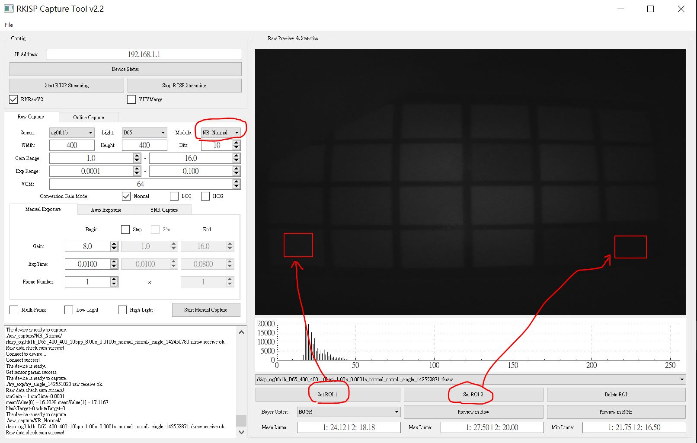  
4. **遍歷 Gain 拍攝（高光與低光檔位）**：
  * 需遍歷拍攝 Gain = `1x, 2x, 4x, 8x, 16x... Max`。
  * 針對每一個 Gain 檔位，勾選 **Multi-Frame**，並分別拍攝：
    * **低光（Low-Light）**：調節曝光使最亮塊像素值達到約 `30`，最暗塊接近 BLC 值。
    * **高光（High-Light）**：調節曝光使最亮塊像素值達到約 `255`（不過曝），最暗塊約在 `60~70`。
    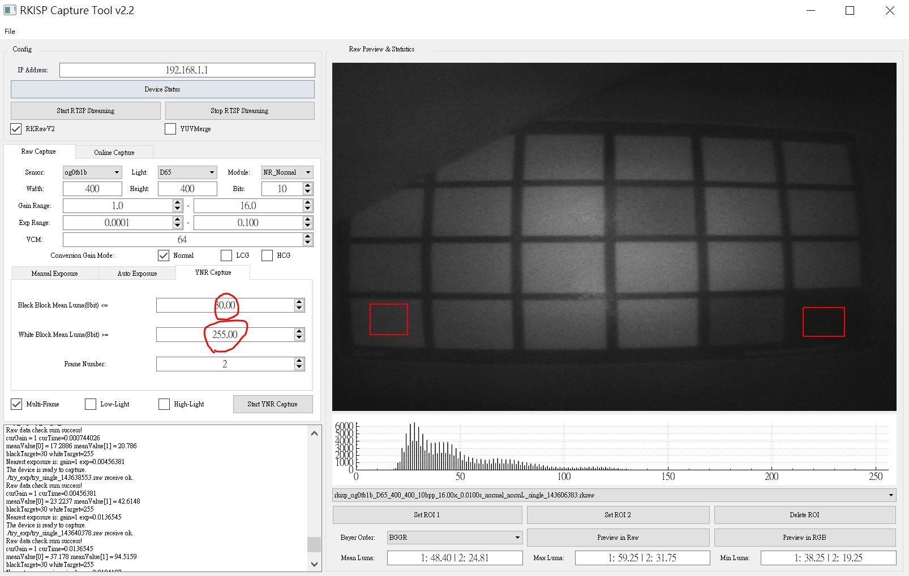  
  * 工具會自動幫每個 Gain 產出 `Single`（單幀）與 `Multiple`（多幀疊加）各一張 Raw 圖。
    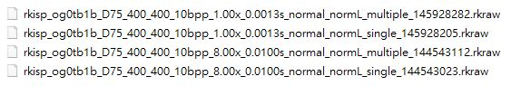  
#### 3\. 標定計算步驟 (使用 RK Calibration Tool)

1. 開啟 **RK Calibration Tool**，進入 **GIC &amp; Bayer NR** 頁面。
2. 點擊 **Load Raw Files** 導入剛拍攝的所有 NR Raw 圖。
3. 點擊 **Find ROI**，框出圖片中灰階漸變卡的位置。
4. 點擊 **Calibrate** 開始計算，工具會擬合出各 ISO 檔位下的 **BayerNR Sigma 噪聲曲線**。
5. 確認曲線平滑無異常後，點擊 **Save** 將標定數據保存至 IQ JSON 檔案中（寫入 `bayer2dnr_v2` / `bayertnr_v2` 節點）。

---

### 二、 DPCC（靜態與動態壞點校正）

#### 1\. 概念與作用

DPCC（Defect Pixel Cluster Correction）模組用於檢測並消除 Sensor 上的「靜態壞點」（常亮亮點、死黑點）以及高 ISO 下產生的「動態壞點」。

#### 2\. 工作模式與關鍵參數 (ISP30 架構)

在 IQ JSON 檔中的 **adpcc\_calib -&gt; DpccTuningPara** 節點下，主要支援以下工作模式：

1. **Fast\_mode（快速抽象模式 - 推薦使用）**：
  * **fast\_mode\_en: 1**：開啟快速模式。
  * **Single\_level** **(0\~10)**：針對孤立單壞點進行濾除。數值越大去除力度越強（`0` 代表不處理）。
  * **Double\_level** **(0\~10)**：針對相鄰的雙壞點（如 1x2、2x1 壞點簇）進行濾除。
  * **Triple\_level** **(0\~10)**：針對 3 個以上的壞點簇進行濾除。
```
        "adpcc_calib":	{
							"DpccTuningPara":	{
								"Enable":	1,
								"Fast_Mode":	{
									"Fast_mode_en":	1,
									"Single_enable":	1,
									"Double_enable":	1,
									"Triple_enable":	1,
									"Fast_Data":	{
										"ISO":	[50],
										"ISO_len":	1,
										"Single_level":	[1, 1, 1, 1, 1, 1, 1, 1, 1, 1, 1, 1, 1, 1, 1, 1, 1, 1, 1, 1, 1, 1, 1, 1, 1, 1, 1, 1, 1, 1, 1, 1, 1, 1, 1, 1, 1, 1, 1, 1, 1, 1, 1, 1, 1, 1, 1, 1, 1, 1, 1, 1, 1, 1, 1, 1, 1, 1, 1, 1, 1, 1, 1, 1, 1, 1, 1, 1, 1, 1, 1, 1, 1, 1, 1, 1, 1, 1, 1, 1, 1, 1, 1, 1, 1, 1, 1, 1, 1, 1, 1, 1, 1, 1, 1, 1, 1, 1, 1, 1],
										"Single_level_len":	100,
										"Double_level":	[1, 1, 1, 1, 1, 1, 1, 1, 1, 1, 1, 1, 1, 1, 1, 1, 1, 1, 1, 1, 1, 1, 1, 1, 1, 1, 1, 1, 1, 1, 1, 1, 1, 1, 1, 1, 1, 1, 1, 1, 1, 1, 1, 1, 1, 1, 1, 1, 1, 1, 1, 1, 1, 1, 1, 1, 1, 1, 1, 1, 1, 1, 1, 1, 1, 1, 1, 1, 1, 1, 1, 1, 1, 1, 1, 1, 1, 1, 1, 1, 1, 1, 1, 1, 1, 1, 1, 1, 1, 1, 1, 1, 1, 1, 1, 1, 1, 1, 1, 1],
										"Double_level_len":	100,
										"Triple_level":	[1, 1, 1, 1, 1, 1, 1, 1, 1, 1, 1, 1, 1, 1, 1, 1, 1, 1, 1, 1, 1, 1, 1, 1, 1, 1, 1, 1, 1, 1, 1, 1, 1, 1, 1, 1, 1, 1, 1, 1, 1, 1, 1, 1, 1, 1, 1, 1, 1, 1, 1, 1, 1, 1, 1, 1, 1, 1, 1, 1, 1, 1, 1, 1, 1, 1, 1, 1, 1, 1, 1, 1, 1, 1, 1, 1, 1, 1, 1, 1, 1, 1, 1, 1, 1, 1, 1, 1, 1, 1, 1, 1, 1, 1, 1, 1, 1, 1, 1, 1],
										"Triple_level_len":	100
									}
								},
```
2. **Expert\_mode（專家模式 - 高級微調）**：
  * 當 Fast\_mode 無法滿足需求時使用，包含 6 種硬體檢測算法（`RK`、`LC`、`PG`、`RND`、`RG`、`RO`）與 4 種判定方案（`fix_set`、`set1~3`）。
```
          "Expert_Mode":	{
									"stage1_Enable":	1,
									"grayscale_mode":	0,
									"dpcc_out_sel":	1,
									"stage1_g_3x3":	0,
									"stage1_rb_3x3":	0,
									"stage1_inc_rb_center":	1,
									"stage1_inc_g_center":	1,
									"rk_out_sel":	0,
									"SetEnable":	{
										"ISO":	[50, 100, 200, 400, 800, 1600, 3200, 6400, 12800, 25600, 51200, 102400, 204800],
										"fix_set":	[0, 0, 0, 0, 0, 0, 0, 0, 0, 0, 0, 0, 0],
										"set1":	[0, 0, 0, 0, 0, 0, 0, 0, 0, 0, 0, 0, 0],
										"set2":	[0, 0, 0, 0, 0, 0, 0, 0, 0, 0, 0, 0, 0],
										"set3":	[0, 0, 0, 0, 0, 0, 0, 0, 0, 0, 0, 0, 0]
									},
									"set1":	{
										"RK":	{
											"RK_enable":	[0, 0, 0, 0, 0, 0, 0, 0, 0, 0, 0, 0, 0],
											"rb_sw_mindis":	[0, 0, 0, 0, 0, 0, 0, 0, 0, 0, 0, 0, 0],
											"g_sw_mindis":	[0, 0, 0, 0, 0, 0, 0, 0, 0, 0, 0, 0, 0],
											"sw_dis_scale_min":	[0, 0, 0, 0, 0, 0, 0, 0, 0, 0, 0, 0, 0],
											"sw_dis_scale_max":	[0, 0, 0, 0, 0, 0, 0, 0, 0, 0, 0, 0, 0]
										},
										"LC":	{
											"LC_enable":	[1, 1, 1, 1, 1, 1, 1, 1, 1, 1, 1, 1, 1],
											"rb_line_thr":	[8, 8, 8, 8, 8, 8, 8, 8, 8, 8, 8, 8, 8],
											"g_line_thr":	[8, 8, 8, 8, 8, 8, 8, 8, 8, 8, 8, 8, 8],
											"rb_line_mad_fac":	[4, 4, 4, 4, 4, 4, 4, 4, 4, 4, 4, 4, 4],
											"g_line_mad_fac":	[4, 4, 4, 4, 4, 4, 4, 4, 4, 4, 4, 4, 4]
										},
										"PG":	{
											"PG_enable":	[1, 1, 1, 1, 1, 1, 1, 1, 1, 1, 1, 1, 1],
											"rb_pg_fac":	[4, 4, 4, 4, 4, 4, 4, 4, 4, 4, 4, 4, 4],
											"g_pg_fac":	[3, 3, 3, 3, 3, 3, 3, 3, 3, 3, 3, 3, 3]
										},
										"RND":	{
											"RND_enable":	[1, 1, 1, 1, 1, 1, 1, 1, 1, 1, 1, 1, 1],
											"rb_rnd_thr":	[8, 8, 8, 8, 8, 8, 8, 8, 8, 8, 8, 8, 8],
											"g_rnd_thr":	[8, 8, 8, 8, 8, 8, 8, 8, 8, 8, 8, 8, 8],
											"rb_rnd_offs":	[3, 3, 3, 3, 3, 3, 3, 3, 3, 3, 3, 3, 3],
											"g_rnd_offs":	[3, 3, 3, 3, 3, 3, 3, 3, 3, 3, 3, 3, 3]
										},
										"RG":	{
											"RG_enable":	[1, 1, 1, 1, 1, 1, 1, 1, 1, 1, 1, 1, 1],
											"rb_rg_fac":	[8, 8, 8, 8, 8, 8, 8, 8, 8, 8, 8, 8, 8],
											"g_rg_fac":	[8, 8, 8, 8, 8, 8, 8, 8, 8, 8, 8, 8, 8]
										},
										"RO":	{
											"RO_enable":	[1, 1, 1, 1, 1, 1, 1, 1, 1, 1, 1, 1, 1],
											"rb_ro_lim":	[1, 1, 1, 1, 1, 1, 1, 1, 1, 1, 1, 1, 1],
											"g_ro_lim":	[1, 1, 1, 1, 1, 1, 1, 1, 1, 1, 1, 1, 1]
										}
									},
```
3. **Sensor\_dpcc**：
  * 若 Sensor 晶片硬體本身支援內建壞點修復，可在此配置 `max_level`、`level_single` 等參數交由 Sensor 端處理。
```
          "Sensor_dpcc":	{
									"sensor_dpcc_auto_en":	1,
									"max_level":	1,
									"SensorDpcc_Data":	{
										"ISO":	[50],
										"ISO_len":	1,
										"level_single":	[1, 1, 1, 1, 1, 1, 1, 1, 1, 1, 1, 1, 1, 1, 1, 1, 1, 1, 1, 1, 1, 1, 1, 1, 1, 1, 1, 1, 1, 1, 1, 1, 1, 1, 1, 1, 1, 1, 1, 1, 1, 1, 1, 1, 1, 1, 1, 1, 1, 1, 1, 1, 1, 1, 1, 1, 1, 1, 1, 1, 1, 1, 1, 1, 1, 1, 1, 1, 1, 1, 1, 1, 1, 1, 1, 1, 1, 1, 1, 1, 1, 1, 1, 1, 1, 1, 1, 1, 1, 1, 1, 1, 1, 1, 1, 1, 1, 1, 1, 1],
										"level_single_len":	100,
										"level_multiple":	[1, 1, 1, 1, 1, 1, 1, 1, 1, 1, 1, 1, 1, 1, 1, 1, 1, 1, 1, 1, 1, 1, 1, 1, 1, 1, 1, 1, 1, 1, 1, 1, 1, 1, 1, 1, 1, 1, 1, 1, 1, 1, 1, 1, 1, 1, 1, 1, 1, 1, 1, 1, 1, 1, 1, 1, 1, 1, 1, 1, 1, 1, 1, 1, 1, 1, 1, 1, 1, 1, 1, 1, 1, 1, 1, 1, 1, 1, 1, 1, 1, 1, 1, 1, 1, 1, 1, 1, 1, 1, 1, 1, 1, 1, 1, 1, 1, 1, 1, 1],
										"level_multiple_len":	100
									}
								}
```
#### 3\. 壞點標定與實用調優步驟

DPCC 不需要複雜的 Raw 圖計算，通常採 **「實測與等級微調」** 方式進行：

1. **尋找與觀察壞點**：
  * **靜態亮點（Hot Pixels）**：全遮黑鏡頭，將 Gain/ISO 拉到最大（如 Gain=16x/32x），觀察畫面上是否有固定不變的白色亮點。
  * **靜態暗點（Dark Pixels）**：對準均勻高光白牆/燈箱，觀察畫面上是否有固定不變的死黑點。
2. **Fast\_mode 調優（建議做法）**：
  * 在 JSON 檔中確認 **Fast\_mode\_enable: 1**。
  * **高 ISO 檔位分段設定**：低 ISO 下壞點不敏感，`Single_level` 可設為 `1~3`；在高 ISO（如 ISO 3200/6400）環境下，將 `Single_level` 逐步調高至 `5~8`。
  * 若發現有連續相鄰壞點未被剔除，可將 `Double_level` 設為 `3~5`。
3. **注意事項**：
  * **避免過度校正**：`Single_level` 等級切勿設得過高（如直接開到 10），否則 ISP 會將畫面中的高頻細節（如星星、細微線條紋理）誤判為壞點而抹除。

---

### 標定與調優順序總結

```
[BLC 黑電平] ➔ [LSC 鏡頭陰影] ➔ [RawNR 噪聲曲線標定] ➔ [DPCC 壞點消除] ➔ [AWB / CCM / YUV 降噪]

```

## 四、 LSC（鏡頭陰影校正 - Lens Shading Correction）
主要用於修復由於鏡頭凸透鏡光學特性導致的邊角亮度衰減（Luma Shading），以及因紅外截止濾光片（IR-Cut）或微透鏡 CRA 不匹配引起的邊角偏色（Color Shading）。ISP 會在影像上記錄 $17 \times 17$ 的網格點陣列，分別對 R、Gr、Gb、B 四個通道獨立進行增益補償。
### 一、 標定前置要求與環境準備
1. 黑電平（BLC）必須先標定準確：LSC 計算屬於乘法增益補償，若 BLC 數值有偏差，經 LSC 增益放大後會嚴重破壞畫面暗部的亮度與色彩。
2. 標準拍攝環境與配件：
    - 燈箱與光源：需在標準光源燈箱中拍攝 7 種光源（HZ、A、CWF、TL84、D50、D65、D75）。
    - 均光配件：使用毛玻璃或均光片緊貼覆蓋鏡頭（或使用 DNP 燈箱/積分球），確保進入鏡頭的光線絕對均勻平坦。
3. 防閃爍與曝光規範：
    - 曝光時間建議設為 10ms 的整數倍 以防止交流電閃爍（Flicker）。
    - Raw 圖的最大亮度需控制在 200 左右（8-bit 規範，約 80% 飽和度），且最小亮度需明顯大於 BLC 黑電平值。
### 二、 RAW 圖拍攝與工具標定步驟
1. 使用 RK Capture Tool 自動擷取 Raw 圖
    - 在 RK Capture Tool 連接板卡，Module 選擇 LSC。
    - 放置均光片並切換燈箱至第一種光源（如 HZ）。
    - 切換至 Auto Exposure 頁面，勾選 **Search Exposure By Max Luma(8bit)**（目標最大亮度設為 200 ± 10%）與 Anti-Flicker(60Hz)。
    - 點擊 **Start Auto Capture**，工具會自動尋找合適曝光並拍攝 Raw 圖。
    - 依序切換其餘 6 種光源（A、CWF、TL84、D50、D65、D75），修改對應 Light 名稱後拍攝完成。
  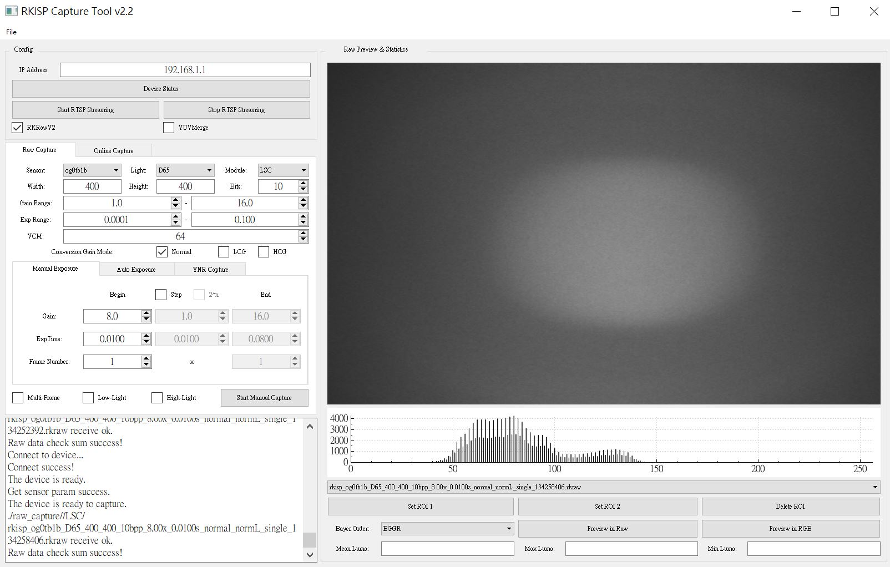
2. 使用 RK Calibration Tool 計算校正矩陣
    - 開啟 RK Calibration Tool，在 **Edit Options** 設定 Raw 圖解析度、Bit 數與 Bayer 順序。
  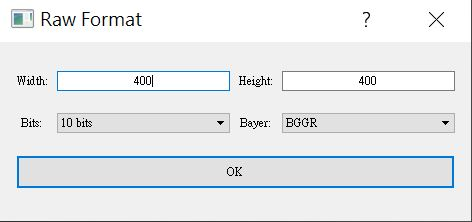
    - 進入 **LSC** 頁面，點擊 **Load Raw Files** 導入剛拍攝的 7 張 Raw 圖。
    - 全補償標定：將 **Light Fall off** 設定為 **100%**，點擊 **Calibrate** 開始計算，完成後點擊 **Save** 存檔。
    - 衰減組標定：將 **Light Fall off** 修改為 **70%**（保留 30% 自然暗角，避免邊角過度放大噪聲），重新點擊 **Calibrate** 並保存。
      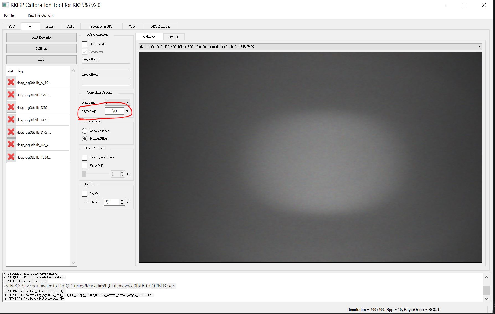
      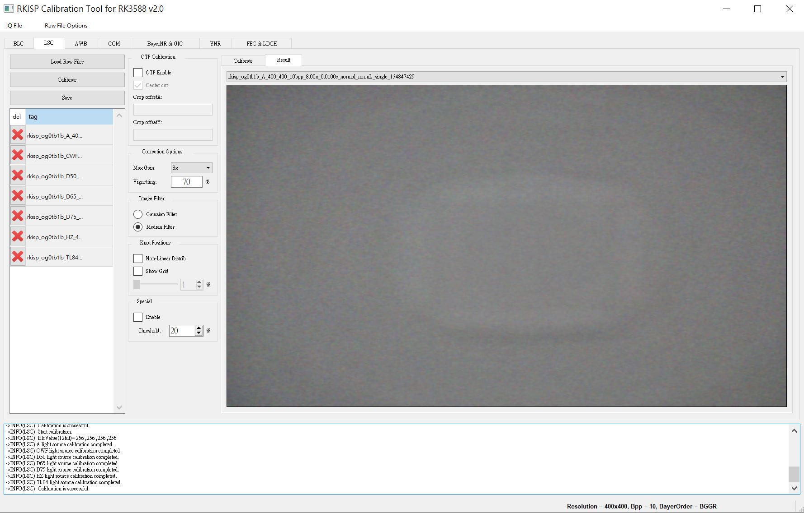

### 三、 IQ JSON 檔中的參數架構與實景調優
標定結果會寫入 IQ JSON 檔的 lsc_v2 節點中，包含三大核心結構：
1. **common**（網格分割）：
    - **enable: 1** 開啟 LSC 功能，**resolutionAll** 定義解析度（如 **400x400**）與水平/垂直 16 個區塊的比重（**lsc_sect_size_x / y**）。
```
"common":	{
								"enable":	1,
								"resolutionAll":	[{
										"name":	"400x400",
										"lsc_sect_size_x":	[25, 25, 25, 25, 25, 25, 25, 25, 25, 25, 25, 25, 25, 25, 25, 25],
										"lsc_sect_size_y":	[25, 25, 25, 25, 25, 25, 25, 25, 25, 25, 25, 25, 25, 25, 25, 25]
									}],
								"resolutionAll_len":	1
							},
```
2. **alscCoef**（光源策略與 ISO 聯動）：
    - **illAll**：定義不同光源下觸發的白平衡增益區間（**wbGain**）。
    ```
            "illAll":	[{
										"usedForCase":	0,
										"name":	"A",
										"wbGain":	[1.0066, 0.9955],
										"tableUsed":	[{
												"name":	"A_70"
											}],
    ```
    - **vig** (ISO 聯動衰減)：為防止低照度（高 ISO/Gain）環境下 LSC 將邊角噪聲過度放大，可透過 **vig** 陣列（如 ....）使 LSC 補償強度隨 ISO 升高而平滑降低。
    ```
										"tableUsed_len":	1,
										"gains":	[1, 4, 8, 16],
										"gains_len":	4,
										"vig":	[100, 100, 90, 70],
										"vig_len":	4
									},
    ```
3. **tbl -> tableAll**（17x17 增益矩陣）：包含 R、Gr、Gb、B 四個通道各 289 個（$17 \times 17$）校正係數（**uCoeff**）...。💡 
    ```
    "tbl":	{
								"tableAll":	[{
										"name":	"400x400_A_70",
										"resolution":	"400x400",
										"illumination":	"A",
										"vignetting":	70,
										"lsc_samples_red":	{
											"uCoeff":	[3793, 3341, 2907, 2519, 2322, 2163, 1982, 1921, 1809, 1785, 1872, 1947, 2071, 2218, 2335, 2586, 2925, 3556, 3228, 2763, 2436, 2264, 2038, 1879, 1828, 1791, 1774, 1814, 1865, 1979, 2118, 2326, 2597, 2818, 3379, 3040, 2683, 2391, 2099, 1976, 1855, 1822, 1786, 1743, 1783, 1846, 1920, 2040, 2243, 2526, 2721, 3302, 2940, 2557, 2293, 2143, 1974, 1881, 1792, 1745, 1736, 1761, 1849, 1932, 2046, 2218, 2417, 2765, 3171, 2916, 2527, 2292, 2113, 1911, 1798, 1706, 1656, 1655, 1707, 1795, 1910, 2035, 2193, 2412, 2694, 3239, 2897, 2463, 2283, 2072, 1870, 1650, 1433, 1281, 1266, 1371, 1591, 1827, 2037, 2259, 2453, 2689, 3112, 2853, 2507, 2290, 2016, 1736, 1407, 1232, 1113, 1105, 1177, 1332, 1667, 1971, 2222, 2443, 2638, 3198, 2869, 2520, 2278, 2001, 1651, 1310, 1168, 1092, 1082, 1137, 1226, 1515, 1924, 2213, 2481, 2699, 3055, 2823, 2510, 2261, 1963, 1564, 1262, 1119, 1057, 1057, 1115, 1201, 1438, 1883, 2186, 2461, 2613, 3011, 2802, 2468, 2237, 1946, 1558, 1235, 1101, 1030, 1024, 1074, 1167, 1426, 1845, 2134, 2433, 2642, 3080, 2659, 2395, 2177, 1931, 1588, 1252, 1115, 1033, 1026, 1083, 1182, 1473, 1853, 2127, 2351, 2554, 2988, 2669, 2357, 2153, 1889, 1686, 1335, 1126, 1034, 1030, 1089, 1235, 1586, 1842, 2058, 2279, 2466, 2951, 2636, 2309, 2060, 1888, 1738, 1562, 1325, 1171, 1142, 1255, 1470, 1708, 1861, 2032, 2205, 2442, 2866, 2642, 2237, 2056, 1883, 1733, 1631, 1555, 1514, 1494, 1550, 1623, 1708, 1857, 1974, 2138, 2457, 2943, 2610, 2264, 1986, 1815, 1674, 1586, 1543, 1513, 1526, 1544, 1596, 1696, 1797, 1924, 2110, 2381, 2820, 2550, 2238, 1989, 1765, 1629, 1545, 1485, 1459, 1439, 1482, 1540, 1643, 1723, 1917, 2159, 2368, 2806, 2524, 2209, 1995, 1767, 1647, 1485, 1441, 1408, 1440, 1463, 1519, 1636, 1771, 1962, 2136, 2360]
										},
										"lsc_samples_greenR":	{
											"uCoeff":	[3714, 3369, 2890, 2602, 2269, 2139, 2025, 1913, 1838, 1794, 1857, 1947, 2068, 2180, 2407, 2591, 2950, 3685, 3255, 2787, 2540, 2238, 2064, 1933, 1880, 1786, 1809, 1815, 1894, 1995, 2125, 2370, 2571, 2842, 3553, 3086, 2690, 2373, 2176, 2018, 1892, 1817, 1807, 1784, 1798, 1832, 1952, 2057, 2217, 2504, 2762, 3383, 3005, 2593, 2347, 2132, 1965, 1888, 1814, 1740, 1745, 1769, 1857, 1948, 2053, 2237, 2436, 2770, 3269, 2959, 2520, 2300, 2131, 1974, 1800, 1726, 1699, 1668, 1703, 1776, 1910, 2043, 2222, 2432, 2666, 3195, 2979, 2537, 2258, 2079, 1857, 1670, 1457, 1304, 1274, 1360, 1588, 1856, 2011, 2223, 2446, 2679, 3253, 2876, 2598, 2308, 2032, 1795, 1442, 1249, 1145, 1107, 1172, 1311, 1658, 1971, 2230, 2424, 2693, 3201, 2839, 2568, 2296, 2017, 1663, 1335, 1166, 1093, 1084, 1144, 1227, 1518, 1932, 2200, 2514, 2672, 3145, 2811, 2517, 2279, 1987, 1613, 1266, 1130, 1065, 1056, 1109, 1200, 1446, 1898, 2184, 2467, 2666, 3099, 2825, 2501, 2245, 2001, 1591, 1240, 1105, 1037, 1039, 1085, 1180, 1432, 1860, 2142, 2428, 2601, 3042, 2762, 2466, 2195, 1954, 1638, 1266, 1117, 1039, 1024, 1085, 1186, 1434, 1853, 2136, 2383, 2575, 3054, 2722, 2376, 2162, 1927, 1724, 1339, 1151, 1044, 1037, 1086, 1245, 1553, 1842, 2092, 2264, 2460, 3080, 2755, 2340, 2096, 1926, 1740, 1596, 1325, 1183, 1146, 1258, 1483, 1698, 1848, 2040, 2201, 2462, 2929, 2729, 2277, 2100, 1913, 1760, 1645, 1593, 1526, 1530, 1563, 1636, 1723, 1821, 2008, 2156, 2409, 2967, 2680, 2283, 2003, 1816, 1705, 1610, 1575, 1521, 1529, 1557, 1609, 1698, 1826, 1908, 2106, 2400, 2904, 2586, 2267, 2013, 1753, 1649, 1563, 1488, 1470, 1469, 1490, 1574, 1645, 1745, 1941, 2166, 2388, 2957, 2625, 2324, 1993, 1795, 1654, 1535, 1449, 1415, 1425, 1480, 1522, 1650, 1785, 1988, 2188, 2393]
										},
										"lsc_samples_greenB":	{
											"uCoeff":	[3678, 3398, 2832, 2570, 2341, 2129, 1989, 1920, 1846, 1844, 1857, 1938, 2022, 2214, 2407, 2591, 2885, 3719, 3180, 2805, 2498, 2294, 2083, 1957, 1836, 1799, 1809, 1829, 1880, 2022, 2135, 2357, 2602, 2944, 3464, 3065, 2690, 2410, 2136, 2009, 1900, 1830, 1781, 1804, 1798, 1846, 1952, 2057, 2239, 2532, 2780, 3356, 3025, 2564, 2334, 2132, 1981, 1903, 1801, 1753, 1751, 1782, 1857, 1957, 2053, 2204, 2410, 2752, 3245, 2940, 2520, 2311, 2112, 1927, 1807, 1720, 1676, 1663, 1703, 1797, 1925, 2061, 2232, 2432, 2699, 3242, 2922, 2483, 2291, 2062, 1885, 1670, 1469, 1307, 1290, 1379, 1604, 1843, 2063, 2255, 2446, 2779, 3182, 2876, 2542, 2297, 2050, 1763, 1434, 1227, 1137, 1119, 1194, 1332, 1669, 1971, 2240, 2503, 2693, 3179, 2856, 2527, 2286, 1992, 1659, 1324, 1163, 1101, 1089, 1152, 1240, 1542, 1932, 2210, 2528, 2721, 3080, 2811, 2531, 2258, 1971, 1592, 1256, 1138, 1065, 1063, 1119, 1206, 1450, 1884, 2184, 2467, 2650, 3015, 2775, 2488, 2234, 1953, 1566, 1233, 1115, 1035, 1035, 1097, 1191, 1441, 1874, 2171, 2428, 2617, 2981, 2728, 2441, 2205, 1946, 1601, 1266, 1107, 1037, 1032, 1083, 1201, 1450, 1861, 2116, 2347, 2590, 2991, 2706, 2352, 2162, 1919, 1707, 1335, 1140, 1047, 1024, 1102, 1236, 1584, 1870, 2102, 2275, 2515, 2954, 2706, 2328, 2104, 1903, 1759, 1601, 1332, 1169, 1143, 1261, 1478, 1716, 1862, 2040, 2201, 2449, 2889, 2695, 2255, 2045, 1883, 1748, 1628, 1567, 1531, 1525, 1572, 1630, 1723, 1836, 2008, 2135, 2463, 2885, 2631, 2260, 1968, 1845, 1687, 1621, 1580, 1531, 1534, 1562, 1598, 1698, 1819, 1941, 2158, 2470, 2925, 2602, 2280, 2013, 1773, 1649, 1553, 1521, 1470, 1474, 1504, 1574, 1675, 1731, 1916, 2155, 2415, 2829, 2576, 2228, 1958, 1824, 1661, 1506, 1449, 1450, 1422, 1489, 1517, 1638, 1785, 1952, 2143, 2393]
										},
										"lsc_samples_blue":	{
											"uCoeff":	[3685, 3404, 2958, 2623, 2359, 2164, 2056, 1908, 1849, 1804, 1884, 1967, 2082, 2174, 2346, 2596, 3001, 3727, 3288, 2847, 2517, 2264, 2069, 1937, 1869, 1809, 1813, 1833, 1876, 1990, 2170, 2401, 2576, 2847, 3441, 3115, 2728, 2416, 2160, 2031, 1896, 1827, 1811, 1775, 1775, 1887, 1940, 2062, 2233, 2509, 2786, 3336, 2990, 2584, 2363, 2126, 2010, 1884, 1811, 1769, 1729, 1779, 1854, 1937, 2058, 2263, 2455, 2740, 3204, 3005, 2553, 2304, 2154, 1954, 1816, 1730, 1674, 1719, 1712, 1813, 1914, 2092, 2259, 2424, 2722, 3225, 2946, 2515, 2318, 2093, 1868, 1685, 1448, 1293, 1303, 1386, 1602, 1853, 2024, 2238, 2465, 2700, 3166, 2900, 2533, 2280, 2020, 1805, 1426, 1242, 1145, 1112, 1194, 1314, 1661, 1974, 2224, 2455, 2714, 3118, 2880, 2519, 2313, 2021, 1690, 1330, 1182, 1105, 1091, 1151, 1248, 1535, 1967, 2215, 2493, 2678, 3108, 2834, 2536, 2273, 2008, 1585, 1265, 1133, 1074, 1068, 1117, 1205, 1445, 1865, 2169, 2513, 2640, 3106, 2831, 2467, 2219, 1965, 1594, 1233, 1118, 1043, 1032, 1092, 1182, 1428, 1863, 2156, 2432, 2717, 3048, 2750, 2484, 2230, 1935, 1631, 1259, 1119, 1041, 1037, 1085, 1192, 1441, 1872, 2140, 2375, 2595, 3061, 2745, 2443, 2196, 1931, 1681, 1345, 1159, 1034, 1024, 1102, 1238, 1552, 1867, 2088, 2258, 2520, 3001, 2761, 2344, 2118, 1915, 1776, 1568, 1328, 1175, 1157, 1267, 1494, 1708, 1866, 2035, 2206, 2413, 2954, 2669, 2281, 2095, 1887, 1758, 1648, 1570, 1529, 1523, 1551, 1623, 1714, 1825, 1961, 2160, 2482, 2932, 2652, 2323, 1990, 1827, 1721, 1630, 1569, 1543, 1546, 1555, 1623, 1719, 1787, 1936, 2110, 2419, 2996, 2640, 2284, 2036, 1776, 1646, 1562, 1500, 1456, 1472, 1493, 1556, 1666, 1734, 1887, 2148, 2365, 2963, 2631, 2291, 2052, 1813, 1670, 1529, 1460, 1426, 1437, 1478, 1529, 1659, 1761, 1974, 2104, 2343]
										}
    ```
## 固定一組 LSC 的快捷配置技巧若只需套用固定一組 LSC 數據：
- 將 illAll 中的 wbGain 設為 [0.0, 1000.0]，確保不論色溫如何變化都能 100% 命中。
- 確保 **illAll -> tableUsed -> name** 與 **tableAll -> name** 的表名完全一致（如均設為 "FIXED_100"），並將 **illAll_len** 與 **tableAll_len** 均修改為 1。

## 五、 AWB（自動白平衡 - Auto White Balance）& CCM (色彩校正矩陣標定 - Color Correction Matrix)
**AWB（自動白平衡）** 與 **CCM（色彩校正矩陣）** 是決定影像色彩還原準確度的核心模組。這兩個模組通常在完成 **BLC (黑電平)** 與 **LSC (鏡頭陰影校正)** 後共同進行標定。
### 一、 RAW 圖拍攝規範 (AWB / CCM 共用)
標定 AWB 與 CCM 需要在標準實驗室環境下拍攝 24 色卡 RAW 圖：
1. 環境與設備準備：
    - 標準光源燈箱：包含 7 種標準光源（HZ、A、CWF、TL84、D50、D65、D75）。
    - X-Rite 24 色卡：將色卡放置於燈箱背景牆中心，確保兩側光源照射均勻。
2. 構圖與擺放：
    - 調整相機距離，使 24 色卡在畫面中的占比大於 1/9，且四周不要有強烈雜光干擾。
3. 曝光控制：
    - 開啟 RK Capture Tool，Module 選擇 **CCM_AWB**。
    - 勾選 **Anti-Flicker (60Hz)** 避免交流電閃爍。  
        ") 
    - 調整曝光時間與增益，使 24 色卡中最亮的白色塊（第 19 號色塊）最大亮度控制在 150 ~ 240（8-bit 規範，建議約 200），且絕不能過曝。
4. 批量拍攝 7 種光源：
    - 依次切換燈箱至 7 種光源（HZ, A, CWF, TL84, D50, D65, D75），同步修改工具中的 Light 名稱後點擊 **Start Auto Capture** 拍攝。  
        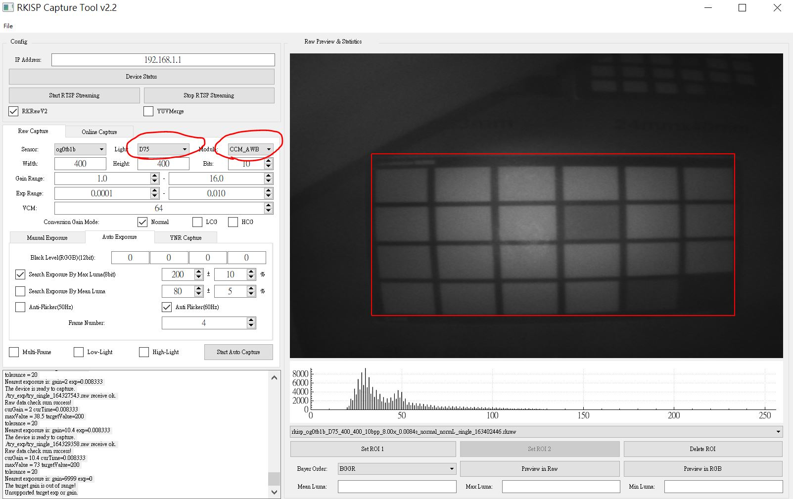     
### 二、 AWB (自動白平衡) 標定步驟
AWB 標定的目的是建立不同光源下的**白點條件框（WPC）**與標準白平衡增益（wbGain）。
1. 導入 Raw 圖：
    - 開啟 RK Calibration Tool，進入 AWB 頁面，點擊 Load Raw Files 載入剛剛拍攝的 7 張 24 色卡 Raw 圖。
      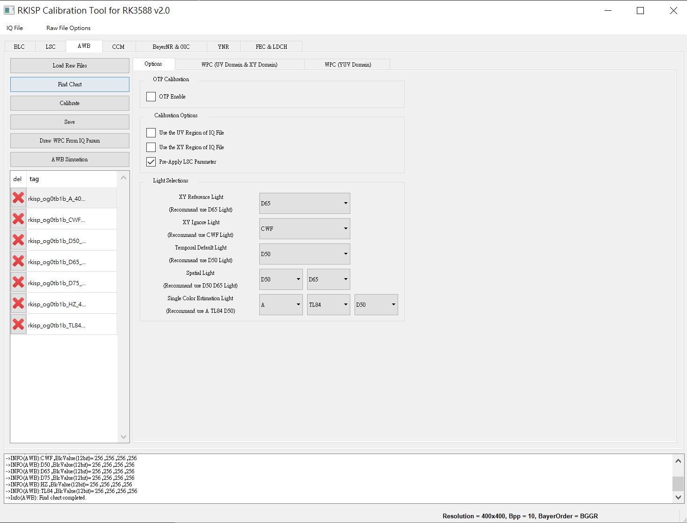  
2. 色塊自動識別 (Find Chart)：
    - 點擊 **Find Chart**，在畫面上框選 24 色卡的四角（第 1、6、19、20 號色塊中心）。
    - 工具會自動批量識別所有光源圖中的色塊位置。若有個別光源（如 TL84）定位偏移，可切換模式為 **Find current chart** 單獨校正點位。
      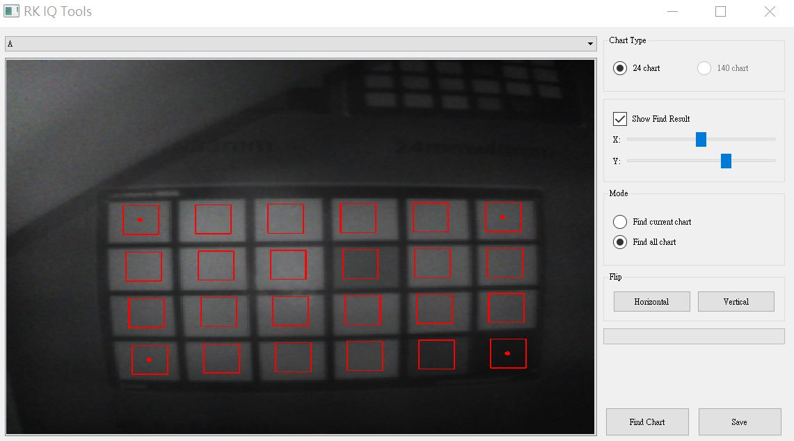      
3. 計算白點條件 (Calibrate)：
    - 點擊 **Calibrate** 開始計算，工具會在 UV 域與 XY 域自動繪製出各光源的初始白點條件框。
      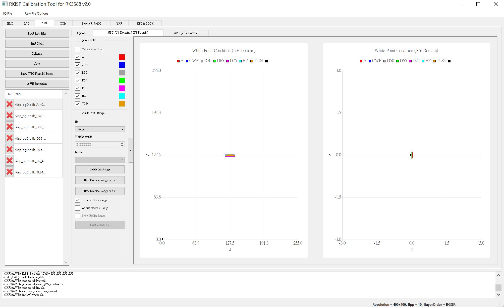  
4. 白點條件驗證與微調 (AWB Simulation)：
    - 點擊 AWB Simulation 導入 Raw 圖測試。
      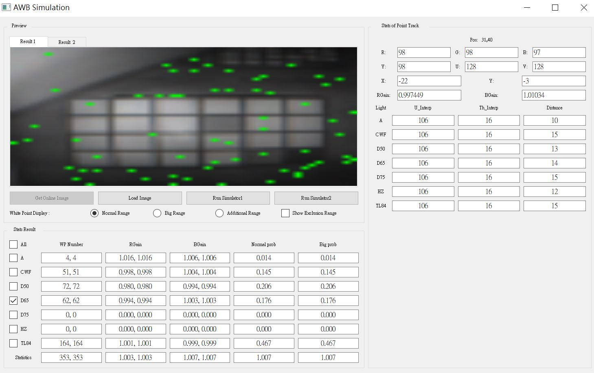  
    - 框選微調原則：手動拖曳 UV / XY 座標系中的框，確保色卡的中性灰/白區塊（第 19~24 號色塊）落在對應光源的框內，並儘量將非白點排除在框外。
    - 連續性要求：所有黑體軌跡上光源的中框在 X 方向上需保持連續；色溫接近的光源中框在 Y 方向上需保持連續。
5. 保存參數：確認各光源白點檢測合理後，點擊 Save 保存 AWB 參數至 JSON 文件中。
```
"TuningPara":	{
								"damp_enable":	1,
								"illu_estim":	{
									"interp_enable":	0,
									"default_illu":	"A",
									"weightRB":	[1, 1],
									"prob_limit":	0.2,
									"frame_no":	8
								},
								"aCcmCof":	[{
										"name":	"A",
										"awbGain":	[1.0126, 1.0001],
										"minDist":	0.05,
										"matrixUsed":	["A_74", "A_100"],
										"matrixUsed_len":	2,
										"gain_sat_curve":	{
											"gains":	[1, 4, 8, 16],
											"sat":	[100, 100, 90, 50]
										}
```
### 三、 CCM (色彩校正矩陣) 標定步驟
CCM 模組透過 $3 \times 3$ 矩陣校正 Sensor 的光學交叉響應，使拍攝色彩還原真實。
1. 選擇 Gamma 曲線：
    - 在進行 CCM 標定前，必須先確定系統使用的 Gamma 曲線（例如預設 Gamma 2.2），因為 Gamma 變更會直接影響標定出的色彩飽和度。
      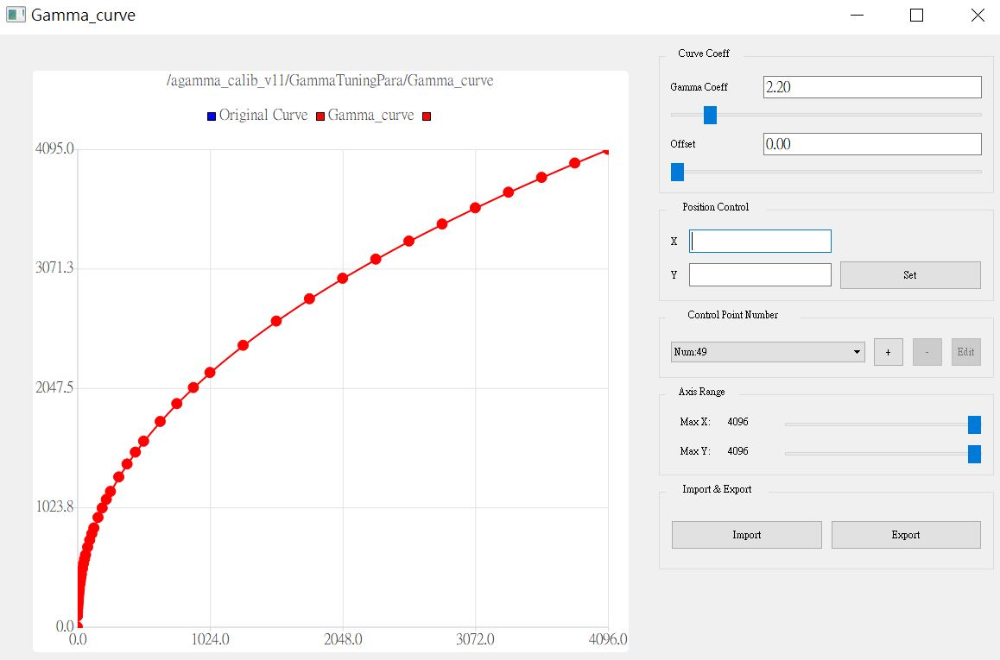 
2. 導入 Raw 圖與色塊選取：
    - 切換至 **CCM** 標籤頁，導入同樣 7 種光源的 Raw 圖，確認採樣區域精確落在 24 色塊內部且無框選到黑邊。
      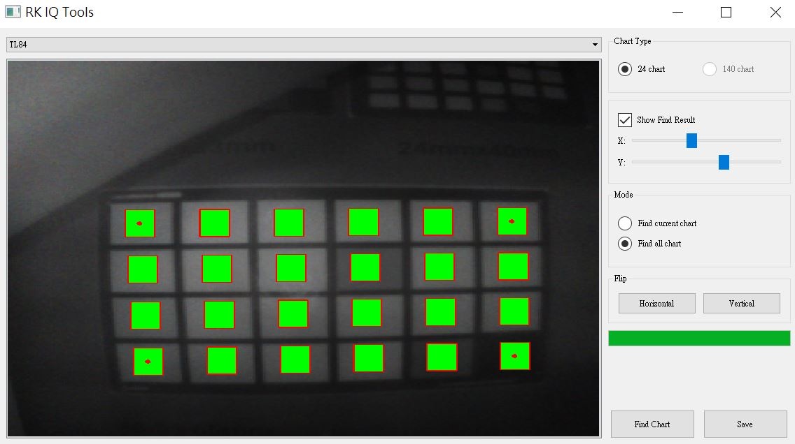     
3. 設定飽和度與色塊權重：
    - 飽和度：通常會同時標定生成 100% 與 74% 兩組飽和度下的 CCM 矩陣。
    - 權重微調：預設使用均勻權重；若希望特定色彩（如三原色 13~15 號、膚色 2 號）還原更準，可提高該色塊的權重（例如將三原色權重設為 8 或 16）。
    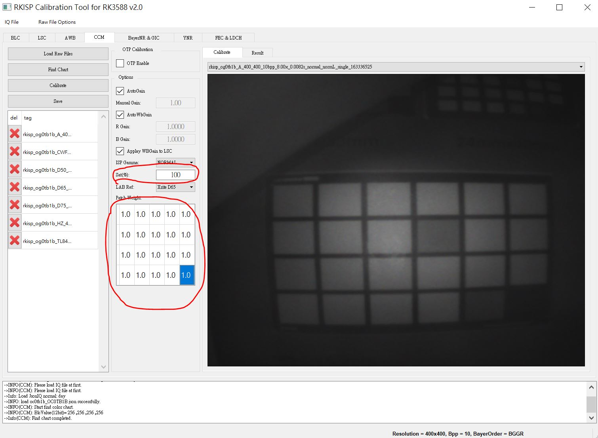   
4. 計算矩陣與檢查色差圖 (Calibrate)：
    - 點擊 **Calibrate** 生成各光源的 $3 \times 3$ CCM 矩陣與 RGB Offset 偏置。
    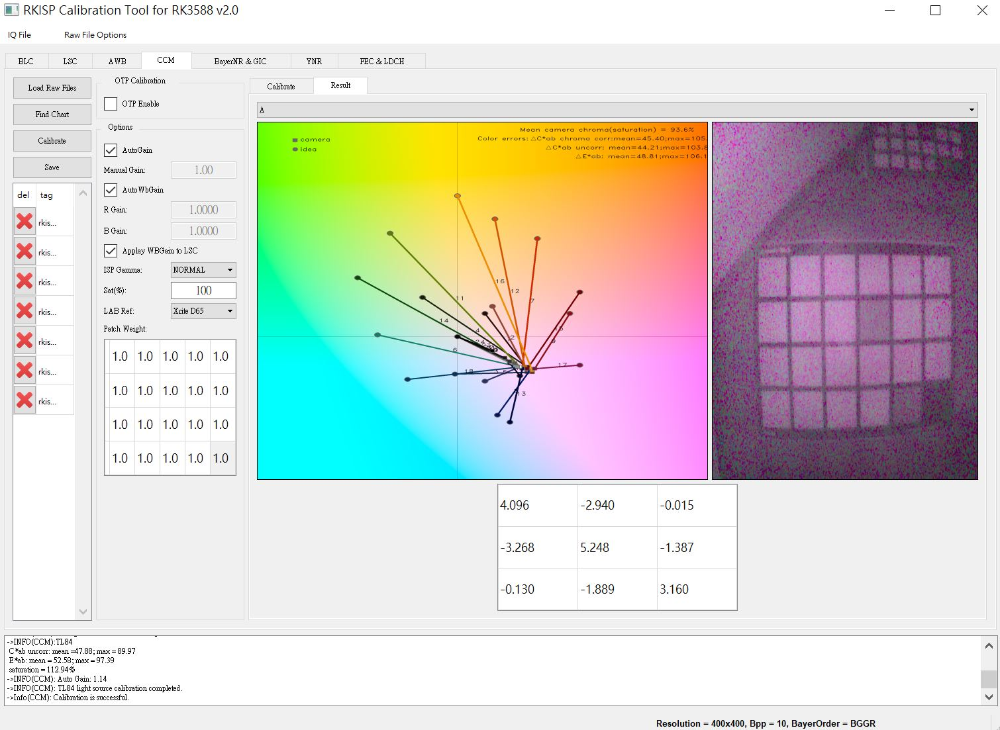   
    - 觀察輸出的 色差圖 (Color Error Chart)：
      - 若 Camera 點比 Idea 點離原點更遠，代表該顏色飽和度偏高。
      - 確認 13 ~ 15 號三原色色塊的色偏向量保持在可接受範圍內。
5. 保存參數：點擊 **Save** 將生成的 14 組 CCM 矩陣（如 **A_100, A_74, D65_100** ...）寫入 IQ JSON 檔的 **ccm_calib** 節點中。
```
"matrixAll":	[{
										"name":	"A_74",
										"illumination":	"A",
										"saturation":	74,
										"ccMatrix":	[0.9632, -0.0233, 0.06, -0.3153, 1.1992, 0.116, -0.0064, -0.637, 1.6435],
										"ccOffsets":	[0, 0, 0]
									}, {
										"name":	"A_100",
										"illumination":	"A",
										"saturation":	100,
										"ccMatrix":	[4.0965, -2.9404, -0.0155, -3.2682, 5.2483, -1.3866, -0.1305, -1.8892, 3.1597],
										"ccOffsets":	[0, 0, 0]
									}, {
```
### 四、 實景色彩微調與穩定度優化
1. 防止白平衡震盪 (Tolerance 設定)：
    - 若實景中色彩或白平衡來回輕微震盪，可在 JSON 的 **tolerance** 節點中調高 **toleranceValue**，當 **wbGain** 變化小於該閾值時不更新，以提升穩定度。
2. 高 ISO 降飽和度 (ISO Linkage)：
    - 高 ISO 環境下，強烈的 CCM 增益會大幅拉高彩色噪點。需在 JSON 檔的 **gain_alphaScale_curve** 
    ```
        "tolerance":	{
									"lumaValue":	[256, 512, 32768, 131072],
									"lumaValue_len":	4,
									"toleranceValue":	[0, 0, 0, 0],
									"toleranceValue_len":	4
								},
    ```
    - 或 **gains-sat** 中，設定高 Gain 下的 **scale** 為 0.8 ~ 0.9，適度降低暗光下的色彩飽和度。
# 重要說明 : 目前展示為 Mono 感測器（Monochrome Sensor，單色/黑白感測器）本身是無法透過單純的 ISP（影像訊號處理器）演算法「解析」出真實彩色影像, 所以在色彩還原調整上,無法解析出真實色彩,目前的說明只提供流程與調整的畫面.

## 六、 YNR（亮度降噪標定 ( YNR / MFNR) )
降噪系統採用分工明確的多級管線。完整的降噪流程包含 **Raw 域多幀時域降噪 (MFNR / BayerTNR)**、**Y 域亮度空域降噪 (YNR)** 以及 **UV 域彩噪降噪 (CNR)**。
各模組在硬體流水線中的位置順序為： **Bayer2DNR ➔ BayerTNR (MFNR/3DNR) ➔ Demosaic ➔ YNR &amp; CNR ➔ Sharpen (銳化)**。

### 一、 MFNR / BayerTNR (Raw 域多幀時域降噪)

#### 1\. 模組功能與特點

* **作用**：在 Raw 域利用當前幀與歷史 (IIR) 幀資料進行低頻與高頻的時域雙邊濾波。
* **優點**：能大幅壓制靜止場景下的高 ISO 雪花噪點，且**完全不損失畫面的靜態高頻細節與清晰度**。

#### 2\. IQ JSON 關鍵參數 (`bayertnr_v2`)

* **lo\_enable** **/** **hi\_enable**：低頻/高頻時域降噪開關。
* **lo\_filter\_strength** **/** **hi\_filter\_strength**：低頻與高頻的運動判斷與降噪強度。數值越大，時域降噪越強。
* **soft\_threshold\_ratio**：軟閾值比率，數值越大，保留的自然噪點越多。

#### 3\. 調優步驟

1. 在高 ISO（如 ISO 1600 \~ 6400）環境下觀察畫面雪花噪點。
2. 逐步調高 `lo_filter_strength` 與 `hi_filter_strength`。
3. **運動物體檢查**：讓人物或物件在鏡頭前移動，觀察邊緣是否有**拖影（Ghosting）** **或** **運動模糊**。若拖影嚴重，需適度調低 `hi_filter_strength` 或調整高頻運動判斷閾值。

---

### 二、 YNR (Y 域亮度降噪 - `ynr_v3`)

#### 1\. 模組功能與特點

* **作用**：在 YUV 域針對亮度（Luminance）信號進行空域雙邊濾波、軟閾值去噪與邊緣保護。
* **特質**：YNR 可以獨立控制高、中、低頻噪點。強度開得太大會導致畫面出現**塗抹感（Muddy/Smear）** **或** **油畫感**，使質感下降。

#### 2\. IQ JSON 關鍵參數 (`ynr_v3`)

* **low\_bf1** **/** **low\_bf2**：原圖 (3x3) 與上一幀縮略圖 (5x5) 的雙邊濾波強度。數值越大去噪越強。
* **low\_thred\_adj**：低頻軟閾值調整力度，控制大塊面（如牆面、皮膚）的平滑度。
* **high\_thred\_adj** **/** **high\_weight**：高頻降噪軟閾值與高頻保留比例。`high_weight` 越大，保留的高頻細節越多，降噪越弱。
* **rnr\_strength** **(徑向降噪)**：從圖像中心到四周 17 個點的降噪強度補償。專門用來壓制因 LSC（鏡頭陰影校正）邊角增益放大帶來的邊角噪點。

#### 3\. 調優步驟

1. **先調低 ISO (ISO 50\~100)**：設定較小的 `low_bf1`，確保微弱紋理（如毛發、布料）不會被抹平。
2. **高 ISO 逐檔調優**：隨 ISO 升高逐步加大 `low_bf1` 與 `low_thred_adj`。
3. **質感與細節平衡**：若發現畫面變太平（塗抹過度），可調高 `high_weight` 或降低 `low_bf1`，保持微小顆粒噪點以維持真實質感。
進行 **亮度降噪標定 (YNR / MFNR)** 是 Rockchip ISP30（RK3588）獲得高品質噪聲模型（Noise Profile/Sigma Curve）的最核心步驟。標定生成的噪聲曲線能讓 **Raw 域多幀時域降噪 (MFNR / BayerTNR)** 與 **YUV 域亮度降噪 (YNR)** 準確識別圖像中哪些是硬體噪點、哪些是實際材質紋理。
### 第一階段：標定前置準備

1. **前置模組必須已完成標定**：
  * **BLC（黑電平）** 與 **LSC（鏡頭陰影）** 必須已標定完成並載入 JSON 檔。若 BLC 或 LSC 數據不準，會直接導致 YNR 噪聲曲線計算偏差。
2. **實驗室環境與卡片**：
  * **環境**：標準燈箱（建議切換至 **TL84** 或 **CWF** 光源，光照度約 800 lux）。
  * **圖卡**：使用 **24 色階 / 灰階漸變卡（Gray Chart）**。將漸變卡貼在燈箱背板中央，並調整相機位置使漸變卡儘量填滿畫面中心。

---

### 第二階段：使用 RK Capture Tool 拍攝專用 Raw 圖

YNR/MFNR 標定需要透過 Tool 擷取多組不同 Gain 檔位下的**高光（High-Light）** **與** **低光（Low-Light）** Raw 圖：

#### 1\. 設定與選取 ROI

1. 開啟 **RK Capture Tool** 並連接板卡，Light 選擇 **TL84**（或 CWF），Module 名稱填寫 **NR\_Normal**。
2. 切換至 **YNR Capture** 頁面，拍攝一張預覽圖。
3. 在右側預覽畫面中**按右鍵選擇** **Draw ROI**，分別繪製兩個矩形框：
  * **黑塊 (Black Block)**：框選漸變卡上最黑的色塊區塊。
  * **白塊 (White Block)**：框選漸變卡上最亮的色塊區塊。

#### 2\. 分 Gain 檔位批量拍攝（遍歷 1x, 2x, 4x, 8x, 16x...）

針對每個 Gain 檔位（例如從 Gain=1.0 開始），需分別拍攝 **Low-Light** 與 **High-Light** 兩組：

* **低光組 (Low-Light) 拍攝**：
  1. 將 `Gain Range` 設定為當前檔位（如 `1.0 - 1.0`）。
  2. 勾選 **Multi-Frame** 與 **Low-Light**，將 `Frame Number` 設為 **32**。
  3. 設定目標閾值：`Black Block Mean Luma` 初次填寫約為 `BLC(8bit) + 1`，`White Block Mean Luma` 填寫約 **30**。
  4. 點擊 **Start YNR Capture**。工具會自動比對平均像素值，達成目標後會產出帶有 **\_single**（單幀）與 **\_multiple**（32 幀疊加）各一張 Raw 檔。
* **高光組 (High-Light) 拍攝**：
  1. 勾選 **Multi-Frame** 與 **High-Light**。
  2. 設定目標閾值：`Black Block Mean Luma` 填寫約 **60**，`White Block Mean Luma` 固定為 **255**（注意白塊切勿過曝）。
  3. 點擊 **Start YNR Capture**，取得該 Gain 檔位下的高光 single 與 multiple Raw 檔。
* **遍歷完成**：將 Gain 改為 2x, 4x, 8x... 重複上述步驟，直到 Sensor 支援的最大 Gain 拍攝完畢。

---

### 第三階段：使用 RK Calibration Tool 計算噪聲曲線

拍攝完成後，進入 **RK Calibration Tool** 進行兩階段標定計算：

#### 步驟 1：GIC &amp; Bayer NR 標定（計算 Raw 域噪聲）

1. 在 Calibration Tool 左上角 `Edit Options` 設定 Raw 圖解析度、Bit 數與 Bayer 順序。
2. 切換至 **GIC &amp; Bayer NR** 標籤頁，點擊 **Load Raw Files** 導入剛剛拍攝的所有 single 與 multiple Raw 檔。
    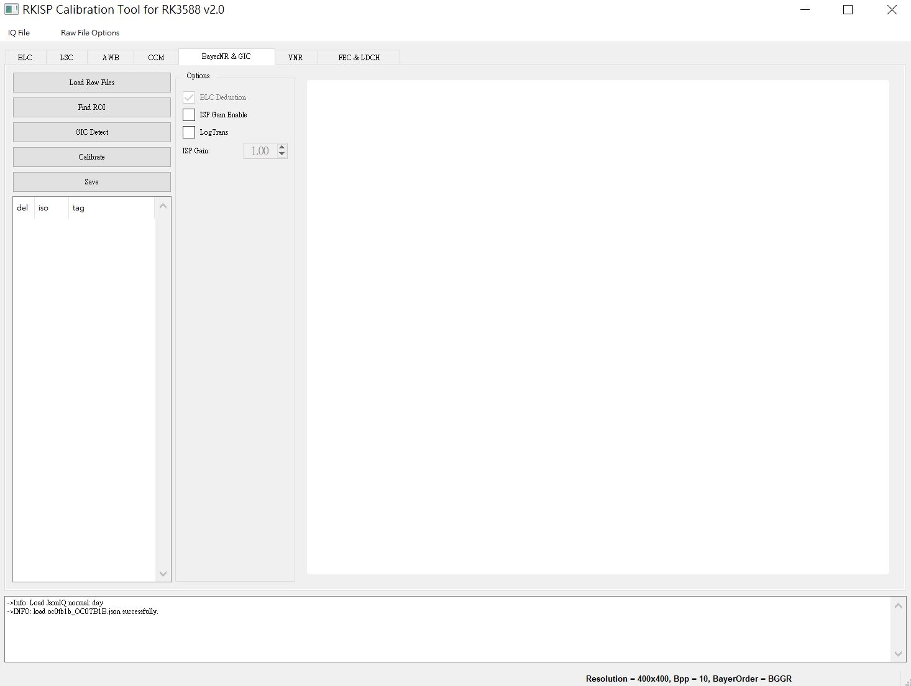   
3. 點擊 **Find ROI**，確保紅框精確覆蓋漸變卡各色塊。
4. 點擊 **Calibrate**，工具會計算並繪製出 Raw 域的 BayerNR 噪聲曲線。點擊 **Save** 存檔。

#### 步驟 2：YNR &amp; MFNR 標定（計算 YUV 域噪聲）

1. 切換至 **YNR &amp; MFNR** 標籤頁，點擊 **Load Raw Files** 導入相同的 Raw 檔列表。
2. 勾選 **YNRCurve Print**（可保存調試採樣點資料）。
3. 點擊 **Calibrate** 開始計算，右側視窗會擬合出各 ISO 檔位下的 **ynr sigma curve** 噪聲曲線（包含 16 個亮度點對應的噪聲值）。
4. 點擊 **Save** 保存結果至 IQ JSON 檔中（會寫入 `ynr_v3` 與 `bayertnr_v2` 節點）。

---

### 第四階段：實用調優與參數控制 (Tuning)

標定完成後，標定數據（`sigma` 曲線）已寫入 JSON，接下來可針對 **MFNR (BayerTNR)** 與 **YNR** 進行實景微調：

#### 1\. BayerTNR (MFNR 多幀時域降噪微調)

* **lo\_filter\_strength** **/** **hi\_filter\_strength**：分別控制低頻與高頻的時域降噪強度。
* **soft\_threshold\_ratio**：軟閾值比率，數值越大保留的自然細節越多。
* **實景檢查**：觀察運動物體（如移動的手或行車），若發現邊緣有**拖影（Ghosting）**，需適度調低 `hi_filter_strength`。

#### 2\. YNR (Y 域亮度降噪微調)

* **low\_bf1** **/** **low\_bf2**：雙邊濾波強度，控制大面積平坦區（如皮膚、牆面）的平滑度。
* **low\_thred\_adj**：低頻軟閾值調整力度，越大降噪越強。
* **high\_thred\_adj** **/** **high\_weight**：高頻降噪門限與高頻保留比例。若畫面出現塗抹感（油畫感），可調高 `high_weight` 以補回紋理細節。
* **rnr\_strength** **(徑向降噪)**：包含 17 個點的鏡頭中心到四周的降噪權重，專門用來補償 LSC 邊角增益帶來的暗角噪點。
---

### 三、 CNR (UV 域彩噪降噪 - `cnr_v2`)

#### 1\. 模組功能與特點

* **作用**：針對 U/V 通道進行多尺度下採樣、中值濾波與雙邊濾波，消除紅綠彩噪與大塊色斑。
* **優點**：**CNR 的強度幾乎不會影響畫面的解析力與線條 sharpness**。
* **注意點**：CNR 力度過大會導致物體邊緣**色彩滲透**或**飽和度下降（褪色）**。

#### 2\. IQ JSON 關鍵參數 (`cnr_v2`)

* **hf\_denoise\_strength**：高頻雙邊濾波去彩噪強度，清除細小紅綠雜點。
* **lf\_denoise\_strength**：低頻雙邊濾波強度，清除大面積的色斑塊。
* **color\_sat\_adj**：基於梯度的 UV 飽和度微調，值越小去彩噪效果越強。
* **thumb\_denoise\_strength**：縮略圖層級的去彩噪強度。

#### 3\. 調優步驟

1. 開啟高 ISO（如 ISO 3200/6400）畫面。
2. 觀察暗部區域的彩色雜點（如黑牆上的紅綠細點）。
3. **先調高頻**：加大 `hf_denoise_strength` 直到細小紅綠彩噪消失。
4. **再調低頻**：若還有不均勻的大塊彩色斑塊，加大 `lf_denoise_strength` 與 `thumb_denoise_strength`。
5. **檢查邊緣與飽和度**：觀察鮮豔物件（如紅花、綠葉）的邊緣，確認沒有出現色彩滲漏或飽和度明顯變淡的情況。

---

### 四、 四大模組實戰聯合調優順序 (Joint Tuning Strategy)

為了達到最佳的「清晰度與噪聲平衡」，請嚴格按照以下流程進行聯調：

1. **第一步：暫時關閉 Sharpen (銳化)**
  * 銳化會放大前級的噪點，調優降噪時務必先關閉 Sharpen 或降至最低。
2. **第二步：優先調大 CNR (彩噪降噪)**
  * 先把畫面上的紅綠彩色噪點徹底壓制乾淨。因為 CNR 不傷解析度，先清乾淨彩噪能讓後續亮度噪點的觀察更為清晰。
3. **第三步：聯調 BayerTNR (MFNR) 與 YNR**
  * 利用 BayerTNR 消除靜止畫面的大部分噪點；
  * 利用 YNR 平滑剩餘的空域亮度噪點，並觀察動態畫面，確保沒有嚴重的塗抹感與拖影。
4. **第四步：最後開啟 Sharpen (銳化)**
  * 在降噪完成、畫面乾淨的前提下，開啟 Sharpen 將靜止物件（如文字、線條、細節輪廓）適度銳化補回。

## 七、 FEC / LDCH(畸變校正標定)
**LDCH（鏡頭水平畸變校正）** 與 **FEC（魚眼全方位畸變校正）** 是基礎標定流程的最後一步。這兩個模組主要用於修復廣角鏡頭或魚眼鏡頭產生的「桶形畸變」或「枕形畸變」，使原本彎曲的畫面邊緣線條恢復平直。
### 一、 LDCH 與 FEC 的概念與差異

1. **LDCH (Lens Distortion Correction Hardware)**：
  * **作用**：專門針對普通廣角鏡頭的**水平方向畸變**進行校正。
  * **特點**：硬體開銷較小，支援在 IQ JSON 中透過 **correct\_level** **(0 \~ 255)** 直接調適校正拉伸強度。
2. **FEC (Fisheye Execution Center)**：
  * **作用**：針對超廣角或魚眼鏡頭進行**水平與垂直 2D 全方位復原校正**。
  * **特點**：需事先透過棋盤格標定，生成下採樣的像素座標對應網格表（Mesh File / Map 表）。

---

### 二、 第一階段：棋盤格標定圖拍攝規範

FEC/LDCH 標定不需要 Raw 圖，而是使用高清晰度的 **RGB/YUV 影像（格式支援 JPG、BMP、PNG）**：

1. **圖卡準備**：
  * 使用標準黑白**棋盤格（Checkerboard）**。
  * **角點計算方式**：水平/垂直角點數量（Corners）等於**排除最外圈黑白塊後**，該方向上的黑白塊數量再減 1。
2. **拍攝角度與姿勢（建議 5 \~ 10 張）**：
  * **位置覆蓋**：拍攝棋盤格放置於畫面**正中心、四周角落、邊界**等不同位置的照片。
  * **角度變異**：包含正面平視、左右傾斜、上下傾斜等角度。
3. **關鍵注意事項**：
  * 最外圈黑白塊不參與角點計算，但在預覽與拍照時**絕對不能被畫面裁切或遮擋**。
  * 畫面必須聚焦清晰，棋盤格內部角點需完全清晰可見（至少需有 **3 張以上**能 100% 完整精確檢測出角點的照片）。
  * 圖檔存放資料夾建議命名為 `Sensor名_鏡頭名_解析度`（例如 `oc0tb1b_lens_400x400`），方便工具自動建立資料夾。

---

### 三、 第二階段：使用 RK Calibration Tool 標定與生成 Mesh 表

1. **工具環境準備**：
  * 開啟 **RK Calibration Tool**，進入 **FEC &amp; LDCH** 標籤頁。
  * **關鍵前提**：請確認標定工具 `.exe` 執行檔的**同級目錄下存在名為** **result** **的資料夾**（若無請手動新建，否則工具無法存入產出的 Mesh 網格檔）。
2. **導入標定圖與輸入參數**：
  * 點擊 **Load Images** 載入剛剛拍攝的一組棋盤格照片。
  * 在介面上填入棋盤格參數：
    * **Horizonal Corners**：內圈水平角點數量。
    * **Vertical Corners**：內圈垂直角點數量。
    * **Square Size**：棋盤格單個方格的實際物理尺寸（單位：`mm`）。
    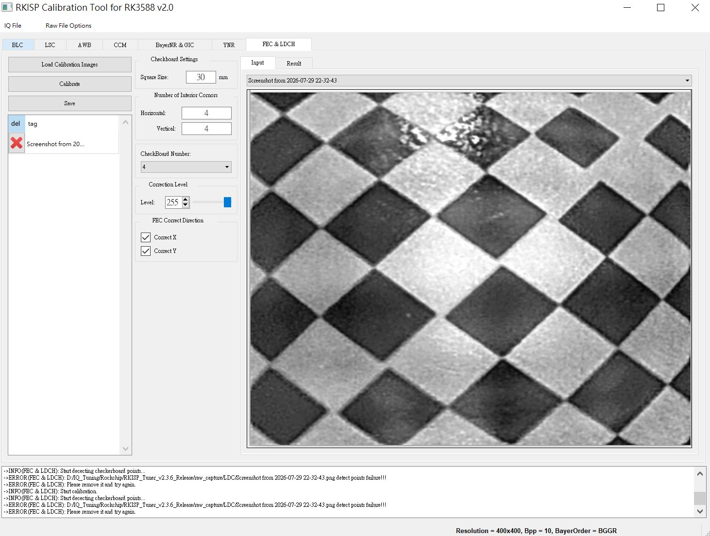   
3. **執行標定計算 (Calibrate)**：
  * 點擊 **Calibrate** 按鈕。
  * 工具會自動搜尋每張照片中的角點，並在右側 **Result** 視窗標記綠色角點。
  * **品質檢查**：若某張照片角點檢測出錯（如紅框偏移），可在列表中點擊 **del** 將該張異常照片刪除後重新 Calibrate。
4. **輸出標定結果與 Mesh 網格**：
  * 標定成功後，左側 Log 視窗會顯示相機內參與畸變參數：
    * **中心座標 (** **cx, cy** **)**：光學中心偏移點。
    * **畸變係數 (** **a0, a2, a3, a4** **)**：鏡頭多項式畸變係數。
  * 工具會自動在 `result/` 資料夾下生成下採樣的 **LDCH / FEC Mesh 映射檔**。
5. **保存參數**：點擊 **Save** 保存結果。

---

### 四、 第三階段：IQ JSON 檔案參數寫入與設定

標定生成的網格檔與參數需寫入 IQ JSON 檔（如 `oc0tb1b_OC0TB1B_default.json.txt`）對應的節點中：

#### 1\. **LDCH 節點設定 (** **aldch** **/** **RK\_MODULE\_LDCH** **)**

```
"aldch": {
  "param": {
    "aldch_en": 1,
    "correct_level": 255  // 0~255，值越大拉直效果越強，通常設為 255 或依需求微調
  }
}

```

#### 2\. **FEC 節點設定 (** **afec** **/** **RK\_MODULE\_FEC** **)**

```
"afec": {
  "param": {
    "fec_en": 1,
    "meshfile": "oc0tb1b_lens_400x400.bin",  // 填入 result 目錄下生成的 Mesh 檔名
    "correct_level": 255,
    "light_center": [200.5, 200.5],          // 填入標定出的 [cx, cy] 光學中心
    "coefficient": [0.0, 0.0, 0.0, 0.0]       // 填入標定出的 [a0, a2, a3, a4] 係數
  }
}
```
# 2. 調整項目內容 (實時線上調優項目)
## 一、**AEC**：調整曝光 Route、目標亮度、抗閃爍（Anti-Flicker）、HDR 曝光比率與動態範圍壓縮（ADRC/AMerge）。 
**自動曝光 (AE / AEC, Auto Exposure Control)** 的主要任務是根據環境光線變化，自動計算並分配最佳的**曝光時間 (Exposure Time)** 與**感光增益 (Gain)**，使影像亮度維持在合理且穩定的目標範圍內。
在進行 AE 調優前，需確認 **Sensor 驅動資訊正確**，且 **BLC (黑電平)、AWB (白平衡)、LSC (陰影校正)** 等基礎模組已完成標定與校正。
### 第一階段：Sensor 曝光參數與同步校驗 (SensorInfo & SyncTest)
1. 核對 SensorInfo 基礎參數：
    - 確認 Sensor Datasheet 中的曝光時間極限（**maxExpTime / minExpTime**）、增益極限（**maxGain / minGain**）以及 **Time2Reg** 與 **Gain2Reg** 轉換公式無誤。
    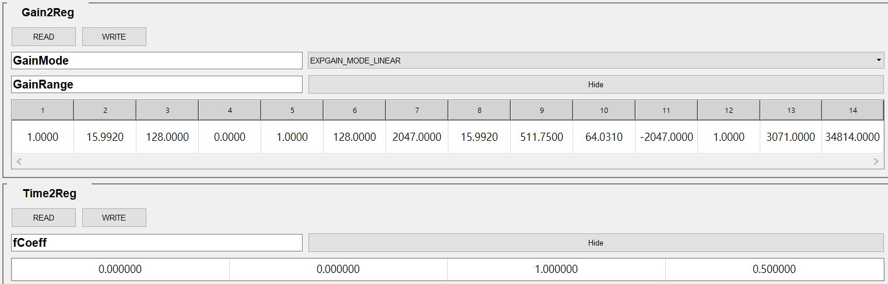 
2. 開啟 SyncTest 測試曝光線性度：
    - 在 IQ JSON 檔中開啟 AecSyncTest 功能。
    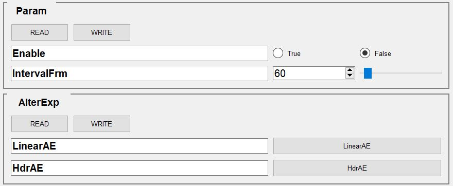   
    - 系統會循環發送 N 組不同的曝光時間與增益組合，用來測試 Sensor 的曝光時間、增益及 DCG (雙原生增益) 切換是否在同一幀精確生效，並排查畫面是否有閃爍或增益不線性問題。
### 第二階段：配置 AE 網格權重表 (AecGridWeight)
1. $15 \times 15$ 統計網格分割：
    - ISP30 硬體會將畫面分割為 $15 \times 15$ 共 225 個區域網格。
2. 設定權重分配 (Weight Grid)：
    - 根據相機安裝場景（如安防監視、人臉辨識、車載行車紀錄器），為不同網格給予 0 ~ 63 的權重比重。
    - 常見設定：將畫面中央區域（關心主體/人臉/車牌位置）設定較高權重（如 10 ~ 14），畫面四周或天空區域給予低權重（如 0 ~ 3），避免天花板燈光或天空影響整體畫面主體的亮度。
    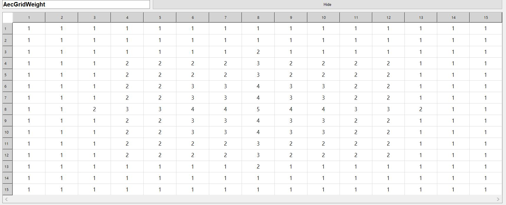  
### 第三階段：配置 AE 曝光路徑分解 (AE Route)
AE Route 決定當曝光量需求增減時，曝光時間（Time）與增益（Gain）的分配順序與比例：
1. 路徑點陣對 (TimeDot / GainDot)：
    - 在 JSON 檔的 **LinearAeCtrl -> Route** 節點中，設定 **TimeDot** (曝光時間陣列) 與 **GainDot** (增益陣列)。
    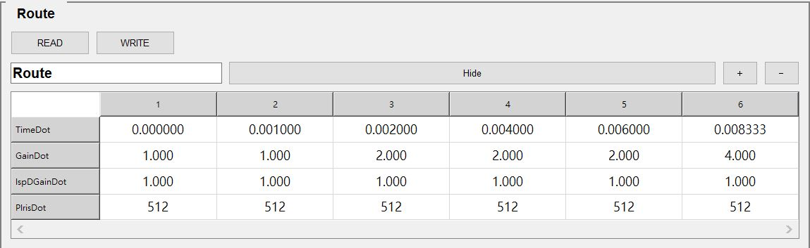  
2. 不同應用場景的 Route 策略：
    - 高速抓拍 / 車牌辨識場景：優先拉大 Gain、嚴格限制曝光時間（例如將時間限制在 **2 ~ 4ms** 以內），防止運動物體產生拖影與模糊。
    - 低照度 / 夜視安防場景：優先拉長曝光時間，最後才增加 Gain，以最大程度抑制高 ISO 帶來的雜訊與噪點。
### 第四階段：設定目標亮度與過曝控制 (Target Luma & OverExpCtrl)
1. 基礎目標亮度 (SetPoint / DynamicSetpoint)：
    - 設定平坦場景下的目標亮度值（例如 8-bit 下中央區域目標亮度控制在 40 ~ 60 左右）。
    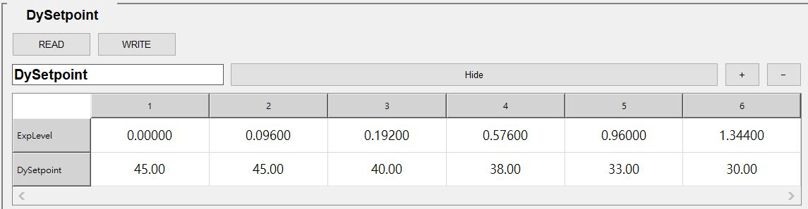  
2. 高光過曝控制 (OverExpCtrl) 與背光補償 (BackLightCtrl)：
    - 逆光/高對比場景：開啟高光控制，當畫面出現高亮度物件（如杯子、陶瓷、燈光）時自動降低整體曝光，避免高光區域出現大面積死白。
    - 策略模式 (StrategyMode)：可依需求切換為低光優先 (**AECV2_STRATEGY_MODE_LOWLIGHT**) 或高光優先策略。
    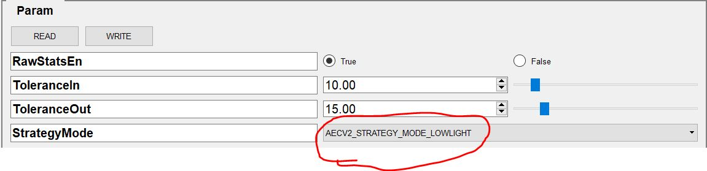  
### 第五階段：控制 AE 收斂速度、容忍度與防閃爍 (Speed, Tolerance & Anti-Flicker)
1. 死區容忍度 (ToleranceIn / ToleranceOut)：
    - 設定 **ToleranceIn**（例如 **10**）與 **ToleranceOut**（例如 **15**）。
    - 當實際畫面亮度與目標亮度的差值小於 **ToleranceIn** 時，AE 停止微調，防止畫面亮度頻繁輕微抖動（呼吸效應）。
    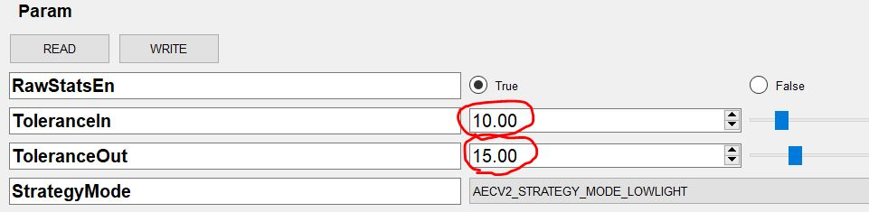 
2. 阻尼收斂速度 (AeSpeed & Damp)：
    - 透過 **DampDark2Bright**（暗到亮）與 **DampBright2Dark**（亮到暗）調整收斂平滑度。
    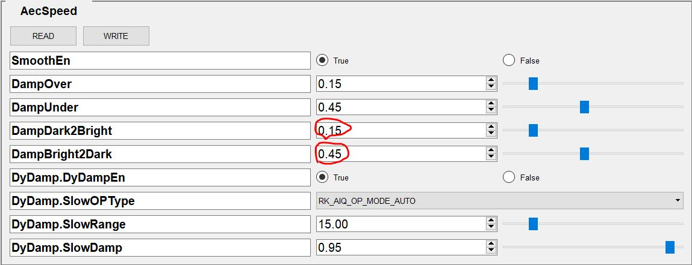 
    - 行車記錄器 / 運動相機：調高收斂速度，以適應快速出入隧道或光線劇烈變化的場景。
    - 定點安防監視：調低收斂速度（加強阻尼），確保光線微變時畫面漸進平滑過渡。
3. 交流電防閃爍 (AecAntiFlicker)：
    - 針對 50Hz (如 10ms/20ms) 或 60Hz (如 8.33ms/16.66ms) 人工光源，將曝光時間限制為平整步長，消除滾動條紋 (Flicker)。
    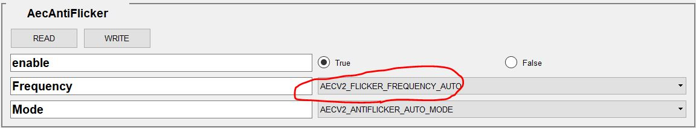 
## 💡 驗證與排查建議： 在 RKISP 3A AnalyzerTool 或控制台開啟 AE 日誌後，可觀察 **MeanLuma** (當前平均亮度) 與 **LumaDeviation** (與目標亮度的偏差值) 的動態變化，並透過燈箱開關燈測試 AE 的收斂時間與平滑度。

## 二、**AWB**：微調偏色修正（CT Line / CRI Line）、白點權重與穩定度門檻（Tolerance）。
**AWB（自動白平衡）** 完成基礎標定後，若在特定環境下出現整體偏色（如偏綠/偏紫、偏冷/偏暖）、白點被雜色干擾，或色彩來回微幅震盪（呼吸效應），就需要進行進階的 **WBGain 色調微調**、**白點權重控制** 與 **穩定度門檻 (Tolerance)** 調整。

### 一、 偏色微調：CT Line / CRI Line 調整流程 (wbGainAdjust)
1. 功能與座標系概念
    - CT (Colour Temperature - 色溫軸)：橫軸代表相對色溫。往左調整畫面變冷（偏藍），往右調整畫面變暖（偏黃/紅）。
    - CRI (Colour Rendering Index - 顯色/色調軸)：縱軸代表綠/紫偏色。向上拖動畫面偏綠，向下拖動畫面偏紫。
    - 在 IQ Tuner 工具中，系統會將輸入的色溫與 CRI 繪製成 $N \times M$ 的網格點陣列。
2. 工具操作與微調步驟 (使用 RKISP Tuner)
    1. 進入控制介面：在工具中打開 AWB -> WBGain Adjust 頁面，勾選 Enable: On。
    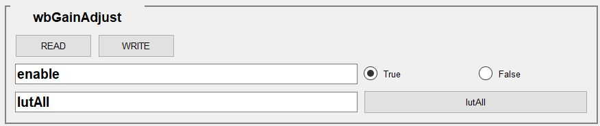 
    2. 選擇模式 (Drag Method)：
        - CT Line Only（整體偏冷/偏暖調整）：
          - 作法：當某一色溫（例如 2000K 低色溫）下畫面太紅/太暖，選擇 CT Line Only 模式，點擊 CCT=2000K 附近的網格點向左拖動。
          - 效果：該色溫下輸入的 AWB Gain 會被強制修正為較冷的色溫輸出，達成降溫/校正偏暖的效果。
        - CRI Line Only（整體偏綠/偏紫校正）：
          - 作法：若日光或日光燈下畫面整體偏紫（例如 CRI=0.5 區域），選擇 CRI Line Only 模式，點擊對應網格點向上拖動。
          - 效果：提高 G 通道權重，將紫味拉回正常中性色；反之若畫面偏綠，則向下拖動壓制綠色。
        - CT Point Only / CRI Point Only：適用於僅對特定極端色溫下的單點進行精準修正。
    3. JSON 檔案中的對應節點： 修正結果會保存至 autoExtPara -> wbGainAdjust -> lutAll 中（包含 ct_out 與 cri_out 陣列）。
### 二、 白點權重調整 (Luma Weight & Block Weight)
當場景中存在大量過亮（如天空/燈光）或過暗（如陰影噪點）的區域干擾 AWB 計算時，可透過權重機制予以抑制。
1. 白點不同亮度權重 (wpDiffLumaWeight)
    - 作用：避免極暗或過曝區域的偽白點干擾 AWB，給予中間適當亮度區間（如 80 ~ 224）更高的信任權重。
    - IQ JSON 關鍵參數 (autoPara -> wpDiffLumaWeight)：
      - enable：設為 1 開啟亮度權重功能。
      - wpDiffWeiEnableTh：包含 wpDiffWeiNoTh（白點數量門檻）與 wpDiffWeiLvValueTh（環境亮度門檻），達到條件才啟用。
      - wpDiffwei_y：將亮度分為 9 個節點（8 個 bin）。
      - perfectBinConf / perfectBin：標記高可信度的亮度區間（設為 1 的 bin 代表高可信度）。
      - wpDiffWeightLvSet：依據不同環境亮度 (LvValue) 與高可信度白點占比，賦予各亮度區間 0.0 ~ 1.0 的加權權重。
    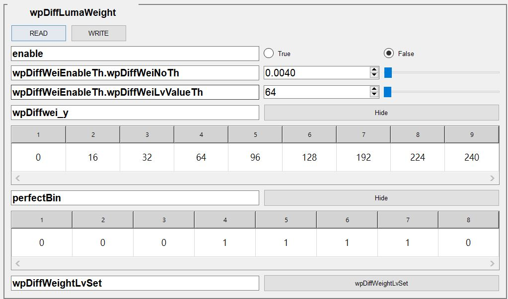 
2. 分塊空間權重 (wpDiffBlkWeight)
    - 作用：對畫面 $15 \times 15$ 共 225 個區塊分別給予權重（0 ~ 63），提升主體區域白點的參考比重。
    - JSON 參數：
      - wpDiffBlkWeiEnable：設為 1 開啟。
      - wpDiffBlkWeight：225 個整數陣列，通常將中央區域設為較高權重（如 30 ~ 63），四周邊角設為低權重（如 6 ~ 10）。
      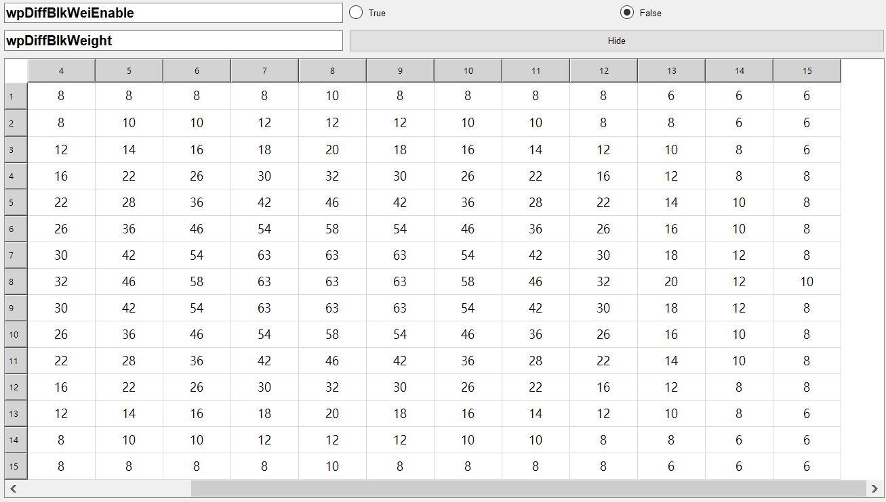 
### 三、 AWB 穩定度門檻與收斂平滑度 (Tolerance & Damp)
在光線微小變化或相機輕微移動時，若 AWB 頻繁微調會造成畫面亮度與色彩的「呼吸效應」或輕微閃爍。
1. 更新容忍度 (tolerance)
  - 作用：當近幾幀計算出的 AWB Gain 變動差值小於 toleranceValue 時，強制鎖定並繼續套用前一幀的 wbGain，防止畫面色溫小幅抖動。
  - IQ JSON 關鍵參數 (autoExtPara -> tolerance)：
    - lumaValue：不同環境亮度檔位。
    - toleranceValue：容忍度門檻（取值範圍 0.0 ~ 1.0，預設通常設為 0.05 ~ 0.1）。
    - 調優建議：若畫面在靜止場景下色彩來回震盪，可適度提高 toleranceValue（例如從 0.02 調高至 0.05）；若希望光線變化時反應更敏捷，則適度調低。
      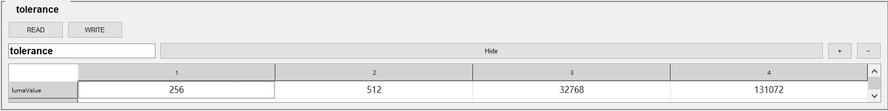 
2. 執行幀間隔 (runInterval)
  - 作用：控制 AWB 演算法隔幾幀執行一次（intervalValue）。適度拉長執行間隔可降低 CPU 負載並提高穩定度。
      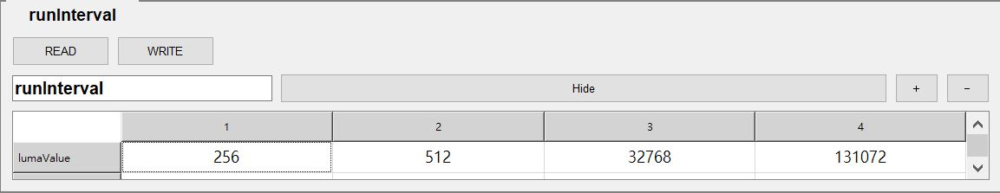 
3. 幀間平滑因子 (dampFactor / awb_smooth_factor)
  - 作用：控制 AWB Gain 在幀與幀之間的平滑過渡速度。
  - 調優建議：平滑係數越大，目前新計算出的 AWB 權重越低，畫面色彩變化越平緩漸進；若出入不同色溫場景需要快速收斂，可降低平滑係數。
      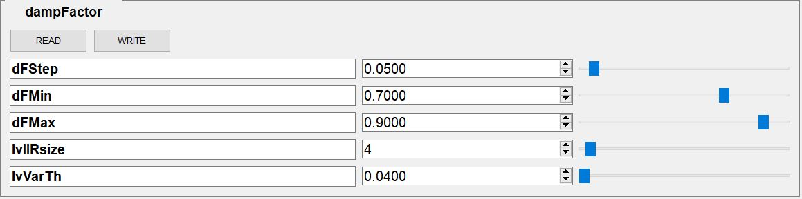 
### 💡 實務微調 SOP 總結
#### 1. 先校色（CT/CRI Line）：在標準光源或實景下觀察，若整體偏綠/紫，用 CRI Line 拖動拉平；若偏冷/暖，用 CT Line 調整。
#### 2. 再控權（Luma/Block Weight）：若逆光或夜間高光處導致 AWB 算錯色溫，開啟 wpDiffLumaWeight 將高光/暗區權重降低。
#### 3. 最後止震（Tolerance）：若畫面色彩微幅閃爍，提高 toleranceValue 鎖定近幀 Gain。
## 三、**畫質與對比度微調**：
- **主要模組**：**Demosaic**、**GIC**、**YNR**、**CNR**、**Sharpen**、**3DNR (BayerTNR)**、**DPCC**。
**質與對比度微調（清晰度與降噪平衡）** 是 ISP 調優的最後一個核心階段。
整體調優遵循 **「清晰度優先，先表現細節再降噪平衡」** 的原則：在調優降噪模組前，先關閉 Sharpen（銳化）或降至最低，將靜止場景的細節呈現出來，再依照流水線（Pipeline）順序依次調適各降噪模組，達到清晰度與噪點的平衡。
### ISP30 畫質與降噪流水線順序 (Pipeline)

```
[Raw 域] DPCC ➔ Bayer2DNR ➔ BayerTNR (3DNR) ➔ GIC
    │
[RGB 域] Debayer (Demosaic)
    │
[YUV 域] YNR &amp; CNR ➔ Sharpen (銳化)

```

---

### 步驟 1：Demosaic (去馬賽克/Debayer) 細節插值與偽色控制

* **功能與重要性**：Demosaic 是 Raw Bayer 圖轉 RGB 的核心插值演算法，是圖像基本紋理細節的第一道關口。
* **微調步驟**：
  1. **低 ISO 解析力驗證**：在實驗室 D65 光源（ISO 50）下，對準 **ISO 解析度卡** 與 **星圖 (Star Chart)**。
  2. **高低頻權重分配**：微調 `debayer_thed0` 與 `debayer_thed1`（控制高低頻權重選取的概率門檻），使高頻紋理順利插值出來。
  3. **濾波與偽色抑制**：微調 `debayer_filter1/2` (梯度濾波器) 與 `debayer_cnr_strength`（色差圖濾波強度），壓制黑白條紋邊緣產生的摩爾紋（Moiré）與偽色。
  4. **全 ISO 遍歷**：檢查高 ISO 下插值出來的噪點型態是否細碎且平穩。
      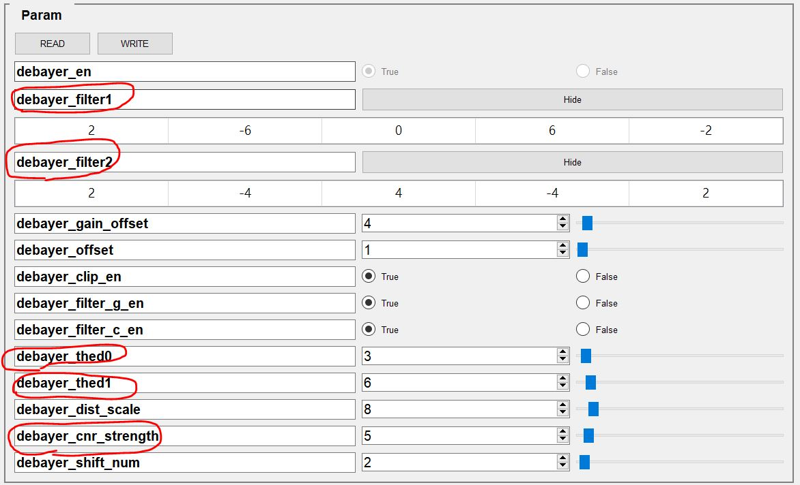 

---

### 步驟 2：GIC (綠通道平衡校正)

* **功能**：校正 Bayer 陣列中 Gr 與 Gb 兩個通道的響應失衡，消除拉亮或高對比邊緣處的網格狀偽影。
* **微調步驟**：
  1. **補償強度**：調適 `gr_ration` 與全局補償強度，壓制畫面高光處的網格偽影。
  2. **紋理保護**：調整 `min_busy_thre`（高對比不規則紋理檢測）。值越大，被判定為繁忙紋理區域越不進行 GIC 處理，防止破壞真實高頻細節。
  3. **上限保護**：設定 `maxCorV`（補償上限），避免平坦區過度校正產生拉絲感。
      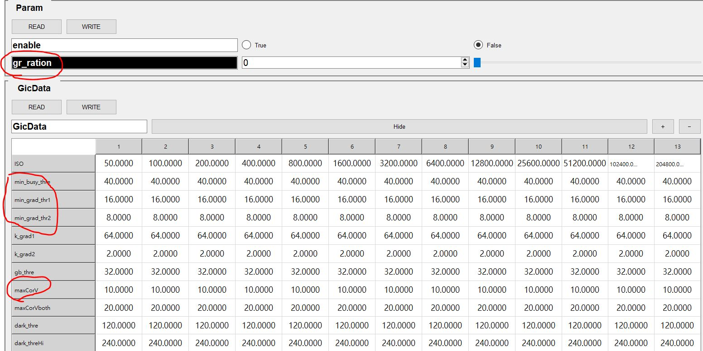 
---

### 步驟 3：DPCC (動態與靜態壞點校正)

* **功能**：消除 Sensor 的靜態壞點與高 ISO 下產生的動態壞點。
* **微調步驟**：
  1. **分照度設定**：高照度（低 ISO）時開弱，防止誤剔高頻細節；低照度（高 ISO）時調高強度。
  2. **Fast\_mode 等級調適**：
    * **Single\_level** **(0\~10)**：校正單個孤立壞點。
    * **Double\_level** **(0\~10)**：校正 1x2、2x1 等相鄰雙壞點簇。
    * **Triple\_level** **(0\~10)**：校正 3 個以上的相鄰壞點簇。
  3. **細節保護**：檢查星圖中心與微小文字，確保未將正常高頻像素誤判為壞點抹除。
      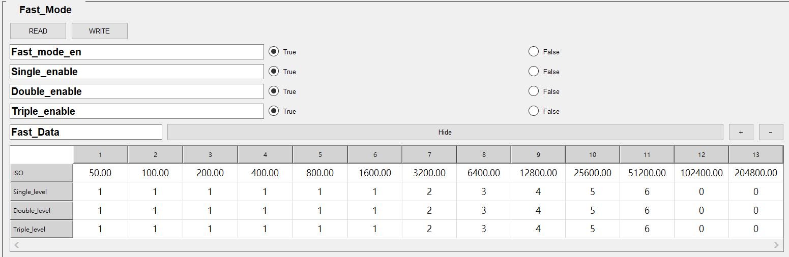 
---

### 步驟 4：3DNR / BayerTNR (Raw 域時域多幀降噪)

* **功能**：在 Raw 域將當前幀與歷史幀（IIR）分為低頻層與高頻層分別進行多幀降噪，完全不損失靜態畫面的高頻細節。
* **微調步驟**：
  1. **關閉後級**：暫時關閉 YNR 與 Sharpen，專注觀察 Raw 域時域效果。
  2. **降噪強度**：調高 `lo_filter_strength`（低頻）與 `hi_filter_strength`（高頻）壓制靜態雪花噪點。
  3. **運動拖影對比**：觀察動態物體（如移動的人手或車輛邊緣）。若有明顯 **拖影 (Ghosting)** 或運動模糊，需適度調低 `hi_filter_strength` 或調整高頻差異閾值 `hidif_th`。
      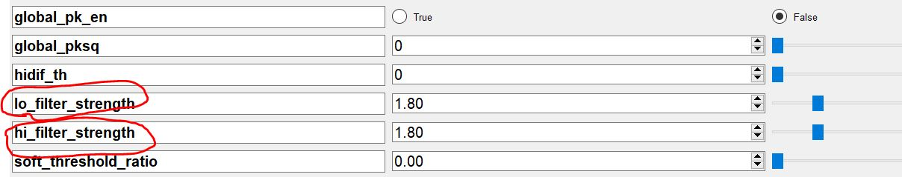 
---

### 步驟 5：CNR (彩噪降噪) 與 YNR (亮度降噪)

#### 1\. CNR (UV 域彩噪降噪)

* **特點**：CNR 的強度幾乎不傷解析力，應優先把紅綠彩噪壓制乾淨。
* **步驟**：調高 `hf_denoise_strength`（高頻彩噪）與 `lf_denoise_strength`（低頻大塊色斑），並檢查鮮豔邊緣是否發生色彩滲漏或褪色。
      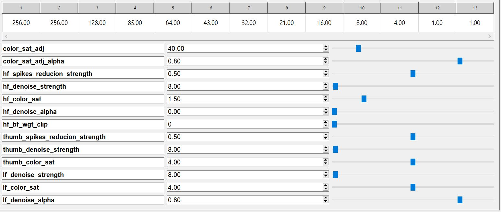 
#### 2\. YNR (Y 域空域亮度降噪)

* **平坦區降噪**：調整 `low_bf1/2` 與 `low_thred_adj`（低頻軟閾值），控制皮膚或牆面大塊平坦區的平滑度。
      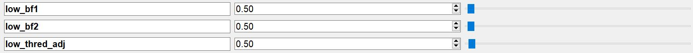 
* **細節保留**：調整 `high_weight` 與 `high_thred_adj`（高頻保留比率）。若畫面出現塗抹感（油畫感），調高 `high_weight` 補回微小顆粒質感。
      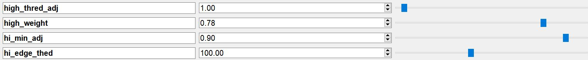 
* **邊角噪點補償**：調整 `rnr_strength`（17 個點的徑向強度），專門補償 LSC（陰影校正）邊角拉亮帶來的額外噪點。
      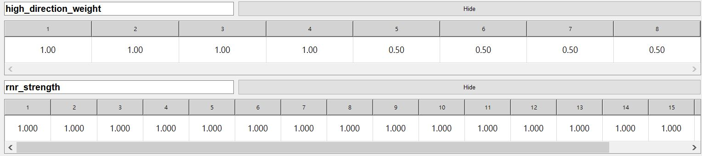 

---

### 步驟 6：Sharpen (銳化) 與 ISO 聯動總驗證

* **功能**：對圖像高頻細節進行提取、預濾波、銳化增強與噪聲抑制。
* **微調步驟**：
  1. **邊緣與細節增強**：調高 `sharp_ratio` 與 `local_sharp_strength`，將靜止場景（如細線、文字、小熊毛髮、星圖邊緣）的銳度增強出來。
      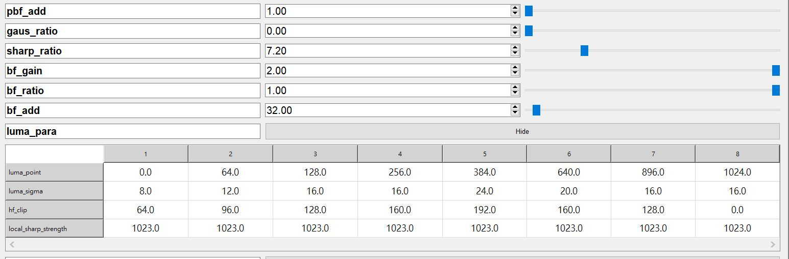 
  2. **銳化噪點抑制**：調整預濾波與高斯雙邊濾波參數（`pbf_gain`, `pbf_ratio`, `gaus_ratio`, `bf_gain`），防止銳化將前級微弱噪點放大成黑白白邊或粗糙噪點。
      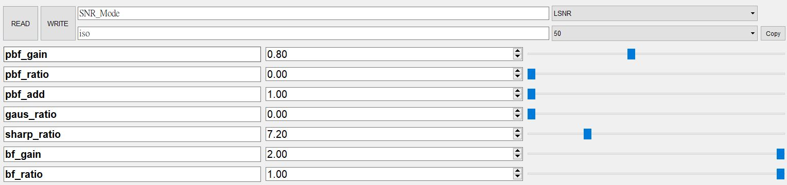 
  3. **綜合 ISO 聯動驗證**：在各 ISO 檔位（ISO 50 \~ 高 ISO）下綜合檢查，確保低 ISO 畫面清晰銳利、高 ISO 噪點平滑無拖影，達成清晰度與噪聲的最終平衡。

---

### 💡 **最佳實戰建議 SOP**：

#### 1. 先定 **Demosaic + GIC** 確保解析力與無網格偽影。
#### 2. 關閉 Sharpen，開啟 **CNR** 徹底清除彩噪。
#### 3. 聯調 **BayerTNR (3DNR)** 與 **YNR**，平衡靜態雪花噪點與動態拖影。
#### 4. 最後開啟 **Sharpen** 補回邊緣線條清晰度。