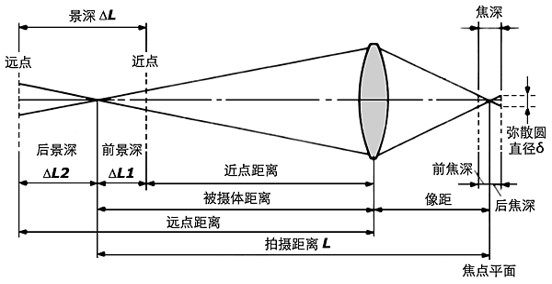
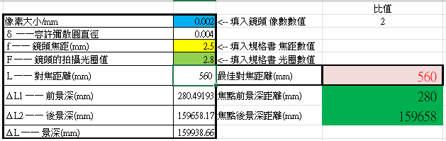
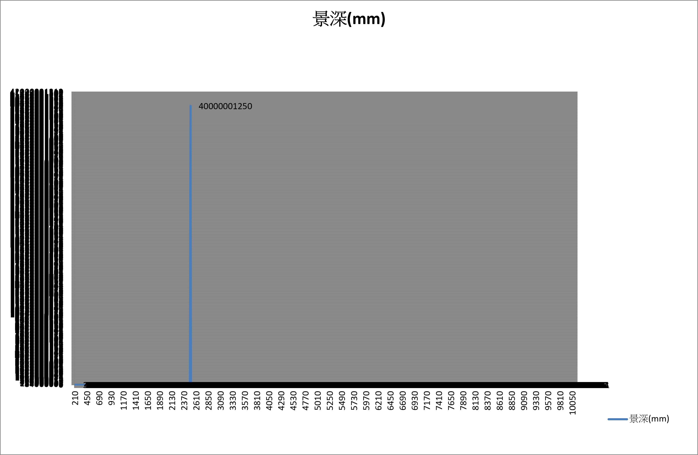
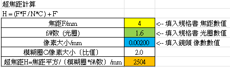

# 光學鏡頭計算對焦距離的方式與原理
## 光學鏡頭「最佳焦距（Optimal Focal Length）」並沒有單一公式，而是依據拍攝目標、空間限制、感光元件尺寸與光學成像原理來推算的結果。


在不同應用場景中，計算最佳焦距的核心原理與公式可分為以下四大類：

## 1. 幾何成像與構圖原理（機器視覺、監控與商業拍攝最常用）

當你需要讓特定大小的物體，在固定距離下剛好填滿感光元件（Sensor）時，是透過薄透鏡成像公式與相似三角形原理來計算：
## $f=\frac{h \times D}{H}$
- ### f：所需鏡頭焦距（mm）
- ### h：感光元件有效高度或寬度（mm，需對應物體方向）
- ### D：鏡頭到被攝物體的距離（工作距離 Working Distance）
- ### H：被攝物體的實際高度或寬度（必須全部納入畫面的視野大小 FOV）
```
範例：感光元件高度 h = 15 mm，在 D = 2000 mm（2公尺）外要拍下高 H = 1000 mm（1公尺）的物體，最佳焦距 f = (15 × 2000) / 1000 = 30 mm。
```

## 2. 視角匹配原理（自然透視與人眼視覺還原）

在一般攝影與電影製作中，若希望照片的空間透視感（近大遠小的比例）最接近人眼自然所見，最佳焦距稱為「標準焦距」，其計算原理是讓焦距等於感光元件的對角線長度：
## $f_{\text{std}}=\sqrt{W^{2}+H^{2}}$
- ### W, H：感光元件的寬度與高度（mm）
- ### 全片幅（36 × 24 mm）：對角線約為 43.3 mm（實務上常以 40mm–50mm 作為標準鏡頭，對應約 46°–53° 的人眼自然注意力視角）。
- ### APS-C（23.5 × 15.6 mm）：對角線約為 28.3 mm。


## 3. 空間解析度與細節辨識原理（天文、顯微、工業檢測）
當拍攝目標是「看清楚極小細節」時，最佳焦距取決於奈奎斯特採樣定理（Nyquist Sampling Theorem），目的是讓鏡頭的光學分辨率（繞射極限）剛好匹配感光元件的像素大小（Pixel Pitch）：
## $f_{\text{opt}}\approx \frac{D_{\text{lens}}\times p}{0.61\times \lambda }$
- ### $D_{\text{lens}}$：鏡頭有效入瞳直徑（mm）
- ### p：感光元件單一像素尺寸（μm）
- ### λ：光線波長（可見光約 0.55 μm）
- ### 核心邏輯：焦距太短會導致「欠採樣」，細節全擠在同一個像素裡無法分辨；焦距過長則會「過採樣」，不僅畫面變暗、視野變窄，也會因繞射而無法增加真實細節。


## 4. 透視壓縮與背景虛化需求（人像與產品攝影）
在人像或空間攝影中，焦距決定了「主體與背景的大小比例（壓縮感）」以及「背景虛化程度」：
- ### 背景虛化上限公式：當拍攝距離固定、主體在畫面中大小不變時，背景光斑的模糊直徑正比於鏡頭的有效光圈直徑（f / N）。因此，在光圈值 N 相同的情況下，焦距 f 越長，虛化能力越強。
- ### 臉部透視不變形原則：距離人臉過近（如 1 公尺內）會因透視原理造成鼻子變大、耳朵變小；實務上會先設定 2–3 公尺 的舒適拍攝距離，再反推能拍出半身或特寫的焦距（全片幅約 85mm–135mm）。

## 如何快速選擇對應的計算方式？

| 你的拍攝目的 | 採用的核心原理 | 決定焦距的關鍵變數
| ---- | ---- | ---- |
| 拍下完整物體 / 機器視覺 | 相似三角形幾何投影 | 拍攝距離、物體尺寸、感光元件尺寸 |
| 紀實街拍 / 自然透視感 | 感光元件對角線匹配 | 感光元件長寬比與對角線長度 |
| 遙遠目標 / 顯微細節辨識 | 光學繞射與像素採樣匹配 | 像素間距（Pixel Pitch）、鏡頭口徑 |
| 人像特寫 / 強烈背景虛化 | 透視比例與入瞳直徑控制 | 舒適拍攝距離、最大光圈值 |

# 計算景深


這組公式是基於幾何光學的「薄透鏡成像原理」與「相似三角形定理」推導而來，且套用了「拍攝距離遠大於焦距$L \gg f$」的近似條件；而公式中的允許彌散圓直徑 $\delta $，則需依據感光元件尺寸、像素密度或最終觀看距離來設定。
## 一、 圖片公式的符號定義
在套用圖片中的公式前，先確認四個變數的物理意義
- ### $f$：鏡頭焦距
- ### $F$：光圈值（F-number，如 f/8 則代入 8）
- ### $L$：對焦距離（鏡頭主平面到對焦平面的距離）
- ### $\delta $：允許彌散圓直徑（Circle of Confusion, CoC）

## 二、 計算原理與 4 項使用要求
### 1. 幾何光學推導原理
當鏡頭對焦在距離 $L$ 處時，該平面的光點會在感光元件上匯聚成一個清晰的點；但位於 $L$ 前方$\Delta L_1$或後方$\Delta L_2$的物體，其光線在感光元件上會提前匯聚或尚未匯聚，形成一個圓形光斑。透過薄透鏡成像公式($\frac{1}{u}$ + $\frac{1}{v}$ = $\frac{1}{f}$)與光圈孔徑($D = f/F$)構成的相似三角形比例，限制光斑直徑不超過 $\delta $，即可解出前後景深範圍。

### 2. 套用此組公式的 4 項關鍵要求
- #### 要求一：拍攝距離必須遠大於焦距$L \gg f$
完整的精確景深公式分子與分母中應包含 ($L - f$)。圖片中的公式已將 ($L - f$) 簡化為 $L$，因此僅適用於一般中遠距離拍攝；若用於「微距攝影」($L$ 與 $f$ 非常接近)，此公式會產生明顯誤差，必須改用包含放大倍率 $m$ 的微距景深公式。
- #### 要求二：所有長度單位必須完全統一
計算時，焦距 $f$、對焦距離 $L$ 與彌散圓 $\delta$ 必須換算成相同單位（通常統一為毫米 mm）。例如 $L = 5\text{ 公尺}$ 必須代入 5000，否則算出的數值會完全錯誤。
- #### 要求三：需滿足超焦距邊界條件($f^2 > F\delta L$)
觀察第 (2) 式的分母 ($f^2 - F\delta L$)：當對焦距離 $L$ 大於或等於超焦距$H = \frac{f^2}{F\delta}$）時，分母會變成 0 或負數，代表後景深 $\Delta L_2$ 已延伸至無限遠($\infty $），此時第 (3) 式的總景深公式便不再適用。
- #### 要求四：理想近軸光學假設
公式未計入鏡頭像差（如球面像差、場曲）以及極小光圈下的光學繞射（Diffraction）影響；實務上若光圈縮得太小，即使公式算出的景深很大，整體畫面也會因繞射而變軟。

## 三、 允許彌散圓直徑（$\delta $）的設定方法
$\delta $ 代表你對「畫面多模糊才算失去焦點」的容忍上限。設定 $\delta $ 時，需根據應用領域選擇對應標準：
### 1. 一般攝影與視覺輸出標準（人眼觀看基準）
以「照片沖印成 8×10 吋、在 25–30 公分明視距離觀看」為基準，通常設為感光元件對角線長度的 $\frac{1}{1500}$：
- #### 全片幅（36×24 mm）：$\delta \approx \mathbf{0.029\text{ – }0.030\text{ mm}}$
- #### APS-C 片幅：$\delta \approx \mathbf{0.018\text{ – }0.019\text{ mm}}$
- #### M4/3 片幅：$\delta \approx \mathbf{0.014\text{ – }0.015\text{ mm}}$
### 2. 高畫素數位檢視標準（100% 放大檢視）
現代高畫素相機若在電腦螢幕上 100% 放大檢視，傳統標準會顯得過於寬鬆（看起來仍不夠銳利）。此時建議將 $\delta $ 設為單一像素間距（Pixel Pitch）的 2 到 3 倍（全片幅高畫素機身通常會下修至 0.015 mm – 0.020 mm）。
### 3. 工業機器視覺與光學檢測標準（精密測量基準）
在工業檢測中，畫面需要極高的邊緣銳利度以供演算法判讀，因此設定最為嚴格：
- 通常直接將 $\delta $ 設為相機感光元件的 1 至 2 個像元尺寸（Pixel Size）（例如像元為 3.45 μm 的工業相機，$\delta $ 會設為 0.00345 mm – 0.0069 mm）。





# 計算超焦距
在攝影中要讓畫面從近到遠盡可能清晰（求最大景深／最遠清晰範圍），關鍵在於超焦距（Hyperfocal Distance）。當對焦在超焦距位置時，清晰範圍會從超焦距的一半延伸到無限遠（∞）。
## 最遠對焦距離（景深遠端）計算公式
若你已選定焦距、光圈與對焦距離，景深範圍的最遠清晰距離($D_{far}$)可用以下公式估算：
## $D_{\text{far}}=\frac{H\times s}{H-(s-f)}$
- #### $H$（超焦距）：$H \approx \frac{f^2}{N \times c} + f$


- #### $f$：鏡頭焦距（例如 24mm）
- #### $N$：光圈值（f-number，例如 8、16）
- #### $c$：容許彌散圓直徑（Circle of Confusion，全片幅常見約 0.029mm–0.03mm，APSC 約 0.019mm–0.02mm）
- #### $s$：實際對焦距離
###  重點結論：當對焦距離 $s \ge H$ 時，最遠清晰距離即為無限遠（$\infty $）；若 $s < H$，則可依上式算出最遠清晰距離，當 $s = H/2$ 時，最近清晰距離約為 $H/4$，最遠清晰距離為 $H$。

---
# 鏡頭彌散圓(模糊圓)
容許彌散圓（Circle of Confusion, CoC）是指在感光元件上，人眼在標準觀看條件下仍能辨識為「清晰點」的最大光斑直徑。
當點光源未精準對焦時，光線在感光元件上會成像為一個圓形光斑（即彌散圓）。只要這個圓小於「容許彌散圓直徑($c$)」，人眼看起來就是銳利的；一旦超過這個數值，畫面就會開始變得模糊。
### 1. 常見的標準計算方式（蔡司公式）
在傳統光學與攝影計算中，最通用的經驗公式是將感光元件對角線長度除以 1500（或 1730）：
## $c\approx \frac{\text{感光元件對角線長度 (mm)}}{1500}$
- 計算基準假設：將照片放大成約 8×10 吋（對角線約 30–32 公分），並在約 25–30 公分 的明視距離下觀看，配合人眼正常的角分辨率（約 1 角分）所推導出的標準。
### 2. 各片幅的常用容許彌散圓參考值
不同感光元件尺寸會對應不同的標準數值（若除以 1500 為基準）：
| 片幅規格 | 感光元件尺寸 (約) | 對角線長度 (約) | 容許彌散圓直徑 ($c$)
| ---- | ---- | ---- | ---- |
| 中片幅 (44×33) | 43.8 × 32.9 mm | 54.8 mm	0.036 mm |
| 全片幅 (Full Frame) | 36.0 × 24.0 mm | 43.3 mm | 0.029 – 0.030 mm |
| APS-C (Canon)	| 22.3 × 14.9 mm | 26.8 mm | 0.018 mm |
| APS-C (Sony/Nikon/Fuji) | 23.5 × 15.6 mm | 28.3 mm | 0.019 mm |
| M4/3 (Micro Four Thirds) | 17.3 × 13.0 mm | 21.6 mm | 0.014 – 0.015 mm |
| 1 吋感光元件 | 13.2 × 8.8 mm | 15.9 mm | 0.011 mm |

### 3. 數位時代的實務調整原則
傳統的 對角線 / 1500 基準較為寬鬆，現代高畫素相機與大螢幕檢視常需要更嚴格的標準：
- #### 100% 放大檢視或高畫素機身（如 4500 萬畫素以上）：若你習慣在電腦螢幕上 100% 放大看細節，建議將 ($c$) 值縮小（例如全片幅改用 0.015 mm 至 0.020 mm，或直接以 2 到 3 個像素寬度作為容許上限），這樣算出來的景深與超焦距會更保險、更銳利。
- #### 社群媒體縮圖或手機觀看：觀看尺寸小，對模糊的容忍度高，直接使用標準值（如全片幅 0.030 mm）即可。
