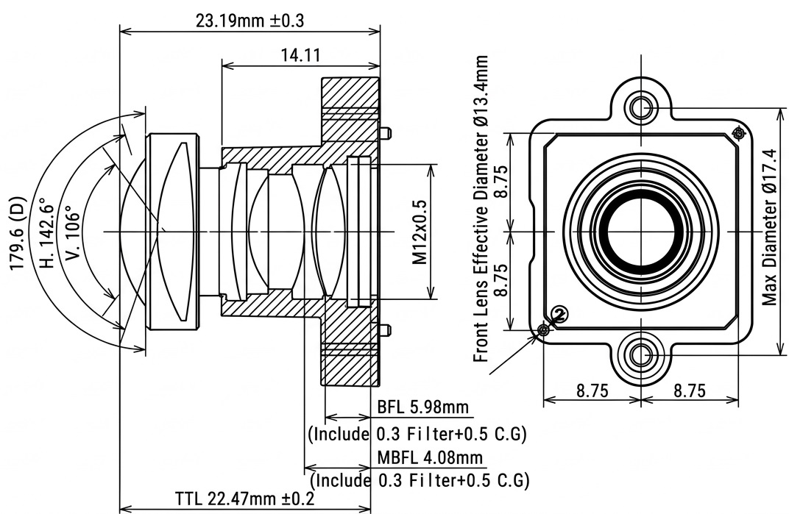

# 鏡頭基本光學原理與說明
## 鏡頭光學：光學原理與構造深度解析
### 一、 幾何光學基本原理 (Geometrical Optics Principles)
光學鏡頭的運作核心基於幾何光學定律，透過精確控制光線的折射與匯聚來成像。
1. 司乃耳定律 (Snell's Law)：
    - 當光線從折射率為 $n_1$ 的介質（如空氣）進入折射率為 $n_2$ 的介質（如玻璃）時會發生偏折：
    - $n_1 \cdot \sin(\theta_1) = n_2 \cdot \sin(\theta_2)$
    - 鏡頭透過不同曲率與材質的鏡片組合，利用此原理精準導引光路。
2. 焦距與視角 (Focal Length & Field of View)：
    - 焦距 ($f$)：光學中心到感光元件（焦點）的距離，決定了放大倍率與視場角 (FOV)。

    - 短焦距（廣角）帶來大視場與強烈的透視變形；長焦距（望遠）則提供窄視場與壓縮感。
3. 光圈與光通量 (Aperture & F-number)：
    - 光圈值 ($F = f / D$) 定義了入瞳直徑對焦距的比例，直接控制進光量與景深 (Depth of Field)。
### 二、 光學鏡頭的內部構造與核心元件 (Lens Internal Structure)
現代相機與手機鏡頭通常由多枚鏡片（Elements）分組（Groups）排列而成，主要構造包含：


- ## 核心光學與尺寸規格對應表
| 參數名稱 | 規格數值 | 在鏡頭結構圖上的位置與說明 |
| ---- | ---- | ---- |
| 型號 (Model No.) | E3666K  | 專用超廣角 M12 鏡頭型號。 | 
| 有效焦距 (EFL) | 2.56 mm | 決定視場角與放大倍率的核心光學參數（光學中心到焦點的距離）。
| 光圈值 (FNo.) | F2.8 (固定光圈 Fixed)  | 位於鏡頭內部光學群組之間，控制進光量。 |
| 視場角 (F.O.V.) | 對角 179.6° / 水平 142.6° / 垂直 106° | 標示於鏡頭前方外側（圖面左側的廣角發散光錐與角度弧度）。 |
| 鏡頭結構 (Lens construction) | 6 Elements (6枚鏡片) | 鏡筒內部由 6 枚透鏡分組排列組成。前通光口徑Ø13.4 mm   位於鏡頭最前端（前端透鏡邊緣直徑）。
| 後通光口徑 | Ø6.1 mm | 位於鏡頭最後端（接近感光元件側的通光孔）。
| 光學總長 (TTL) | 22.47 mm ±0.2(含 0.3 Filter + 0.5 C.G) | 從鏡片最前端頂點到後方感光元件成像平面的總長度。 |
| 後截距 (BFL) | 5.98 mm(含 0.3 Filter + 0.5 C.G) | 從後鏡片表面到感光元件（Sensor）的距離。
| 機械後截距 (MBFL) | 4.08 mm | 從機械參考面到感光元件的距離。 |
| 介面 (Mount) | M12 × 0.5 | 位於鏡筒後側的螺紋規格，用於固定於機身或基板上。 |
| 感光元件規格 (Sensor) | 1/2.3" (對角線 Ø7.8 mm) | 配合的感光晶片尺寸。 |
```
[被攝物] ---> (前鏡片組：聚焦/廣角) ---> [光圈葉片 (Aperture Diaphragm)] ---> (後鏡片組：像差矯正) ---> [感光元件 (Sensor)]
```

1. 球面與非球面鏡片 (Spherical & Aspherical Lenses)：
    - 球面鏡片：加工簡單，但近軸與邊緣光線無法匯聚於同一點，產生球差。
    - 非球面鏡片：曲率半徑隨中心距離遞減，能有效修正球差與畸變，減少鏡片總數與體積。

2. 特殊光學玻璃與低色散鏡片 (ED / LD Lenses)：
    - 利用特殊折射率與阿貝數（Abbe number）的玻璃材質，抑制不同波長光線因折射率差異產生的色差（Chromatic Aberration）。

3. 光圈與消光結構 (Diaphragm & Baffling)：
    - 控制曝光量並調節成像銳利度（避免過度繞射）。鏡筒內部透過精密消光紋路吸收雜散光。

### 三、 光學像差及其成因 (Optical Aberrations)
實際鏡頭無法達到理想成像，主要存在以下五種初級Seidel像差：
1. 球差 (Spherical Aberration)：邊緣光線與中心光線匯聚點不同，導致畫面整體較軟、對比降低。

2. 彗形像差 (Coma)：離軸光線經過鏡片後呈彗星狀拖尾，影響點光源（如夜景燈光）的邊緣成像。

3. 像散與場曲 (Astigmatism & Field Curvature)：子午面與弧矢面焦點不一致，導致邊緣無法同時清晰對焦；像面呈彎曲狀而非平面。

4. 畸變 (Distortion)：
    - 桶形畸變 (Barrel Distortion)：放大率向邊緣遞減（常見於廣角鏡）。
    - 枕形畸變 (Pincushion Distortion)：放大率向邊緣遞增（常見於長焦鏡）。

5. 色差 (Chromatic Aberration)：波長不同導致成像位置偏移（軸向色差與橫向色差）。

### 四、 光學成像品質評估指標 (Image Quality Metrics)
1. MTF (Modulation Transfer Function, 調制轉換函數)：
    - 評估鏡頭對比度與解析力的黃金標準，描述空間頻率下影像對比度的保留程度。
2. 相對照度 (Relative Illumination / Vignetting)：
    - 衡量邊緣失光（暗角）現象的指標。