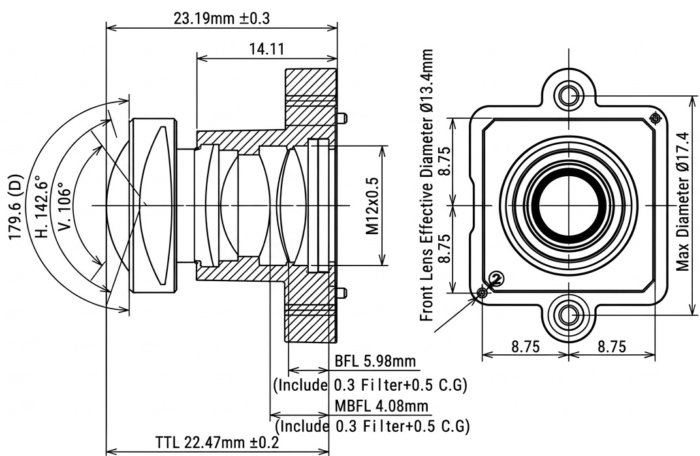
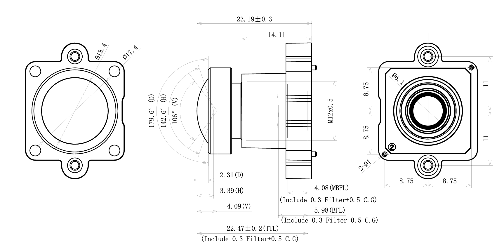

# 鏡頭基本光學原理與說明
## 鏡頭光學：光學原理與構造深度解析
## 一、 幾何光學基本原理 (Geometrical Optics Principles)
光學鏡頭的運作核心基於幾何光學定律，透過精確控制光線的折射與匯聚來成像。
### 1. 司乃耳定律 (Snell's Law)：
    - 當光線從折射率為 $n_1$ 的介質（如空氣）進入折射率為 $n_2$ 的介質（如玻璃）時會發生偏折：
    - $n_1 \cdot \sin(\theta_1) = n_2 \cdot \sin(\theta_2)$
    - 鏡頭透過不同曲率與材質的鏡片組合，利用此原理精準導引光路。
### 2. 焦距與視角 (Focal Length & Field of View)：
    - 焦距 ($f$)：光學中心到感光元件（焦點）的距離，決定了放大倍率與視場角 (FOV)。

    - 短焦距（廣角）帶來大視場與強烈的透視變形；長焦距（望遠）則提供窄視場與壓縮感。
### 3. 光圈與光通量 (Aperture & F-number)：
    - 光圈值 ($F = f / D$) 定義了入瞳直徑對焦距的比例，直接控制進光量與景深 (Depth of Field)。
## 二、 光學鏡頭的內部構造與核心元件 (Lens Internal Structure)
現代相機與手機鏡頭通常由多枚鏡片（Elements）分組（Groups）排列而成，主要構造包含：


- ## 核心光學與尺寸規格對應表
| 參數名稱 | 規格數值 | 在鏡頭結構圖上的位置與說明 |
| ---- | ---- | ---- |
| 型號 (Model No.) | E3666K  | 專用超廣角 M12 鏡頭型號。 | 
| 有效焦距 (EFL) | 2.56 mm | 決定視場角與放大倍率的核心光學參數（光學中心到焦點的距離）。
| 光圈值 (FNo.) | F2.8 (固定光圈 Fixed)  | 位於鏡頭內部光學群組之間，控制進光量。 |
| 視場角 (F.O.V.) | 對角 179.6° / 水平 142.6° / 垂直 106° | 標示於鏡頭前方外側（圖面左側的廣角發散光錐與角度弧度）。 |
| 鏡頭結構 (Lens construction) | 6 Elements (6枚鏡片) | 鏡筒內部由 6 枚透鏡分組排列組成。前通光口徑Ø13.4 mm   位於鏡頭最前端（前端透鏡邊緣直徑）。
| 後通光口徑 | Ø6.1 mm | 位於鏡頭最後端（接近感光元件側的通光孔）。
| 光學總長 (TTL) | 22.47 mm ±0.2(含 0.3 Filter + 0.5 C.G) | 從鏡片最前端頂點到後方感光元件成像平面的總長度。 |
| 後截距 (BFL) | 5.98 mm(含 0.3 Filter + 0.5 C.G) | 從後鏡片表面到感光元件（Sensor）的距離。
| 機械後截距 (MBFL) | 4.08 mm | 從機械參考面到感光元件的距離。 |
| 介面 (Mount) | M12 × 0.5 | 位於鏡筒後側的螺紋規格，用於固定於機身或基板上。 |
| 感光元件規格 (Sensor) | 1/2.3" (對角線 Ø7.8 mm) | 配合的感光晶片尺寸。 |
```
[被攝物] ---> (前鏡片組：聚焦/廣角) ---> [光圈葉片 (Aperture Diaphragm)] ---> (後鏡片組：像差矯正) ---> [感光元件 (Sensor)]
```

### 1. 球面與非球面鏡片 (Spherical & Aspherical Lenses)：
    - 球面鏡片：加工簡單，但近軸與邊緣光線無法匯聚於同一點，產生球差。
    - 非球面鏡片：曲率半徑隨中心距離遞減，能有效修正球差與畸變，減少鏡片總數與體積。

### 2. 特殊光學玻璃與低色散鏡片 (ED / LD Lenses)：
    - 利用特殊折射率與阿貝數（Abbe number）的玻璃材質，抑制不同波長光線因折射率差異產生的色差（Chromatic Aberration）。

### 3. 光圈與消光結構 (Diaphragm & Baffling)：
    - 控制曝光量並調節成像銳利度（避免過度繞射）。鏡筒內部透過精密消光紋路吸收雜散光。

## 三、 光學像差及其成因 (Optical Aberrations)
實際鏡頭無法達到理想成像，主要存在以下五種初級Seidel像差：
### 1. 球差 (Spherical Aberration)：邊緣光線與中心光線匯聚點不同，導致畫面整體較軟、對比降低。

### 2. 彗形像差 (Coma)：離軸光線經過鏡片後呈彗星狀拖尾，影響點光源（如夜景燈光）的邊緣成像。

### 3. 像散與場曲 (Astigmatism & Field Curvature)：子午面與弧矢面焦點不一致，導致邊緣無法同時清晰對焦；像面呈彎曲狀而非平面。

### 4. 畸變 (Distortion)：
    - 桶形畸變 (Barrel Distortion)：放大率向邊緣遞減（常見於廣角鏡）。
    - 枕形畸變 (Pincushion Distortion)：放大率向邊緣遞增（常見於長焦鏡）。

### 5. 色差 (Chromatic Aberration)：波長不同導致成像位置偏移（軸向色差與橫向色差）。

## 四、 光學成像品質評估指標 (Image Quality Metrics)
### 1. MTF (Modulation Transfer Function, 調制轉換函數)：
    - 評估鏡頭對比度與解析力的黃金標準，描述空間頻率下影像對比度的保留程度。
### 2. 相對照度 (Relative Illumination / Vignetting)：
    - 衡量邊緣失光（暗角）現象的指標。

## 五、 光學鏡頭參數 (Image Quality Lens Param)
### 1. 光學成像與感光元件匹配參數
- 像面尺寸（Image Circle / Sensor Format）。代表鏡頭投射出的圓形畫面大小，常見規格如 1/2.8"、1/2.9" 或 1/3"。鏡頭的像面必須大於或等於你的感光元件（CMOS Sensor）尺寸，否則畫面四個角落會出現嚴重的黑角（暗角 / Vignetting）。
- 有效焦距（EFL, Effective Focal Length）。決定畫面的拉近或拉遠程度（單位為 mm）。通常廣角視野，M6 鏡頭常見的 EFL 約在 2.0mm 至 3.6mm 之間；數值越小，拍到的範圍越廣，但畫面邊緣的物體會顯得較遠、較小。
- 視場角（FOV, Field of View）。鏡頭能拍到的角度範圍，通常會標示 對角線（D）、水平（H）、垂直（V） 三個數值。一般行車紀錄器建議選擇 水平視角（H-FOV）在 110° 至 130°（對角線約 130° 至 150°） 的鏡頭，既能涵蓋雙向車道，又不會因為過度廣角（魚眼）導致車牌嚴重變形。
- 光圈值（F-Number / Aperture）。決定進光量的大小（如 F1.6、F1.8、F2.0）。F 值越小代表光圈越大、進光量越多。行車紀錄器極度重視夜間無路燈環境的畫質與動態車牌辨識，強烈建議挑選 F1.8 或更大光圈（如 F1.6） 的鏡頭。
### 2. 畫質與抗干擾參數
- 解析度（Resolution / MTF）。代表鏡頭能解析的像素上限（如 2MP / 1080P、4MP / 2K、8MP / 4K）。鏡頭的解析度等級必須大於或等於 Sensor 像素，否則就算用了高階感光元件，拍出來的畫面依然會模糊不清。
- 光學畸變（TV Distortion）。廣角鏡頭容易讓畫面邊緣的直線（如路燈、大樓）彎曲成桶狀。一般廣角鏡頭畸變在 -15% 到 -30% 之間；若希望車牌在畫面邊緣依然清晰可辨，建議挑選 低畸變（Low Distortion） 設計，將畸變控制在 -10% 以內。
- 紅外線截止濾光片（IR-Cut Filter, IRCF）。白天太陽光含有大量紅外線，若無濾除會導致畫面嚴重偏紅、色偏。選購時需確認鏡頭底部是否已貼附 650nm IR-Cut 濾光片（若無夜間紅外線補光燈需求，行車紀錄器通常直接選用內建 650nm IRCF 的日夜通用型鏡頭即可）。

### 3. 機構參數（常用鏡頭）
- 法蘭焦距（FFL / BFL）與總長（TTL）。TTL（Total Track Length） 是鏡頭最前端到感光元件表面的總高度，決定了你的外殼厚度；FFL（Flange Focal Length） 則是鏡頭螺紋定位面到感光面的距離，這是你設計 M6 鏡頭座高度 最重要的依據。
- 鏡片材質（全玻 vs. 玻塑混合）。塑膠鏡片（P）受熱容易膨脹變形導致畫面模糊（熱失焦），因此鏡頭強烈建議選擇 全玻璃鏡片（如 6G，代表 6 片全玻璃），至少也要是 玻塑混合（如 2G4P，前 2 片玻璃防刮耐熱＋後 4 片塑膠），絕對避免純塑膠（All-Plastic）鏡頭。
--- 
| 項目 | 說明 |
| ---- | ---- |
| Resolution(解析度) | 依照廠商提供,lp/mm 中心可以達到200lp/mm,四周0.6場域位置可以達到125lp/mm為主. |
| Image format(影像尺寸) | 搭配 image sensor 如 : IMX307 為 1/2.8" sensor 成像畫素1920X1080 |
| Focal Length(焦距)(EFL) | 光學焦距 |
| Aperture(光圈) | F/No 數字越大,光圈越小 |
| Mount(介面) | 鏡筒牙距與筒寬 |
| Image Circle | 光進入sensor 的範圍 |
| Image Height | (像高) |	
| Field Angle D×H×V(°)(視場角)	| sensor 尺寸 (") |
| Optical Distortion(畸變) | 影像呈現桶型或枕型變形的變形量 |
| 主光束入射角（CRA） | 主光線入射角度 |
| 最近物距(M.O.D.) | 可對焦最短距離 |
| 外形尺寸(Dimension) | |	
| 光學後焦距(BFL) | 焦點與image plane 的距離 |
| 機械後焦距(MBF) | 鏡頭機構與image plane 最近距離 |
| 鏡頭結構(Lens Construction) | 玻璃與塑膠鏡頭的數量 |
| 相對照度(Relative Illumination) | 中心與邊緣進光亮度差異比 |
| IR Filter | |	
| 鍍膜指標(Coating indicators) | 	|
| 工作溫度（Operating temperature）| |	
| 存儲溫度（Storage temperature） | |	
| Holder Material(底座材質) | 目前有使用 PPS 與 LPC | 
| 防水等級 |  |
| "鏡頭與底座螺紋配合扭力(Clamp Force)" | gf-cm|	
| TTL | 鏡頭G1 到 image plane 的高度. | |

## 鏡頭2D 尺寸說明
    
這張是 鏡頭模組（含鏡頭＋鏡頭座）的機構與光學尺寸圖。  
在解讀數據前，請先特別注意圖面中央標示的螺紋規格為 M12x0.5，代表這顆是標準 M12 鏡頭，而非先前提到的 M6 規格，開孔與繪製 PCB 時務必依此圖面為準。  
### 以下將圖面數據分為「視場角與防遮光」、「光學後焦與總長」、「鏡頭座機構尺寸」三大類為你逐一說明：
### 1. 視場角與入瞳位置（左側與左下數據）
這組數據決定了鏡頭能拍多廣，以及外殼開孔該做多大才不會擋到畫面：
- 179.6°(D) / 142.6°(H) / 106°(V)（視場角 FOV）。分別代表 對角線（179.6°）、水平（142.6°） 與 垂直（106°） 的拍攝角度。這是一顆接近 180° 的超廣角魚眼鏡頭。
- 2.31(D) / 3.39(H) / 4.09(V)（各視角入射光線交點 / 入瞳深度）。代表從鏡頭最前端鏡片頂點往後算，對角、水平與垂直邊緣光線匯聚的軸向距離（單位 mm）。設計外殼的鏡頭開孔時，必須依據這幾個位置推算光錐角度，避免外殼邊緣擋住廣角畫面（產生暗角）。

### 2. 光學總長與後焦距（下方與上方橫向數據）
這組數據決定了「感光元件（CMOS Sensor）表面」到「鏡頭」的精準距離，是確保畫面準焦的核心：
- 23.19±0.3（模組總機械長度）。從最前端鏡片頂點，到鏡頭座底部貼合 PCB 表面的總長度為 23.19mm（不含底部定位柱）。
- 14.11（前鏡筒凸出長度）。從鏡頭座底部貼合面，往前算到前段大鏡筒台階處的距離為 14.11mm，可用來計算鏡頭伸出外殼的長度。
- 22.47±0.2(TTL)（光學總長 Total Track Length）。從最前端鏡片頂點，一路穿透鏡片到達 CMOS 感光晶片表面 的光學總距離。
- 5.98(BFL)（光學後焦距 Back Focal Length）。最後一片鏡片的玻璃表面，到 CMOS 感光晶片表面的距離為 5.98mm。
- 4.08(MBFL)（機構後焦距 Mechanical BFL）。鏡頭本體（不含底座）最尾端的金屬/塑膠邊緣，到 CMOS 感光晶片表面的安全距離為 4.08mm。
- (Include 0.3 Filter+0.5 C.G)（光程補償註記）。括號內說明上述 TTL、BFL 與 MBFL 數值，都已經把 0.3mm 厚的紅外線濾光片（IR Filter） 與 0.5mm 厚的感光元件保護玻璃（Cover Glass） 的折射厚度計算進去了，設計時無需再額外加減厚度。

### 3. 螺紋與鏡頭座尺寸（中央與右側視圖數據）
這組數據是用來設計 PCB 焊盤、螺絲鎖孔與定位孔 的依據：
- M12x0.5（鏡頭螺紋規格）。鏡頭與底座的結合牙規為直徑 12mm、螺距 0.5mm 的細牙（業界最標準的 M12 介面）。
- 8.75（四個方向，底座方框半寬）。代表底座正方形本體從中心點往上下左右各延伸 8.75mm，因此底座的實際長寬為 17.5mm × 17.5mm。
- 11 與 11（上下鎖附螺絲孔距）。上下兩個螺絲固定耳的孔中心，距離光學中心各為 11mm，代表兩顆固定螺絲的總孔距為 22mm。
- 2-Ø1（PCB 定位柱）。底座右上與左下對角線處，各有 1 根直徑 1.0mm 的定位凸柱（共 2 根），用來插入 PCB 板上對應的定位孔，防止組裝時鏡頭座歪斜。
- Ø6.1（底座內部通光孔徑）。鏡頭座底部的圓形開孔直徑為 6.1mm，代表光線穿過底座投射到 Sensor 的最大範圍。

